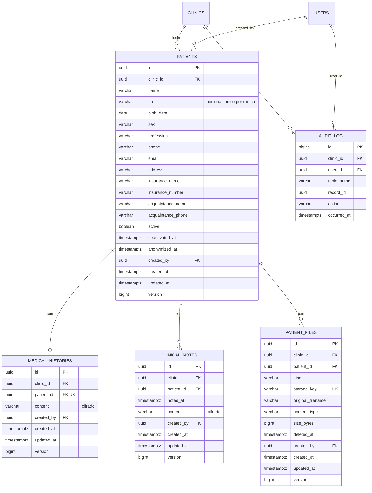

# Spec Técnica Global (Banco) — Fase 1: Núcleo clínico

**Base:** `docs/global/banco/Fase-1/prd.md` (aprovado em 2026-10-21) e a base entregue na Fase 0 (`docs/global/banco/Fase-0/spec.md`; `database/` com V001–V006).
**Escopo:** pacientes, prontuário cifrado, metadados de exames, `audit_log`, reforço de `app.role`, retenção e anonimização (LGPD). Schema `core`.
**Regra:** nenhum SQL é executado aqui. O DDL abaixo é **ilustrativo do contrato**; as migrations finais são do `dev-engineer-postgres`.
**Mapeamento ao modelo de spec:** as seções 1 a 6 abaixo cobrem, nesta ordem, visão técnica, modelo de dados, papéis e RLS (no lugar de "componentes": não há UI no banco), lógica central, migrations e contrato; erros, segurança/desempenho e testes vêm depois.

---

## 1. Visão técnica

- **Feature:** Banco e segurança da Fase 1.
- **Stack:** PostgreSQL 16 (Supabase gratuito, só como Postgres), `scripts/apply_migrations.sh` (psql), extensão `pg_trgm`, `psql`. Sem `pgcrypto`: a cifra AES-256-GCM é da aplicação.
- **Abordagem:** 5 tabelas novas em `core`, todas com `clinic_id`, RLS `ENABLE` + `FORCE` e uma política por operação. O papel dentro da clínica (`app.role`) passa a ser lido pelas políticas. Escritas em `audit_log` e a anonimização só por funções `SECURITY DEFINER` do `crm_definer`.

### 1.1 Papéis e sessão

Os quatro papéis da Fase 0 não mudam (`crm_owner`, `crm_app`, `crm_backup`, `crm_definer`; nenhum com `BYPASSRLS`). Novidades:

| Item | Mudança |
|---|---|
| Variáveis de sessão | O backend define, na **mesma transação**, `app.clinic_id`, `app.role` (`DENTIST_ADMIN` \| `RECEPTIONIST`) e `app.user_id` (uuid), sempre por `set_config(..., true)` |
| `crm_definer` | Passa a ter políticas **escopadas ao tenant** (`clinic_id = core.current_clinic_id()`) nas tabelas clínicas, e não `USING (true)`. As funções `SECURITY DEFINER` desta fase só enxergam a clínica da sessão |
| `crm_app` | Ganha grants por tabela (seção 3); continua sem `DELETE` em qualquer tabela clínica e sem escrita em `audit_log` |
| Extensão | `pg_trgm` instalada pelo bootstrap (como `postgres`), no schema `extensions` |

Parâmetros de sessão de `crm_app` (`statement_timeout 15s`, `search_path = core, pg_catalog`) permanecem. A anonimização de um paciente com muitos registros deve caber em 15 s (volume esperado: dezenas de linhas).

### 1.2 Decisões desta spec (onde o PRD deixou aberto)

| # | Decisão | Justificativa |
|---|---|---|
| S1 | `audit_log.id` é `bigint GENERATED ALWAYS AS IDENTITY` (única exceção ao uuid) | Log só de inserção, ordenação cronológica barata, sem expor ids entre tenants (a leitura é filtrada por RLS) |
| S2 | **Não existe coluna `retention_until`.** O fim da retenção é calculado em `core.anonymize_patient` a partir do último registro clínico + `core.clinical_retention_period()` (20 anos) | Uma coluna mantida por trigger sofre *lost update* do JPA (que reescreve todas as colunas) e poderia encurtar a retenção por engano. Calculando na hora, o prazo nunca fica velho. **Altera** a US-110 e a FR-15 do PRD (atualizadas junto com esta spec) |
| S3 | Nova coluna `patients.anonymized_at timestamptz`, gravável só pela função de anonimização (grant por coluna) | Marca o estado terminal e permite bloquear qualquer edição posterior |
| S4 | Paciente **sem nenhum registro clínico** (sem histórico, notas ou exames) pode ser anonimizado assim que estiver inativo; a retenção de 20 anos só vale para quem tem prontuário | A guarda legal é do prontuário; cadastro isolado não a justifica (minimização, LGPD art. 6º, III). Contestável |
| S5 | Limites: histórico médico até **10.000 caracteres**, nota até **5.000 caracteres** (validados no backend por `@Size`); arquivo até **10 MB** | Cabe com folga em consultório solo; 10 MB é o teto prático de upload por requisição no Render, abaixo dos 50 MB do plano gratuito do Storage |
| S6 | Colunas cifradas dimensionadas para o pior caso de 4 bytes UTF-8 por caractere | O banco não vê o texto claro; o `varchar` precisa comportar o teto do backend sem truncar (cálculo na seção 2.3) |
| S7 | Tipos de arquivo aceitos: `image/jpeg`, `image/png`, `image/webp`, `application/pdf` | Radiografia e foto intraoral exportadas como imagem; DICOM fica fora (sem visualizador) |
| S8 | Busca por nome **sem acento-insensível** | `unaccent` não é `IMMUTABLE`; o índice exigiria função-envoltório. O backend pode normalizar a pesquisa. Limitação documentada |
| S9 | Data de nascimento e telefone são obrigatórios; CPF opcional | A clínica precisa contatar o paciente e calcular idade; CPF nem todo paciente informa |

---

## 2. Modelo de dados e schema

### 2.1 Diagrama ER



### 2.2 Convenções

As da Fase 0: `snake_case`, tabelas no plural, `uuid` gerado pela aplicação (`DEFAULT gen_random_uuid()` como reserva), `varchar(n)` + `CHECK` (nunca `text` nem `char`), `timestamptz`, `updated_at` por trigger, `version bigint` para o `@Version`. Toda FK de filha aponta para `patients` por **FK composta** `(patient_id, clinic_id)` → `patients (id, clinic_id)` `ON DELETE RESTRICT`. Toda `created_by` é FK composta `(created_by, clinic_id)` → `users (id, clinic_id)` `ON DELETE RESTRICT`. Telefones são gravados **só com dígitos** (o backend normaliza).

### 2.3 Dicionário de dados

#### `core.patients`
| Coluna | Tipo | Nulo | Default | Regra |
|---|---|---|---|---|
| `id` | `uuid` | não | `gen_random_uuid()` | PK; imutável |
| `clinic_id` | `uuid` | não | — | FK `clinics(id)` `RESTRICT`; imutável |
| `name` | `varchar(120)` | não | — | `CHECK (char_length(btrim(name)) >= 2)` |
| `cpf` | `varchar(11)` | sim | — | `CHECK (cpf ~ '^[0-9]{11}$')`; dígito verificador é do backend; único por clínica |
| `birth_date` | `date` | não | — | `CHECK (birth_date >= DATE '1900-01-01')`; data futura é validada pelo backend (`CURRENT_DATE` não é `IMMUTABLE`) |
| `sex` | `varchar(15)` | não | `'NOT_INFORMED'` | `CHECK (sex IN ('FEMALE','MALE','OTHER','NOT_INFORMED'))` |
| `profession` | `varchar(100)` | sim | — | |
| `phone` | `varchar(20)` | não | — | `CHECK (phone ~ '^[0-9]{10,13}$')` |
| `email` | `varchar(254)` | sim | — | `CHECK (email = lower(email))` |
| `address` | `varchar(255)` | sim | — | |
| `insurance_name` | `varchar(100)` | sim | — | Convênio |
| `insurance_number` | `varchar(40)` | sim | — | `CHECK (insurance_number IS NULL OR insurance_name IS NOT NULL)` |
| `acquaintance_name` | `varchar(120)` | sim | — | Conhecido para emergência |
| `acquaintance_phone` | `varchar(20)` | sim | — | `CHECK (acquaintance_phone ~ '^[0-9]{10,13}$')`; `CHECK ((acquaintance_name IS NULL) = (acquaintance_phone IS NULL))` |
| `active` | `boolean` | não | `true` | |
| `deactivated_at` | `timestamptz` | sim | — | `CHECK ((active AND deactivated_at IS NULL) OR (NOT active AND deactivated_at IS NOT NULL))` |
| `anonymized_at` | `timestamptz` | sim | — | `CHECK (anonymized_at IS NULL OR NOT active)`; só a função de anonimização grava (S3) |
| `created_by` | `uuid` | não | — | FK composta para `users`; imutável |
| `created_at` / `updated_at` | `timestamptz` | não | `now()` | `created_at` imutável; `updated_at` por trigger |
| `version` | `bigint` | não | `0` | `@Version` |

Constraints: `UNIQUE (id, clinic_id)` (alvo das FKs compostas).

#### `core.medical_histories` (no máximo 1 por paciente)
| Coluna | Tipo | Nulo | Default | Regra |
|---|---|---|---|---|
| `id` | `uuid` | não | `gen_random_uuid()` | PK; imutável |
| `clinic_id` | `uuid` | não | — | FK `clinics(id)` `RESTRICT`; imutável |
| `patient_id` | `uuid` | não | — | FK composta; `UNIQUE (patient_id)`; imutável |
| `content` | `varchar(54000)` | não | — | Texto cifrado, ver abaixo |
| `created_by` | `uuid` | não | — | FK composta; imutável |
| `created_at` / `updated_at` / `version` | como acima | | | |

#### `core.clinical_notes`
| Coluna | Tipo | Nulo | Default | Regra |
|---|---|---|---|---|
| `id`, `clinic_id`, `patient_id`, `created_by`, `created_at`, `updated_at`, `version` | como `medical_histories` | | | `patient_id` sem `UNIQUE` |
| `noted_at` | `timestamptz` | não | `now()` | Instante do atendimento relatado (a nota pode ser lançada depois) |
| `content` | `varchar(27000)` | não | — | Texto cifrado, ver abaixo |

#### `core.patient_files`
| Coluna | Tipo | Nulo | Default | Regra |
|---|---|---|---|---|
| `id`, `clinic_id`, `patient_id`, `created_by`, `created_at`, `updated_at`, `version` | como acima | | | |
| `kind` | `varchar(20)` | não | — | `CHECK (kind IN ('RADIOGRAPH','INTRAORAL_PHOTO','OTHER'))` |
| `storage_key` | `varchar(120)` | não | — | Único. `CHECK (storage_key ~ ('^' \|\| clinic_id::text \|\| '/' \|\| patient_id::text \|\| '/[0-9a-f-]{36}$'))` |
| `original_filename` | `varchar(255)` | não | — | Pode conter dado pessoal; é substituído na anonimização |
| `content_type` | `varchar(50)` | não | — | `CHECK (content_type IN ('image/jpeg','image/png','image/webp','application/pdf'))` |
| `size_bytes` | `bigint` | não | — | `CHECK (size_bytes BETWEEN 1 AND 10485760)` |
| `deleted_at` | `timestamptz` | sim | — | Remoção lógica |

#### Campos cifrados (`medical_histories.content`, `clinical_notes.content`)
Formato gravado pela aplicação (`AesGcmCipher`): `Base64( versão_da_chave[1] | IV[12] | texto_cifrado + tag[16] )`.
- Dimensionamento (pior caso, 4 bytes por caractere): histórico `10.000 × 4 + 29 = 40.029` bytes → `ceil(40029/3) × 4 = 53.372` caracteres → `varchar(54000)`; nota `5.000 × 4 + 29 = 20.029` → `26.708` → `varchar(27000)`.
- `CHECK (char_length(content) >= 40 AND content ~ '^[A-Za-z0-9+/]+={0,2}$')`: o mínimo é um texto vazio cifrado (29 bytes = 40 caracteres Base64). O formato Base64 sem espaço **rejeita texto clínico em claro** gravado por engano (defesa em profundidade; o banco não decifra nem autentica o conteúdo).
- A chave e sua rotação continuam fora do banco (`CRM_AES_KEYS`).

#### `core.audit_log`
| Coluna | Tipo | Nulo | Default | Regra |
|---|---|---|---|---|
| `id` | `bigint` | não | `GENERATED ALWAYS AS IDENTITY` | PK |
| `clinic_id` | `uuid` | não | — | FK `clinics(id)` `RESTRICT` |
| `user_id` | `uuid` | não | — | FK composta `(user_id, clinic_id)` → `users(id, clinic_id)` `RESTRICT` |
| `table_name` | `varchar(30)` | não | — | `CHECK (table_name IN ('patients','medical_histories','clinical_notes','patient_files'))` |
| `record_id` | `uuid` | não | — | Id do registro afetado (sem FK: sobrevive ao registro) |
| `action` | `varchar(10)` | não | — | `CHECK (action IN ('INSERT','UPDATE','DELETE','ANONYMIZE'))` |
| `occurred_at` | `timestamptz` | não | `now()` | |

Sem coluna de valores: nome, CPF e conteúdo clínico nunca entram no log.

### 2.4 Índices

| Índice | Tabela | Definição | Atende |
|---|---|---|---|
| `ux_patients_id_clinic` | `patients` | `(id, clinic_id)` único | FKs compostas |
| `ux_patients_clinic_cpf` | `patients` | `(clinic_id, cpf)` único `WHERE cpf IS NOT NULL` | Unicidade e busca por CPF |
| `ix_patients_clinic_name` | `patients` | `(clinic_id, name, id)` | Listagem paginada por keyset |
| `ix_patients_name_trgm` | `patients` | `GIN (lower(name) gin_trgm_ops)` | Busca por trecho (≥ 3 caracteres) |
| `ix_patients_name_prefix` | `patients` | `(clinic_id, lower(name) text_pattern_ops)` | Busca por prefixo (1 a 2 caracteres) |
| `ix_patients_created_by` | `patients` | `(created_by, clinic_id)` | FK |
| `ux_histories_patient` | `medical_histories` | `(patient_id)` único | 1 por paciente e FK |
| `ix_histories_clinic` | `medical_histories` | `(clinic_id)` | Suporte à RLS |
| `ix_notes_timeline` | `clinical_notes` | `(clinic_id, patient_id, noted_at DESC, id DESC)` | Linha do tempo paginada |
| `ix_files_patient` | `patient_files` | `(clinic_id, patient_id, created_at DESC, id DESC) WHERE deleted_at IS NULL` | Lista de exames ativos |
| `ux_files_storage_key` | `patient_files` | `(storage_key)` único | Unicidade do objeto |
| `ix_audit_clinic_time` | `audit_log` | `(clinic_id, occurred_at DESC, id DESC)` | Consulta recente por clínica |
| `ix_audit_record` | `audit_log` | `(clinic_id, table_name, record_id, occurred_at DESC)` | Histórico de um registro |

As FKs `created_by` de `medical_histories`, `clinical_notes`, `patient_files` e `audit_log.user_id` recebem índice `(created_by|user_id, clinic_id)` parcial ou simples, conforme o volume; como `users` nunca é apagado (Fase 0), o índice serve só a verificações de integridade e pode ser omitido nessas quatro, **desde que a decisão conste na migration** (registrada aqui como exceção consciente).

Volume esperado: poucos milhares de pacientes por clínica, dezenas de notas por paciente; sem particionamento.

### 2.5 DDL ilustrativo (contrato)

```sql
-- V007: leitura do papel e do usuário da sessão (falha fechada se ausentes ou inválidos)
CREATE FUNCTION core.current_app_role() RETURNS varchar
  LANGUAGE sql STABLE PARALLEL SAFE SET search_path = pg_catalog
AS $$ SELECT CASE WHEN current_setting('app.role', true) IN ('DENTIST_ADMIN','RECEPTIONIST')
                  THEN current_setting('app.role', true) END $$;

CREATE FUNCTION core.current_user_id() RETURNS uuid
  LANGUAGE sql STABLE PARALLEL SAFE SET search_path = pg_catalog
AS $$ SELECT NULLIF(current_setting('app.user_id', true), '')::uuid $$;

CREATE FUNCTION core.clinical_retention_period() RETURNS interval
  LANGUAGE sql IMMUTABLE PARALLEL SAFE SET search_path = pg_catalog
AS $$ SELECT interval '20 years' $$;   -- parâmetro único da retenção (US-110)

-- V008: trecho de patients
CREATE TABLE core.patients (
  id uuid PRIMARY KEY DEFAULT gen_random_uuid(),
  clinic_id uuid NOT NULL REFERENCES core.clinics(id) ON DELETE RESTRICT,
  name varchar(120) NOT NULL CHECK (char_length(btrim(name)) >= 2),
  cpf varchar(11) CHECK (cpf ~ '^[0-9]{11}$'),
  -- ... demais colunas da seção 2.3 ...
  created_by uuid NOT NULL,
  CONSTRAINT fk_patients_created_by FOREIGN KEY (created_by, clinic_id)
    REFERENCES core.users (id, clinic_id) ON DELETE RESTRICT
);
CREATE UNIQUE INDEX ux_patients_clinic_cpf ON core.patients (clinic_id, cpf) WHERE cpf IS NOT NULL;
CREATE INDEX ix_patients_name_trgm ON core.patients USING gin (lower(name) extensions.gin_trgm_ops);

-- V009: trecho de medical_histories (cifra opaca)
CREATE TABLE core.medical_histories (
  id uuid PRIMARY KEY DEFAULT gen_random_uuid(),
  clinic_id uuid NOT NULL REFERENCES core.clinics(id) ON DELETE RESTRICT,
  patient_id uuid NOT NULL,
  content varchar(54000) NOT NULL
    CHECK (char_length(content) >= 40 AND content ~ '^[A-Za-z0-9+/]+={0,2}$'),
  -- ... created_by, created_at, updated_at, version ...
  CONSTRAINT fk_histories_patient FOREIGN KEY (patient_id, clinic_id)
    REFERENCES core.patients (id, clinic_id) ON DELETE RESTRICT,
  CONSTRAINT ux_histories_patient UNIQUE (patient_id)
);
```

### 2.6 Triggers

| Trigger | Tabelas | Evento | Efeito |
|---|---|---|---|
| `trg_*_set_updated_at` | as 4 tabelas clínicas | `BEFORE UPDATE` | `core.set_updated_at()` (V002) |
| `trg_*_forbid_immutable` | `patients` (`id`, `clinic_id`, `created_by`, `created_at`); `medical_histories`, `clinical_notes` (+ `patient_id`); `patient_files` (+ `patient_id`, `storage_key`, `content_type`, `size_bytes`) | `BEFORE UPDATE` | `core.forbid_immutable_columns(...)` (V002) |
| `trg_patients_guard_anonymized` | `patients` | `BEFORE UPDATE` | Erro `CR003` se `OLD.anonymized_at IS NOT NULL` (anonimizado é terminal). Erro `42501` se `anonymized_at` mudar de `NULL` para valor sem a função de anonimização (checagem por `current_setting('core.anonymizing', true) = 'on'`, definido localmente pela função) |
| `trg_*_no_anonymized_parent` | `medical_histories`, `clinical_notes`, `patient_files` | `BEFORE INSERT` | Erro `CR003` se o paciente já estiver anonimizado (`SECURITY INVOKER`; lê `patients` sob a RLS do chamador) |
| `trg_*_audit` | as 4 tabelas clínicas | `AFTER INSERT OR UPDATE OR DELETE`, `FOR EACH ROW` | `core.write_audit()` |
| `trg_audit_log_append_only` | `audit_log` | `BEFORE UPDATE OR DELETE` | Erro para todos, inclusive o dono (a tabela só cresce) |

Funções de trigger com `SET search_path = pg_catalog, pg_temp`.

---

## 3. Papéis, GRANTs e RLS

### 3.1 Matriz de privilégios

| Objeto | `crm_app` | `crm_definer` | `crm_backup` |
|---|---|---|---|
| `patients` | `SELECT`; `INSERT` e `UPDATE` **por coluna** (todas exceto `anonymized_at`) | `SELECT`, `UPDATE` | `SELECT` |
| `medical_histories` | `SELECT`, `INSERT`, `UPDATE` | `SELECT`, `DELETE` | `SELECT` |
| `clinical_notes` | `SELECT`, `INSERT`, `UPDATE` | `SELECT`, `DELETE` | `SELECT` |
| `patient_files` | `SELECT`, `INSERT`, `UPDATE` | `SELECT`, `UPDATE` | `SELECT` |
| `audit_log` | `SELECT` | `INSERT` | `SELECT` |
| `core.current_app_role()`, `core.current_user_id()` | `EXECUTE` | `EXECUTE` | — |
| `core.current_clinic_id()` | `EXECUTE` (já existe) | `EXECUTE` (**novo**) | — |
| `core.write_audit()` (trigger) | — | dono | — |
| `core.anonymize_patient(uuid)` | `EXECUTE` | dono | — |

`crm_backup` também tem `SELECT` na sequência `core.audit_log_id_seq` (o `pg_dump` a lê; `crm_app` e `crm_definer` não precisam de privilégio nela). Nenhum `DELETE` para `crm_app` em nenhuma tabela clínica; nenhum `GRANT ALL`; `crm_app` sem `INSERT/UPDATE/DELETE/TRUNCATE` em `audit_log`. `ALTER DEFAULT PRIVILEGES` da Fase 0 mantém objetos novos sem acesso para ninguém.

### 3.2 Políticas RLS

Todas as tabelas: `ENABLE` + `FORCE`. `T` abaixo é `clinic_id = core.current_clinic_id()`; `D` é `core.current_app_role() = 'DENTIST_ADMIN'`; `A` é `core.current_app_role() IN ('DENTIST_ADMIN','RECEPTIONIST')`; `U` é `created_by = core.current_user_id()` (autoria verdadeira na inserção).

| Tabela | Operação | Papel | Condição |
|---|---|---|---|
| `patients` | SELECT | `crm_app` | `T AND A` |
| `patients` | INSERT | `crm_app` | `WITH CHECK (T AND A AND U)` |
| `patients` | UPDATE | `crm_app` | `USING (T AND A)` `WITH CHECK (T AND A)` |
| `patients` | DELETE | — | sem política (negado) |
| `medical_histories`, `clinical_notes` | SELECT / UPDATE | `crm_app` | `T AND D` (UPDATE com `USING` e `WITH CHECK`) |
| `medical_histories`, `clinical_notes` | INSERT | `crm_app` | `WITH CHECK (T AND D AND U)` |
| `medical_histories`, `clinical_notes` | DELETE | — | negado |
| `patient_files` | SELECT / UPDATE | `crm_app` | `T AND D` |
| `patient_files` | INSERT | `crm_app` | `WITH CHECK (T AND A AND U)` **(recepção pode inserir)** |
| `patient_files` | DELETE | — | negado |
| `audit_log` | SELECT | `crm_app` | `T AND D` |
| `audit_log` | INSERT/UPDATE/DELETE | `crm_app` | sem política (negado) |
| `audit_log` | INSERT | `crm_definer` | `WITH CHECK (T)` |
| `patients`, `patient_files` | SELECT, UPDATE | `crm_definer` | `T` |
| `medical_histories`, `clinical_notes` | SELECT, DELETE | `crm_definer` | `T` |
| as 5 tabelas | SELECT | `crm_backup` | `USING (true)` |

**Forma implementada das políticas.** (1) A condição `A` é escrita como `OR` de igualdades, e não `IN (...)`: sobre `varchar`, o `IN` é reinterpretado pelo `pg_dump`/`pg_restore` como outra árvore de expressão e o guarda de catálogo da restauração (modo *full*) acusaria diferença. (2) As funções de sessão aparecem como `(SELECT core.current_app_role())`: o PostgreSQL as avalia uma vez por consulta (InitPlan), e não uma vez por linha; funções com `SET search_path` não são embutidas e custam ~1,5 µs por linha, o que levava a busca de 10 mil pacientes de ~5 ms para ~18 ms. A semântica é idêntica à da tabela acima.

**Receptionist e `patient_files`:** a política de `INSERT` não exige `SELECT`, mas o PostgreSQL só dispensa a política de `SELECT` se o `INSERT` não usar `RETURNING`, `ON CONFLICT DO UPDATE` ou cláusulas que leiam a linha. O backend não pode usar esses recursos nesse caminho (ver 6.3).

Sem `app.clinic_id` ou com `app.role` ausente/inválido: `T` ou `A`/`D` é `NULL`/falso; nada é lido e nada é gravado.

### 3.3 Endurecimento padrão

Sem mudanças nos `REVOKE` da Fase 0. Cada migration nova: `REVOKE EXECUTE ... FROM PUBLIC` em funções, `GRANT` explícito e mínimo, funções `SECURITY DEFINER` com `SET search_path = pg_catalog, pg_temp`, sem SQL dinâmico.

---

## 4. Funções e lógica central

### 4.1 `core.write_audit()` (trigger, `SECURITY DEFINER`, dono `crm_definer`)

1. Lê `app.user_id`; se `NULL`, `RAISE EXCEPTION` com `ERRCODE '28000'` e a transação inteira falha (auditoria não pode ser anônima).
2. Escolhe a linha: `NEW` em `INSERT/UPDATE`, `OLD` em `DELETE`.
3. `INSERT INTO core.audit_log (clinic_id, user_id, table_name, record_id, action)` com `clinic_id` e `id` da linha e `TG_TABLE_NAME`. Nunca lê nem grava valores de coluna.
4. A política `WITH CHECK (T)` do `crm_definer` valida que a linha pertence ao tenant da sessão; a FK composta valida que o usuário pertence à clínica.

### 4.2 `core.anonymize_patient(p_patient_id uuid) RETURNS timestamptz` (`SECURITY DEFINER`, dono `crm_definer`)

Passos, numa transação, sem SQL dinâmico:
1. Se `core.current_app_role() IS DISTINCT FROM 'DENTIST_ADMIN'` → erro `42501`. Se `core.current_clinic_id()` ou `core.current_user_id()` for `NULL` → erro `28000`.
2. `SELECT ... FROM core.patients WHERE id = p_patient_id FOR UPDATE` (a política do definer limita ao tenant). Não achou → erro `P0002`.
3. Já anonimizado → erro `CR003`. `active = true` → erro `CR001` (inativar primeiro).
4. Último registro clínico: `GREATEST(max(updated_at) de medical_histories, max(updated_at) e max(noted_at) de clinical_notes, max(updated_at) de patient_files)` do paciente. Se existir e `now() < último + core.clinical_retention_period()` → erro `CR002`, com o instante liberado em `DETAIL` (data, não dado pessoal). Se não existir registro clínico, a retenção não se aplica (S4).
5. `set_config('core.anonymizing', 'on', true)`.
6. `DELETE` de `medical_histories` e `clinical_notes` do paciente (os triggers de auditoria registram cada `DELETE`).
7. `UPDATE patient_files SET deleted_at = COALESCE(deleted_at, now()), original_filename = 'anonimizado'` do paciente (mantém `storage_key`, que é uuid sem dado pessoal, para o backend limpar os objetos).
8. `UPDATE patients SET name = 'Paciente anonimizado', cpf = NULL, birth_date = date_trunc('year', birth_date)::date, sex = 'NOT_INFORMED', profession = NULL, phone = '0000000000', email = NULL, address = NULL, insurance_name = NULL, insurance_number = NULL, acquaintance_name = NULL, acquaintance_phone = NULL, anonymized_at = now(), version = version + 1`. A data de nascimento é reduzida ao ano (estatística sem identificação).
9. `INSERT` em `audit_log` com `action = 'ANONYMIZE'`.
10. Devolve `anonymized_at`.

Códigos de erro (`SQLSTATE`): `42501` sem permissão; `28000` sessão sem usuário/clínica; `P0002` paciente inexistente na clínica; `CR001` paciente ativo; `CR002` retenção não vencida; `CR003` já anonimizado.

### 4.3 Inativação e reativação

Feitas por `UPDATE` comum de `active` e `deactivated_at` (a `CHECK` garante a coerência). Paciente com `anonymized_at` não pode ser reativado (`trg_patients_guard_anonymized`).

### 4.4 Consultas críticas e índices

| Consulta | Índice | Plano esperado |
|---|---|---|
| Listar pacientes ativos por nome (keyset `(name, id) > (?, ?)`, `LIMIT 20`) | `ix_patients_clinic_name` | `Index Scan`, sem *sort* |
| Buscar por trecho do nome (≥ 3 caracteres): `lower(name) LIKE '%' \|\| ? \|\| '%'` | `ix_patients_name_trgm` | `Bitmap Index Scan` + filtro de clínica |
| Buscar por 1–2 caracteres: `lower(name) LIKE ? \|\| '%'` | `ix_patients_name_prefix` | `Index Scan` |
| Buscar por CPF | `ux_patients_clinic_cpf` | `Index Scan` |
| Linha do tempo de notas (keyset por `(noted_at, id)`) | `ix_notes_timeline` | `Index Scan` |
| Lista de exames ativos | `ix_files_patient` | `Index Scan` |
| Auditoria de um registro | `ix_audit_record` | `Index Scan` |

---

## 5. Migrations e ambientes

### 5.1 Estrutura (acréscimos)

```
database/
├─ bootstrap/20_extensions.sql                 -- como postgres, idempotente (pg_trgm)
├─ migrations/
│  ├─ V007__core_session_functions.sql         -- current_app_role, current_user_id, retention, EXECUTE do tenant ao definer
│  ├─ V008__core_patients.sql                  -- tabela, índices, triggers, RLS, grants
│  ├─ V009__core_medical_histories.sql
│  ├─ V010__core_clinical_notes.sql
│  ├─ V011__core_patient_files.sql
│  ├─ V012__core_audit_log.sql                 -- tabela, write_audit, triggers nas 4 tabelas clínicas
│  └─ V013__core_patient_anonymization.sql     -- políticas do definer, guards, anonymize_patient
├─ rollback/U007…U013
└─ tests/ (novos e ampliados, seção 9)
```

Cada migration é aditiva, em uma transação, com `-- Reverter:` apontando para `rollback/U0NN`. O rollback das tabelas (`DROP`) só é seguro **antes** de haver dados; depois, restaurar do `pg_dump`. Funções `SECURITY DEFINER` seguem o padrão da V006: `GRANT CREATE ON SCHEMA core TO crm_definer` temporário, `ALTER FUNCTION ... OWNER TO crm_definer` e `REVOKE CREATE` ao fim.

### 5.2 `bootstrap/20_extensions.sql` (como `postgres`, uma vez)

Cria `pg_trgm`: `CREATE SCHEMA IF NOT EXISTS extensions; CREATE EXTENSION IF NOT EXISTS pg_trgm WITH SCHEMA extensions; GRANT USAGE ON SCHEMA extensions TO crm_owner;` (no Supabase o schema `extensions` já existe). `crm_app` não precisa de `USAGE` nele: o planejador escolhe o índice pelo operador `LIKE`, sem resolver nomes. Se o projeto real não permitir, o plano B é remover `ix_patients_name_trgm` e manter só a busca por prefixo.

### 5.3 Regras e ambientes

As regras de migration e ambientes da Fase 0 valem, exceto o Flyway: abandonado em 2026-10-21 (migrations por `scripts/apply_migrations.sh`, sem histórico no banco). O CI/CD segue adiado: as migrations rodam pelo `database/tests/run_all.sh` e o deploy no Supabase continua manual (decisão vigente); o bucket do Storage é criado à mão.

### 5.4 Supabase Storage (decisão P5)

Configuração manual, documentada em `database/README.md`:
- Bucket **privado**, `file_size_limit` = 10 MB e `allowed_mime_types` = os quatro tipos da S7 (mesma lista da `CHECK`).
- Nenhuma política em `storage.objects` para `anon` e `authenticated` (negado por padrão); apenas a service key do backend acessa.
- Chave do objeto: `<clinic_id>/<patient_id>/<uuid>` (igual à `CHECK` de `storage_key`).
- Download por URL assinada de curta duração, gerada pelo backend depois de conferir clínica e papel `DENTIST_ADMIN`.
- O `pg_dump` não cobre os objetos; a perda do bucket deixa metadados órfãos (risco aceito do PRD).

---

## 6. Contrato com o backend

### 6.1 Nomes definitivos

| Item | Nome |
|---|---|
| Tabelas | `core.patients`, `core.medical_histories`, `core.clinical_notes`, `core.patient_files`, `core.audit_log` |
| Variáveis de sessão | `app.clinic_id`, `app.role`, `app.user_id` (todas por `set_config(..., true)` na mesma transação) |
| Funções | `core.current_app_role()`, `core.current_user_id()`, `core.anonymize_patient(uuid)` |
| Códigos de erro | `42501`, `28000`, `P0002`, `CR001`, `CR002`, `CR003`; `23505` (CPF duplicado, constraint `ux_patients_clinic_cpf`); `23514` (`CHECK`) |

### 6.2 Mapeamento esperado das entidades

- `uuid` → `UUID`; `timestamptz` → `Instant`; `date` → `LocalDate`; `varchar` → `String`; `bigint version` → `@Version Long`; enums (`sex`, `kind`) com `@Enumerated(STRING)`.
- `content` de histórico e nota: `@Convert(EncryptedStringConverter)`; o texto claro nunca vai para `toString` nem para log.
- `@Column(insertable = false, updatable = false)` em `patients.anonymized_at` (o grant por coluna do `crm_app` o exclui; mapear de outra forma gera `permission denied`, falha intencional).
- `updatable = false` nas colunas imutáveis da seção 2.6, para o JPA não reenviá-las.
- `audit_log` mapeada como entidade **somente leitura** (`@Immutable`).
- `patient_files.storage_key` gerado pelo backend como `<clinic_id>/<patient_id>/<uuid>`.

### 6.3 Regras para o backend

1. Definir `app.clinic_id`, `app.role` e `app.user_id` em **toda** transação autenticada, a partir do JWT validado, em um único ponto (o aspecto de tenant da F02 do backend).
2. Inserção de exame pela recepção: `INSERT` simples, **sem** `RETURNING`, sem recarregar a linha e sem `ON CONFLICT`; a leitura é negada à recepção. Com `id` atribuído pela aplicação, o Hibernate já se comporta assim.
3. Anonimização: chamar `SELECT core.anonymize_patient(?)`; **antes**, listar as `storage_key` do paciente; **depois** do sucesso, apagar os objetos no Storage. Falha no Storage deixa linhas `deleted_at IS NOT NULL` com `original_filename = 'anonimizado'` para conciliação posterior.
4. Traduzir os códigos: `CR001` → 409 (inative antes), `CR002` → 409 com a data liberada, `CR003` → 409, `42501` → 403, `P0002` → 404, `23505` em CPF → 409 sem revelar outro paciente.
5. Limites de texto (10.000 e 5.000 caracteres) e dígito verificador do CPF são validados no backend; o banco só limita o tamanho cifrado e o formato.
6. Telefones só com dígitos; e-mail em minúsculas.

---

## 7. Erros e casos de borda

| Cenário | Tratamento |
|---|---|
| Transação sem `app.clinic_id` | 0 linhas; `INSERT`/`UPDATE` falham por `WITH CHECK` |
| `app.role` ausente ou inválido | `current_app_role()` é `NULL`; tudo negado nas tabelas clínicas, inclusive `patients` |
| `app.user_id` ausente | `INSERT/UPDATE/DELETE` clínico falha com `28000` (a auditoria exige autoria) |
| `app.user_id` de usuário de outra clínica | FK composta de `created_by` ou de `audit_log` falha |
| Recepcionista lê prontuário | 0 linhas, sem erro; backend responde 403 antes |
| Recepcionista insere exame | Passa; `SELECT` seguinte devolve 0 linhas |
| Recepcionista tenta `UPDATE` em `patient_files` | Afeta 0 linhas |
| Texto clínico em claro gravado em `content` | `CHECK` de Base64 e tamanho mínimo falha |
| Segunda ficha de histórico para o mesmo paciente | `ux_histories_patient` falha (`23505`) |
| CPF duplicado na mesma clínica / em outra clínica | Falha / permitido (único por clínica) |
| `storage_key` de outra clínica ou fora do formato | `CHECK` falha |
| Arquivo > 10 MB ou tipo fora da lista | `CHECK` falha |
| Alterar `clinic_id`, `patient_id`, `storage_key` etc. | Trigger de imutáveis (`23514`) |
| Editar ou reativar paciente anonimizado | `CR003` |
| Inserir nota, histórico ou exame para paciente anonimizado | `CR003` |
| Anonimizar paciente ativo / dentro da retenção / de outra clínica | `CR001` / `CR002` / `P0002` |
| Anonimizar duas vezes em paralelo | `FOR UPDATE` serializa; a segunda recebe `CR003` |
| Gravar `anonymized_at` fora da função | Falta de grant por coluna (`42501`) |
| `UPDATE`/`DELETE` em `audit_log` | Sem grant e trigger de append-only |
| `crm_app` tenta `DELETE` em tabela clínica | `42501` |
| Falha de auditoria (qualquer erro no trigger) | A operação clínica inteira é revertida |
| `pg_trgm` indisponível no projeto | Plano B da 5.2 (só prefixo); busca por trecho passa a filtrar sem índice e é limitada pelo backend |
| Backup após anonimização | Dumps de até 30 dias ainda contêm os dados originais (documentado na política de privacidade) |

---

## 8. Segurança e desempenho

**Segurança**
- RLS `FORCE` em todas as tabelas; autoria verdadeira (`created_by = app.user_id`) imposta na inserção.
- Papel dentro da clínica reforçado no banco para prontuário, exames e auditoria (resolve o ponto deixado para a Fase 1 na spec da Fase 0).
- Funções `SECURITY DEFINER` com `search_path` fixo, sem SQL dinâmico, políticas do definer escopadas ao tenant, `EXECUTE` só ao `crm_app`.
- `audit_log` sem dados pessoais nem clínicos, append-only inclusive para o dono.
- Limite aceito: o banco confia no `app.role` que o backend informa; um backend comprometido contorna a separação (risco 1 do PRD).
- Trade-off aceito (P2): nome, CPF, telefone e convênio em texto claro, protegidos por RLS; o dump é cifrado com `age`.
- Logs do PostgreSQL sem `log_statement = 'all'`; o texto cifrado nunca é logado.

**Desempenho**
- Busca por trecho do nome ≤ 20 ms (`EXPLAIN ANALYZE`) com 10 mil pacientes na clínica e 100 mil no banco; busca por CPF ≤ 5 ms.
- Listagem e linha do tempo por keyset, sem *sort* no plano.
- `current_clinic_id()`, `current_app_role()` e `current_user_id()` são `STABLE`: avaliadas uma vez por consulta.
- Custo de auditoria: 1 `INSERT` por linha alterada; irrelevante no volume esperado.
- Anonimização de um paciente com 500 notas dentro do `statement_timeout` de 15 s.

---

## 9. Testes (para o `dev-engineer-postgres`)

Continuam em `database/tests/` com `psql -v ON_ERROR_STOP=1`; a numeração segue a da Fase 0 (que terminou em 28). `run_all.sh`, `catalog_rls_pattern.sql`, `schema_dictionary.sql`, `roles_and_privileges.sql`, `permissions_tables.sql`, `table_counts.sql` e os testes de backup são **ampliados** para as 5 tabelas novas.

**Isolamento de tenant (como `crm_app`, clínicas A e B, papel `DENTIST_ADMIN`)**
29. Sob A, `SELECT/UPDATE` nas 5 tabelas não alcança linhas de B; `INSERT` com `clinic_id = B` falha.
30. Sem `app.clinic_id`: 0 linhas e `INSERT` falha, nas 5 tabelas.
31. `patient_id` de outra clínica falha pela FK composta em histórico, nota e exame.

**Papéis (`app.role`)**
32. `RECEPTIONIST`: `SELECT` em `medical_histories`, `clinical_notes`, `patient_files` e `audit_log` → 0 linhas; `INSERT/UPDATE` em histórico e nota falham.
33. `RECEPTIONIST`: `INSERT` em `patient_files` passa; `UPDATE` afeta 0 linhas; `INSERT ... RETURNING` falha.
34. `RECEPTIONIST` lê, insere e altera `patients`.
35. `app.role` ausente ou `'ADMIN'`: tudo negado, inclusive `patients`.
36. `INSERT` com `created_by` diferente de `app.user_id` falha.

**Constraints**
37. CPF duplicado na mesma clínica falha; igual em clínicas diferentes passa; CPF `NULL` repetido passa.
38. Formato de CPF, telefone, e-mail, `sex`, `kind`, `content_type`, `size_bytes` fora do permitido falham.
39. Coerência de convênio, conhecido e `active/deactivated_at/anonymized_at`.
40. `content` com texto em claro (com espaços) ou menor que 40 caracteres falha; Base64 válido passa; segundo histórico do mesmo paciente falha.
41. `storage_key` fora de `<clinic_id>/<patient_id>/<uuid>` falha.
42. Colunas imutáveis não mudam; `updated_at` muda a cada `UPDATE`.

**Auditoria**
43. Cada `INSERT/UPDATE/DELETE` clínico gera exatamente 1 linha; nenhuma coluna de valor existe.
44. Sem `app.user_id` a operação clínica falha (`28000`) e nada é gravado.
45. `crm_app` não consegue `INSERT/UPDATE/DELETE/TRUNCATE` em `audit_log`; o dono também não consegue `UPDATE/DELETE` (trigger).

**Anonimização**
46. Recepcionista chamando a função → `42501`; paciente de outra clínica → `P0002`; paciente ativo → `CR001`.
47. Paciente com prontuário dentro de 20 anos → `CR002`; com `updated_at` recuado para mais de 20 anos → passa (o teste manipula o relógio por dados, como `crm_owner` em banco descartável).
48. Paciente sem registro clínico e inativo → passa imediatamente (S4).
49. Após a função: nenhuma coluna pessoal mantém o valor original; histórico e notas apagados; exames com `deleted_at` e `original_filename = 'anonimizado'`; `audit_log` preserva as linhas e ganha `ANONYMIZE`.
50. Segunda chamada, edição, reativação e novos filhos → `CR003`.
51. `crm_app` não consegue gravar `anonymized_at` diretamente.

**Permissões e catálogo**
52. `crm_app` sem `DELETE`, `DROP`, `TRUNCATE`, `ALTER` nas tabelas novas; sem `EXECUTE` fora da lista da matriz.
53. As funções novas têm `search_path` fixo e `EXECUTE` só para os papéis da matriz; nenhuma é executável por `PUBLIC`.
54. Toda tabela nova tem `ENABLE` + `FORCE`, política por operação e política `SELECT TO crm_backup` (reforça o teste 26).

**Desempenho**
55. Com 10 mil pacientes em uma clínica e 100 mil no total: planos da seção 4.4 sem `Seq Scan`; busca por trecho ≤ 20 ms e por CPF ≤ 5 ms.

**Migrations e backup**
56. Migrations V007–V013 aplicam do zero; a cadeia de rollback `U013 → U007` reverte e reaplica (estende o `rollback_chain.sh`).
57. `ddl-auto=validate` do backend passa contra o schema (CI do backend com os mesmos scripts).
58. `pg_dump` como `crm_backup` traz as linhas das 5 tabelas das clínicas A e B; restaura em PostgreSQL limpo com as mesmas contagens.

---

## 10. Pontos a validar no projeto Supabase real

1. `CREATE EXTENSION pg_trgm WITH SCHEMA extensions` permitido ao `postgres` e `USAGE` em `extensions` concedível a `crm_owner`.
2. `CREATE INDEX ... USING gin (lower(name) extensions.gin_trgm_ops)` por `crm_owner`.
3. `ALTER FUNCTION ... OWNER TO crm_definer` das novas funções (padrão da V006 já validado na Fase 0).
4. Bucket privado com `file_size_limit` e `allowed_mime_types`; `storage.objects` sem política para `anon`/`authenticated`.
5. Que o limite de 15 s de `statement_timeout` comporta a anonimização do maior paciente do portfólio.

---

## 11. Divergências em relação ao PRD (a conciliar)

| Item | PRD | Esta spec |
|---|---|---|
| `retention_until` | Coluna mantida por trigger | Calculado em `anonymize_patient` (S2); PRD ajustado |
| `anonymized_at` | Não citada | Nova coluna (S3) |
| Retenção para quem não tem prontuário | Não citada | Não se aplica (S4) |
| `patients.phone`, `birth_date` | "Contato" e "demográficos" | Obrigatórios (S9) |
| `crm_definer` com `USING (true)` | Padrão da Fase 0 | Nesta fase, políticas escopadas ao tenant |
| B2 (Fase 0: "não usar Storage") | Revista no PRD (P5) | Atualizar `docs/global/banco/Fase-0/spec.md` (itens 7.1–7.2 e a seção 1) quando esta spec for aprovada |

## 12. Fases seguintes (visão)

| Fase | Schema | Destaques |
|---|---|---|
| 2 | `scheduling` | `appointment_id` nulo em `clinical_notes`; `EXCLUDE USING gist` (`btree_gist`); feriados; transições de status |
| 3 | `billing`, `finance` | `numeric(12,2)`; políticas com `app.role` (financeiro só `DENTIST_ADMIN`) |
| 4 | `documents`, `dashboard` | Documentos gerados; views com `security_invoker = true` |
