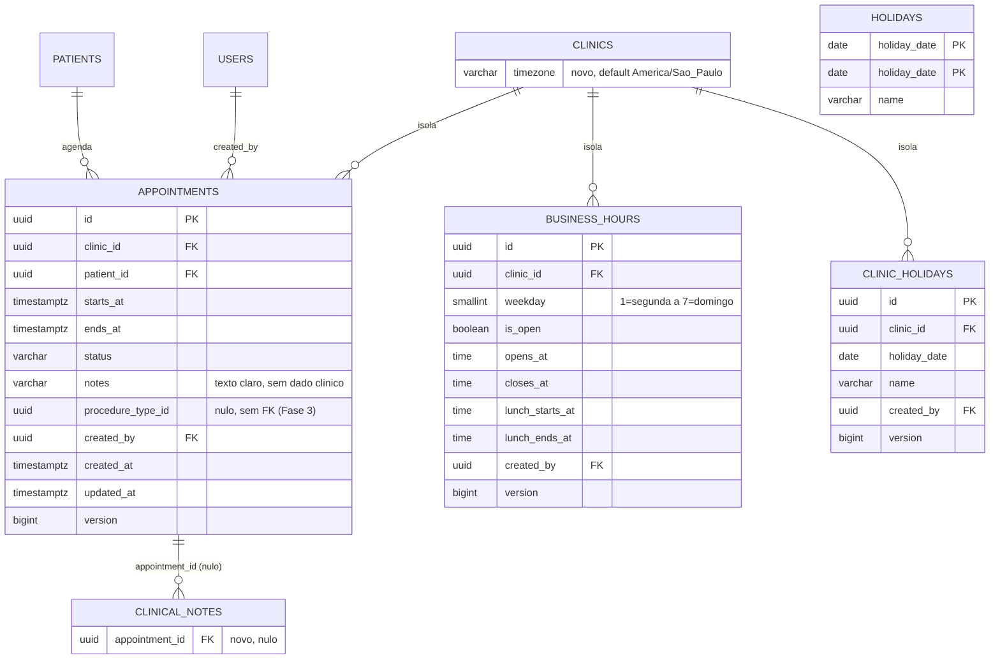

# Spec Técnica Global (Banco) — Fase 2: Agenda

**Base:** `docs/global/banco/Fase-2/prd.md` (aprovado em 2026-10-23) e as Fases 0 e 1 (`docs/global/banco/Fase-{0,1}/spec.md`; `database/` com V001–V013, `bootstrap/20_extensions.sql`, `tests/`).
**Escopo:** agendamentos com bloqueio de conflito, horário comercial, feriados (nacionais e da clínica), fuso da clínica, vínculo da nota clínica com o atendimento, auditoria da agenda e ajuste da anonimização. Schema `core`.
**Regra:** nenhum SQL é executado aqui. O DDL abaixo é **ilustrativo do contrato**; as migrations finais são do `dev-engineer-postgres`.
**Mapeamento ao modelo de spec:** as seções 1 a 6 cobrem, nesta ordem, visão técnica, modelo de dados, papéis e RLS (no lugar de "componentes": não há UI no banco), lógica central, migrations e contrato; erros, segurança/desempenho e testes vêm depois.

---

## 1. Visão técnica

- **Feature:** Banco e segurança da Fase 2 (agenda).
- **Stack:** PostgreSQL 16 (Supabase gratuito, só como Postgres), `scripts/apply_migrations.sh` (psql), extensão **`btree_gist`** (nova), `pg_trgm` já existente. Sem `pgcrypto`.
- **Abordagem:** 4 tabelas novas em `core` (`appointments`, `business_hours`, `clinic_holidays`, `holidays`) e 2 alterações aditivas (`clinics.timezone`, `clinical_notes.appointment_id`). A não sobreposição de horários é garantida por **constraint de exclusão**; o papel dentro da clínica (`app.role`) limita o que a recepção grava na agenda; a ordem das transições de status é do backend.

### 1.1 Papéis e sessão

Os quatro papéis (`crm_owner`, `crm_app`, `crm_backup`, `crm_definer`) e as três variáveis de sessão (`app.clinic_id`, `app.role`, `app.user_id`) **não mudam**. Novidades:

| Item | Mudança |
|---|---|
| `crm_app` | Grants por tabela (seção 3.1). Continua sem `DELETE` em tudo, **exceto** `clinic_holidays` (S5) |
| `crm_definer` | Ganha `SELECT` e `UPDATE (notes, version)` em `appointments`, com políticas escopadas ao tenant, para `anonymize_patient` |
| `crm_owner` | Políticas próprias em `core.holidays` (a tabela tem `FORCE`), usadas só pelas migrations de seed (S6) |
| Extensão | `btree_gist` instalada pelo bootstrap (como `postgres`), no schema `extensions` |

Parâmetros de sessão de `crm_app` (`statement_timeout 15s`, `search_path = core, pg_catalog`) permanecem.

### 1.2 Decisões desta spec (onde o PRD deixou aberto)

| # | Decisão | Justificativa |
|---|---|---|
| S1 | `appointments` tem **só** `UNIQUE (id, patient_id, clinic_id)`; o `UNIQUE (id, clinic_id)` do PRD não é criado | O primeiro já cobre qualquer FK composta com `clinic_id`; o segundo seria um índice redundante em tabela de escrita frequente. Se a Fase 3 precisar, entra numa migration dela |
| S2 | `business_hours` tem **uma linha por (clínica, dia)** com colunas `opens_at`, `closes_at`, `lunch_starts_at`, `lunch_ends_at` e `is_open`; não existe a coluna `slot` do PRD | Ordem entre as duas faixas e "faixa 2 só com faixa 1" viram `CHECK` de uma linha só, atômicos. Com duas linhas seria preciso trigger entre linhas, e trocar as duas faixas numa transação falharia no estado intermediário. Perde-se só a 3ª faixa, que o produto não pede |
| S3 | `business_hours` **sem `DELETE`**: dia fechado é `is_open = false` | Mantém `crm_app` sem `DELETE` nesta tabela. Dia **sem linha** significa "não configurado"; o backend o trata como fechado |
| S4 | O fuso só é alterado por `DENTIST_ADMIN` por um **trigger** em `clinics`, não por política | A política de `clinics` (Fase 0) não olha o papel e não pode distinguir colunas. O trigger só age quando o valor **muda**, porque o JPA reenvia todas as colunas em todo `UPDATE` |
| S5 | `clinic_holidays` tem `DELETE` físico, só `DENTIST_ADMIN` | Sem dado pessoal, sem histórico a preservar (nenhuma tabela aponta para o feriado; a agenda não o referencia). É a **única** exceção à regra "sem `DELETE`" na aplicação |
| S6 | `holidays` tem `ENABLE` + `FORCE` e quatro políticas para `crm_owner` (uma por operação) | Com `FORCE`, o dono também obedece à RLS; sem política o seed da migration não escreve. As políticas valem só para migrations (o `crm_owner` não é usado pela aplicação) |
| S7 | Dois códigos novos: **`CR004`** (paciente com agendamento futuro em aberto, na anonimização) e **`CR005`** (paciente inativo, ao agendar) | O PRD deixou o código do paciente inativo em aberto. `CR004` fecha uma lacuna: sem ele, anonimizar deixaria um horário ocupado por "Paciente anonimizado" |
| S8 | Não há colunas de carimbo (`confirmed_at`, `started_at`, `finished_at`) | O PRD deixou em aberto. A auditoria registra quem e quando, mas **não** o novo status; se o produto quiser "hora real de início/fim do atendimento" (relatórios da Fase 4), as colunas entram depois, aditivas e nulas. **Contestável** |
| S9 | Carnaval e Corpus Christi **não** entram no seed | Não são feriado nacional por lei (ponto facultativo); a clínica cadastra se quiser |
| S10 | Duração de 5 min a 12 h (múltipla de 5), `starts_at` sem segundos, `notes` até 500 caracteres | Confirmados como no PRD. O teto de 12 h também torna a consulta da agenda indexável (seção 4.5) |
| S11 | `btree_gist` entra no `bootstrap/20_extensions.sql` existente (idempotente, reexecutável), e a V015 tem um guarda que falha com mensagem clara se a extensão faltar | Evita arquivo de bootstrap novo; o `crm_owner` não pode criar a extensão |
| S12 | `appointments.procedure_type_id` é `uuid` nulo **sem FK**, sem índice | A tabela de procedimentos é da Fase 3; a FK e o índice entram lá |

---

## 2. Modelo de dados e schema

### 2.1 Diagrama ER



### 2.2 Convenções

As das Fases 0 e 1 (`snake_case`, plural, `uuid` gerado pela aplicação com `gen_random_uuid()` de reserva, `varchar(n)` + `CHECK`, `timestamptz`, `updated_at` por trigger, `version bigint`, FKs compostas `(x_id, clinic_id)` `ON DELETE RESTRICT`, `created_by` como FK composta para `users`). Em `CHECK`, `status IN (...)` segue a convenção da Fase 1; em **predicados de índice e políticas** usa-se `<>`/`OR` de igualdades, porque o `pg_dump` reinterpreta `varchar IN (...)`.

### 2.3 Dicionário de dados

#### `core.clinics` (alteração)
| Coluna | Tipo | Nulo | Default | Regra |
|---|---|---|---|---|
| `timezone` | `varchar(50)` | não | `'America/Sao_Paulo'` | `CHECK (char_length(timezone) >= 3)`; nome validado contra `pg_timezone_names` por trigger (seção 4.3); só `DENTIST_ADMIN` altera |

#### `core.appointments`
| Coluna | Tipo | Nulo | Default | Regra |
|---|---|---|---|---|
| `id` | `uuid` | não | `gen_random_uuid()` | PK; imutável |
| `clinic_id` | `uuid` | não | — | FK `clinics(id)` `RESTRICT`; imutável |
| `patient_id` | `uuid` | não | — | FK composta `(patient_id, clinic_id)` → `patients(id, clinic_id)` `RESTRICT`; imutável |
| `starts_at` | `timestamptz` | não | — | Sem segundos: `CHECK (mod(extract(epoch FROM starts_at), 60) = 0)` |
| `ends_at` | `timestamptz` | não | — | `CHECK (ends_at > starts_at)` |
| `status` | `varchar(15)` | não | `'SCHEDULED'` | `CHECK (status IN ('SCHEDULED','CONFIRMED','IN_PROGRESS','COMPLETED','NO_SHOW','CANCELED'))` |
| `notes` | `varchar(500)` | sim | — | `CHECK (notes IS NULL OR char_length(btrim(notes)) >= 1)`; **texto claro**, sem dado clínico |
| `procedure_type_id` | `uuid` | sim | — | Sem FK nesta fase (S12) |
| `created_by` | `uuid` | não | — | FK composta para `users`; imutável |
| `created_at` / `updated_at` / `version` | como nas Fases 0 e 1 | | | `created_at` imutável |

Constraints: `ck_appt_duration` = `CHECK ((ends_at - starts_at) BETWEEN interval '5 minutes' AND interval '12 hours' AND mod(extract(epoch FROM (ends_at - starts_at)), 300) = 0)`; `ux_appt_id_patient_clinic UNIQUE (id, patient_id, clinic_id)` (S1); `ex_appt_no_overlap` (seção 4.1).

#### `core.business_hours` (uma linha por clínica e dia, S2)
| Coluna | Tipo | Nulo | Default | Regra |
|---|---|---|---|---|
| `id`, `clinic_id`, `created_by`, `created_at`, `updated_at`, `version` | como acima | | | imutáveis: `id`, `clinic_id`, `weekday`, `created_by`, `created_at` |
| `weekday` | `smallint` | não | — | `CHECK (weekday BETWEEN 1 AND 7)` (ISO: 1 = segunda) |
| `is_open` | `boolean` | não | — | `false` = clínica fechada nesse dia |
| `opens_at` / `closes_at` | `time(0)` | sim | — | Hora **local da clínica** (`clinics.timezone`); `ck_bh_open` |
| `lunch_starts_at` / `lunch_ends_at` | `time(0)` | sim | — | Intervalo opcional; `ck_bh_lunch` |

- `ck_bh_open`: `(is_open AND opens_at IS NOT NULL AND closes_at IS NOT NULL AND opens_at < closes_at) OR (NOT is_open AND opens_at IS NULL AND closes_at IS NULL AND lunch_starts_at IS NULL AND lunch_ends_at IS NULL)`.
- `ck_bh_lunch`: `(lunch_starts_at IS NULL AND lunch_ends_at IS NULL) OR (lunch_starts_at IS NOT NULL AND lunch_ends_at IS NOT NULL AND opens_at < lunch_starts_at AND lunch_starts_at < lunch_ends_at AND lunch_ends_at < closes_at)`.
- `UNIQUE (clinic_id, weekday)`. O horário não atravessa a meia-noite (`opens_at < closes_at`); fechar às 24:00 é `'24:00:00'`, aceito por `time`.

#### `core.clinic_holidays`
| Coluna | Tipo | Nulo | Default | Regra |
|---|---|---|---|---|
| `id`, `clinic_id`, `created_by`, `created_at`, `updated_at`, `version` | como acima | | | imutáveis: `id`, `clinic_id`, `created_by`, `created_at` |
| `holiday_date` | `date` | não | — | `CHECK (holiday_date >= DATE '2000-01-01')` |
| `name` | `varchar(80)` | não | — | `CHECK (char_length(btrim(name)) >= 2)` |

`UNIQUE (clinic_id, holiday_date)`. Pode repetir uma data nacional (a clínica não precisa saber que já existe).

#### `core.holidays` (global, sem `clinic_id`)
| Coluna | Tipo | Nulo | Default | Regra |
|---|---|---|---|---|
| `holiday_date` | `date` | não | — | PK |
| `name` | `varchar(80)` | não | — | `CHECK (char_length(btrim(name)) >= 2)` |

#### `core.clinical_notes` (alteração)
| Coluna | Tipo | Nulo | Default | Regra |
|---|---|---|---|---|
| `appointment_id` | `uuid` | sim | — | FK composta `(appointment_id, patient_id, clinic_id)` → `appointments(id, patient_id, clinic_id)` `ON DELETE RESTRICT`. Mutável (o dentista pode vincular depois). Sem `UNIQUE` |

Com `MATCH SIMPLE`, a FK não é verificada quando `appointment_id` é nulo; `patient_id` e `clinic_id` são `NOT NULL` e vêm da própria nota, o que garante **mesmo paciente e mesma clínica**.

#### `core.audit_log` (alteração)
`ck_audit_table` passa a aceitar `'appointments'` (a constraint é recriada). Nada mais muda.

### 2.4 Índices

| Índice | Tabela | Definição | Atende |
|---|---|---|---|
| `ex_appt_no_overlap` | `appointments` | `GIST (clinic_id, tstzrange(starts_at, ends_at)) WHERE status <> 'CANCELED' AND status <> 'NO_SHOW'` | Conflito de horário (garantia) e consulta de sobreposição |
| `ix_appt_clinic_start` | `appointments` | `(clinic_id, starts_at, id)` | Agenda do dia/semana |
| `ix_appt_patient` | `appointments` | `(clinic_id, patient_id, starts_at DESC, id DESC)` | Histórico do paciente e FK composta |
| `ux_appt_id_patient_clinic` | `appointments` | `(id, patient_id, clinic_id)` único | Alvo da FK de `clinical_notes` |
| `ix_notes_appointment` | `clinical_notes` | `(clinic_id, appointment_id) WHERE appointment_id IS NOT NULL` | Notas de um atendimento e FK |
| (unique) | `business_hours` | `(clinic_id, weekday)` | Unicidade e leitura da semana |
| `ux_clinic_holidays_date` | `clinic_holidays` | `(clinic_id, holiday_date)` único | Unicidade e consulta por período |
| PK | `holidays` | `(holiday_date)` | Consulta por período |

Exceção consciente (como na Fase 1): `created_by` de `appointments`, `business_hours` e `clinic_holidays` fica **sem índice**, pois `users` nunca é apagado; a migration registra a decisão. Volume esperado: um dentista solo gera ~10 a 30 agendamentos por dia (menos de 10 mil por ano); a meta de teste (20 mil por clínica) já é um extremo.

### 2.5 DDL ilustrativo (contrato)

```sql
-- V014: fuso da clínica
ALTER TABLE core.clinics
  ADD COLUMN timezone varchar(50) NOT NULL DEFAULT 'America/Sao_Paulo'
  CONSTRAINT ck_clinics_timezone CHECK (char_length(timezone) >= 3);

-- V015: agendamentos
CREATE TABLE core.appointments (
  id          uuid PRIMARY KEY DEFAULT gen_random_uuid(),
  clinic_id   uuid NOT NULL REFERENCES core.clinics (id) ON DELETE RESTRICT,
  patient_id  uuid NOT NULL,
  starts_at   timestamptz NOT NULL,
  ends_at     timestamptz NOT NULL,
  status      varchar(15) NOT NULL DEFAULT 'SCHEDULED',
  notes       varchar(500),
  procedure_type_id uuid,
  created_by  uuid NOT NULL,
  created_at  timestamptz NOT NULL DEFAULT now(),
  updated_at  timestamptz NOT NULL DEFAULT now(),
  version     bigint NOT NULL DEFAULT 0,
  CONSTRAINT ck_appt_status CHECK (status IN ('SCHEDULED','CONFIRMED','IN_PROGRESS','COMPLETED','NO_SHOW','CANCELED')),
  CONSTRAINT ck_appt_range  CHECK (ends_at > starts_at),
  CONSTRAINT ck_appt_start_minute CHECK (mod(extract(epoch FROM starts_at), 60) = 0),
  CONSTRAINT ck_appt_duration CHECK (
    (ends_at - starts_at) BETWEEN interval '5 minutes' AND interval '12 hours'
    AND mod(extract(epoch FROM (ends_at - starts_at)), 300) = 0),
  CONSTRAINT ck_appt_notes CHECK (notes IS NULL OR char_length(btrim(notes)) >= 1),
  CONSTRAINT fk_appt_patient FOREIGN KEY (patient_id, clinic_id)
    REFERENCES core.patients (id, clinic_id) ON DELETE RESTRICT,
  CONSTRAINT fk_appt_created_by FOREIGN KEY (created_by, clinic_id)
    REFERENCES core.users (id, clinic_id) ON DELETE RESTRICT,
  CONSTRAINT ux_appt_id_patient_clinic UNIQUE (id, patient_id, clinic_id),
  CONSTRAINT ex_appt_no_overlap EXCLUDE USING gist (
    clinic_id WITH =, tstzrange(starts_at, ends_at) WITH &&)
    WHERE (status <> 'CANCELED' AND status <> 'NO_SHOW')
);
CREATE INDEX ix_appt_clinic_start ON core.appointments (clinic_id, starts_at, id);
CREATE INDEX ix_appt_patient ON core.appointments (clinic_id, patient_id, starts_at DESC, id DESC);

-- V016: horário comercial (uma linha por dia, S2)
CREATE TABLE core.business_hours (
  id uuid PRIMARY KEY DEFAULT gen_random_uuid(),
  clinic_id uuid NOT NULL REFERENCES core.clinics (id) ON DELETE RESTRICT,
  weekday smallint NOT NULL CONSTRAINT ck_bh_weekday CHECK (weekday BETWEEN 1 AND 7),
  is_open boolean NOT NULL,
  opens_at time(0), closes_at time(0), lunch_starts_at time(0), lunch_ends_at time(0),
  created_by uuid NOT NULL,
  -- created_at, updated_at, version ...
  CONSTRAINT ck_bh_open  CHECK ((is_open AND opens_at IS NOT NULL AND closes_at IS NOT NULL AND opens_at < closes_at)
                             OR (NOT is_open AND opens_at IS NULL AND closes_at IS NULL
                                 AND lunch_starts_at IS NULL AND lunch_ends_at IS NULL)),
  CONSTRAINT ck_bh_lunch CHECK ((lunch_starts_at IS NULL AND lunch_ends_at IS NULL)
                             OR (lunch_starts_at IS NOT NULL AND lunch_ends_at IS NOT NULL
                                 AND opens_at < lunch_starts_at AND lunch_starts_at < lunch_ends_at
                                 AND lunch_ends_at < closes_at)),
  CONSTRAINT ux_bh_clinic_weekday UNIQUE (clinic_id, weekday)
  -- FK composta de created_by ...
);

-- V017: feriados
CREATE TABLE core.holidays (
  holiday_date date PRIMARY KEY,
  name varchar(80) NOT NULL CHECK (char_length(btrim(name)) >= 2)
);
-- core.clinic_holidays: como a seção 2.3 (UNIQUE (clinic_id, holiday_date))

-- V019: vínculo da nota com o atendimento (aditivo, sem reescrever linhas)
ALTER TABLE core.clinical_notes ADD COLUMN appointment_id uuid;
ALTER TABLE core.clinical_notes ADD CONSTRAINT fk_notes_appointment
  FOREIGN KEY (appointment_id, patient_id, clinic_id)
  REFERENCES core.appointments (id, patient_id, clinic_id) ON DELETE RESTRICT;
CREATE INDEX ix_notes_appointment ON core.clinical_notes (clinic_id, appointment_id)
  WHERE appointment_id IS NOT NULL;
```

### 2.6 Triggers

| Trigger | Tabelas | Evento | Efeito |
|---|---|---|---|
| `trg_*_set_updated_at` | `appointments`, `business_hours`, `clinic_holidays` | `BEFORE UPDATE` | `core.set_updated_at()` (V002) |
| `trg_*_forbid_immutable` | `appointments` (`id`, `clinic_id`, `patient_id`, `created_by`, `created_at`); `business_hours` (`id`, `clinic_id`, `weekday`, `created_by`, `created_at`); `clinic_holidays` (`id`, `clinic_id`, `created_by`, `created_at`) | `BEFORE UPDATE` | `core.forbid_immutable_columns(...)` (V002) |
| `trg_appt_guard_patient` | `appointments` | `BEFORE INSERT OR UPDATE` | `core.guard_appointment_patient()` (seção 4.2): `CR003` paciente anonimizado, `CR005` paciente inativo |
| `trg_clinics_validate_timezone` | `clinics` | `BEFORE INSERT OR UPDATE OF timezone` | `core.validate_clinic_timezone()` (seção 4.3) |
| `trg_appt_audit` | `appointments` | `AFTER INSERT OR UPDATE OR DELETE`, `FOR EACH ROW` | `core.write_audit()` (V012, **sem alteração**) |

Funções de trigger com `SET search_path = pg_catalog, pg_temp`; `REVOKE EXECUTE ... FROM PUBLIC`. `business_hours`, `clinic_holidays` e `holidays` **não** são auditadas (PRD, US-209).

---

## 3. Papéis, GRANTs e RLS

### 3.1 Matriz de privilégios

| Objeto | `crm_app` | `crm_definer` | `crm_backup` | `crm_owner` |
|---|---|---|---|---|
| `appointments` | `SELECT`, `INSERT`, `UPDATE` | `SELECT`; `UPDATE (notes, version)` | `SELECT` | dono |
| `business_hours` | `SELECT`, `INSERT`, `UPDATE` | — | `SELECT` | dono |
| `clinic_holidays` | `SELECT`, `INSERT`, `UPDATE`, **`DELETE`** | — | `SELECT` | dono |
| `holidays` | `SELECT` | — | `SELECT` | dono (por políticas, S6) |
| `clinics` | sem mudança (`SELECT`, `INSERT`, `UPDATE`) | — | — | — |
| `clinical_notes` | sem mudança (a coluna nova herda o grant da tabela) | — | — | — |

Nenhum `GRANT ALL`; nenhum `TRUNCATE`; `crm_app` sem `DELETE` em `appointments`, `business_hours` e `holidays`. As funções novas (`guard_appointment_patient`, `validate_clinic_timezone`) não recebem `EXECUTE` para ninguém além do necessário ao disparo do trigger (o privilégio é checado só ao criar o trigger). `ALTER DEFAULT PRIVILEGES` da Fase 0 mantém objetos novos sem acesso.

### 3.2 Políticas RLS

Todas as tabelas: `ENABLE` + `FORCE`. Notação da Fase 1: `T` = `clinic_id = core.current_clinic_id()`; `D` = `(SELECT core.current_app_role()) = 'DENTIST_ADMIN'`; `R` = `(SELECT core.current_app_role()) = 'RECEPTIONIST'`; `A` = `D OR R`; `U` = `created_by = core.current_user_id()`.

| Tabela | Operação | Papel | Condição |
|---|---|---|---|
| `appointments` | SELECT | `crm_app` | `T AND A` |
| `appointments` | INSERT | `crm_app` | `WITH CHECK (T AND U AND (D OR (R AND status = 'SCHEDULED')))` |
| `appointments` | UPDATE | `crm_app` | `USING (T AND (D OR (R AND (status = 'SCHEDULED' OR status = 'CONFIRMED'))))` `WITH CHECK (T AND (D OR (R AND (status = 'SCHEDULED' OR status = 'CONFIRMED' OR status = 'CANCELED' OR status = 'NO_SHOW'))))` |
| `appointments` | DELETE | — | sem política (negado) |
| `appointments` | SELECT / UPDATE | `crm_definer` | `T` (o `UPDATE` só alcança `notes` e `version` pelo grant por coluna) |
| `business_hours` | SELECT | `crm_app` | `T AND A` |
| `business_hours` | INSERT | `crm_app` | `WITH CHECK (T AND D AND U)` |
| `business_hours` | UPDATE | `crm_app` | `USING (T AND D)` `WITH CHECK (T AND D)` |
| `business_hours` | DELETE | — | sem política (negado) |
| `clinic_holidays` | SELECT | `crm_app` | `T AND A` |
| `clinic_holidays` | INSERT | `crm_app` | `WITH CHECK (T AND D AND U)` |
| `clinic_holidays` | UPDATE / DELETE | `crm_app` | `USING (T AND D)` (UPDATE também com `WITH CHECK (T AND D)`) |
| `holidays` | SELECT | `crm_app` | `USING (true)` (dado global, igual para todas as clínicas) |
| `holidays` | INSERT/UPDATE/DELETE | `crm_app` | sem política (negado) |
| `holidays` | SELECT, INSERT, UPDATE, DELETE | `crm_owner` | `true` (uma política por operação; só migrations) |
| as 4 tabelas | SELECT | `crm_backup` | `USING (true)` |

**Efeito da política de `UPDATE` da recepção em `appointments`:**
- Só enxerga para alterar as linhas hoje `SCHEDULED` ou `CONFIRMED`; `IN_PROGRESS`, `COMPLETED`, `CANCELED` e `NO_SHOW` ficam intocáveis (0 linhas afetadas, sem erro).
- Só pode gravar `SCHEDULED`, `CONFIRMED`, `CANCELED` ou `NO_SHOW`. Tentar `IN_PROGRESS` ou `COMPLETED` falha por `WITH CHECK` (`42501`).
- Pode remarcar (mudar `starts_at`/`ends_at`) e editar `notes` dessas linhas.
- **Reativar** um cancelado ou faltoso (`CANCELED`/`NO_SHOW` → `SCHEDULED`) é **só do dentista**. A recepção cria um agendamento novo.
- O **banco não valida a ordem** das transições (A4): o `DENTIST_ADMIN` pode gravar qualquer status sobre qualquer outro.

Sem `app.clinic_id` ou com `app.role` ausente ou inválido, `T` ou `A`/`D`/`R` é `NULL` ou falso: nada é lido nem gravado (falha fechada). `holidays` é a exceção intencional: dado público, legível mesmo sem sessão.

### 3.3 Endurecimento padrão

Sem mudanças nos `REVOKE` da Fase 0. Cada migration nova: `REVOKE EXECUTE ... FROM PUBLIC` em funções, `GRANT` explícito e mínimo, `SECURITY DEFINER` apenas onde já existe (`write_audit`, `anonymize_patient`), `search_path` fixo, sem SQL dinâmico.

---

## 4. Funções e lógica central

### 4.1 Não sobreposição (`ex_appt_no_overlap`)

- Chave: mesmo `clinic_id` **e** intervalos `tstzrange(starts_at, ends_at)` que se sobrepõem (`&&`). O intervalo é **semiaberto** `[início, fim)`: um atendimento que termina às 10:00 e outro que começa às 10:00 **não** conflitam.
- Ocupam horário: `SCHEDULED`, `CONFIRMED`, `IN_PROGRESS`, `COMPLETED`. Não ocupam: `CANCELED`, `NO_SHOW` (o predicado é parcial).
- **Concorrência:** quando duas transações tentam o mesmo horário, a segunda **espera** a primeira terminar; se esta confirmar, a segunda falha com `23P01` (`exclusion_violation`); se esta desfizer, a segunda passa. Não é preciso `SELECT ... FOR UPDATE` nem lock do backend.
- O constraint é verificado em `INSERT` e em `UPDATE` de `starts_at`, `ends_at`, `status` ou `clinic_id`. Cancelar libera o horário; **reativar** pode falhar com `23P01`.
- O constraint **não** é deferrable: trocar o horário de dois agendamentos entre si (permuta) numa só transação falha no passo intermediário. A permuta é feita pelo backend em duas etapas (cancelar um, mover o outro, recriar o primeiro) ou fica fora do escopo.
- O `EXCLUDE` não passa pela RLS (a verificação lê todas as linhas), mas o `clinic_id` entra na chave: **clínicas diferentes nunca conflitam**. O teste 63 prova isso.

### 4.2 `core.guard_appointment_patient()` (trigger, `SECURITY INVOKER`)

`BEFORE INSERT OR UPDATE ON core.appointments`, `FOR EACH ROW`. Roda só quando o agendamento **passa a ocupar horário**:
1. `INSERT` com status ocupante (`SCHEDULED`, `CONFIRMED`, `IN_PROGRESS`, `COMPLETED`), **ou** `UPDATE` em que o status antigo era `CANCELED`/`NO_SHOW` e o novo é ocupante. Qualquer outro caso: `RETURN NEW` sem consultar nada (o JPA reenvia todas as colunas em todo `UPDATE`, e isso evita custo e travas à toa).
2. `SELECT p.active, p.anonymized_at FROM core.patients p WHERE p.id = NEW.patient_id AND p.clinic_id = NEW.clinic_id FOR KEY SHARE` (mesmo padrão de `forbid_child_of_anonymized`: se uma anonimização está em curso, o `INSERT` espera e relê o paciente já anonimizado).
3. `anonymized_at IS NOT NULL` → `RAISE EXCEPTION ... USING ERRCODE = 'CR003'`.
4. `active = false` → `RAISE EXCEPTION ... USING ERRCODE = 'CR005'`.

Agendamentos **já existentes** de um paciente depois inativado permanecem como estão (o backend os cancela ao inativar; ver 6.3).

### 4.3 `core.validate_clinic_timezone()` (trigger, `SECURITY INVOKER`)

`BEFORE INSERT OR UPDATE OF timezone ON core.clinics`, `FOR EACH ROW`:
1. `UPDATE` com `NEW.timezone = OLD.timezone` → `RETURN NEW` (curto-circuito: o JPA reenvia a coluna em todo `UPDATE` de `clinics`).
2. `UPDATE` com valor novo e `core.current_app_role()` diferente de `DENTIST_ADMIN` → erro `42501`.
3. Valor fora de `pg_catalog.pg_timezone_names.name` → erro `23514` (`check_violation`) com mensagem "fuso inválido".
4. O `INSERT` (cadastro da clínica pelas funções da V006) usa o default e só passa pela validação do nome.

A consulta a `pg_timezone_names` custa alguns milissegundos; só ocorre na criação da clínica e na troca do fuso.

### 4.4 `core.anonymize_patient` (alteração, V021)

A função da V013 é **substituída** por `CREATE OR REPLACE FUNCTION` (mantém dono `crm_definer` e `EXECUTE` do `crm_app`; se o projeto real exigir, repetir o padrão `GRANT CREATE ON SCHEMA core TO crm_definer` / `REVOKE` da V013). Mudanças, em relação aos passos da spec da Fase 1 (4.2):
- **Novo passo, depois da checagem de retenção (passo 4):** se existir agendamento do paciente com `status` `SCHEDULED`, `CONFIRMED` ou `IN_PROGRESS` e `ends_at > now()`, erro **`CR004`** ("cancele os agendamentos futuros antes de anonimizar"). O backend cancela antes (6.3).
- **Novo passo, antes do `UPDATE` de `patients`:** `UPDATE core.appointments SET notes = NULL, version = version + 1 WHERE patient_id = p_patient_id AND notes IS NOT NULL`. `starts_at`, `ends_at`, `status` e `patient_id` permanecem (não identificam ninguém sozinhos). Cada `UPDATE` gera uma linha de auditoria `appointments`/`UPDATE`.
- A retenção de 20 anos **não** considera agendamentos (não são registro clínico).
- Demais passos, códigos de erro (`42501`, `28000`, `P0002`, `CR001`, `CR002`, `CR003`) e o `ANONYMIZE` no `audit_log` ficam como na Fase 1.
- Códigos novos desta fase: `CR004` (agendamento futuro em aberto) e, no trigger de agendamento, `CR005` (paciente inativo).

### 4.5 Máquina de status (referência para o backend; **não imposta pelo banco**)

| De | Para (permitido) | Quem |
|---|---|---|
| `SCHEDULED` | `CONFIRMED`, `CANCELED`, `NO_SHOW` | recepção ou dentista |
| `CONFIRMED` | `IN_PROGRESS`, `CANCELED`, `NO_SHOW` | `IN_PROGRESS`: **só dentista**; os demais, recepção ou dentista |
| `IN_PROGRESS` | `COMPLETED` | só dentista |
| `COMPLETED` | — (terminal) | — |
| `CANCELED`, `NO_SHOW` | `SCHEDULED` (reativar, sujeito a conflito) | só dentista |

O banco reforça só a coluna **Quem** para a recepção (política de `UPDATE` da seção 3.2); a coluna **Para** é do backend (decisão A4). Um trigger de transição pode ser acrescentado depois sem mudar o modelo.

### 4.6 Consultas críticas e índices

| Consulta | Índice | Plano esperado |
|---|---|---|
| Agenda da semana/dia: `clinic_id = ? AND starts_at >= :ini - interval '12 hours' AND starts_at < :fim AND ends_at > :ini ORDER BY starts_at, id` (o recuo de 12 h pega o atendimento que começou antes da janela e entra nela; vale pelo teto de duração) | `ix_appt_clinic_start` | `Index Scan`, sem *sort* |
| Conflito (pré-checagem opcional): `clinic_id = ? AND status <> 'CANCELED' AND status <> 'NO_SHOW' AND tstzrange(starts_at, ends_at) && tstzrange(?, ?) AND id <> ?` | `ex_appt_no_overlap` (GiST parcial) | `Index Scan` no GiST |
| Histórico do paciente (keyset por `(starts_at, id)`) | `ix_appt_patient` | `Index Scan` |
| Agendamento aberto futuro do paciente (`CR004`) | `ix_appt_patient` | `Index Scan` |
| Notas de um atendimento | `ix_notes_appointment` | `Index Scan` |
| Horário comercial da clínica (7 linhas) | `ux_bh_clinic_weekday` | `Index Scan` |
| Feriados no período (nacional + clínica) | PK de `holidays` e `ux_clinic_holidays_date` | `Index Scan` |

A autoridade do conflito é sempre a constraint; a pré-checagem serve só para mostrar o horário ocupado na tela.

---

## 5. Migrations e ambientes

### 5.1 Estrutura (acréscimos)

```
database/
├─ bootstrap/20_extensions.sql                  -- ESTENDIDO: + btree_gist (idempotente; reexecutar como postgres)
├─ migrations/
│  ├─ V014__core_clinic_timezone.sql            -- clinics.timezone + trigger de validação
│  ├─ V015__core_appointments.sql               -- guarda de btree_gist; tabela, EXCLUDE, índices, triggers, RLS, grants
│  ├─ V016__core_business_hours.sql
│  ├─ V017__core_holidays.sql                   -- holidays (global) + clinic_holidays
│  ├─ V018__core_holidays_seed_2026_2030.sql    -- seed idempotente (ON CONFLICT DO NOTHING)
│  ├─ V019__core_notes_appointment_link.sql     -- clinical_notes.appointment_id (aditivo)
│  ├─ V020__core_appointments_audit.sql         -- ck_audit_table ampliado + trg_appt_audit
│  └─ V021__core_appointments_anonymization.sql -- políticas do definer + anonymize_patient (CR004, notes)
├─ rollback/U014…U021
└─ tests/ (novos e ampliados, seção 9)
```

Cada migration é aditiva, em uma transação, com `-- Reverter:` apontando para `rollback/U0NN`. `scripts/apply_migrations.sh` e `MIGRATIONS_EXPECTED` (`run_all.sh`) passam de 13 para **21**. O rollback de tabelas (`DROP`) só é seguro **antes** de haver dados; depois, restaurar do `pg_dump`. `U021` restaura a função da V013 sem `CR004`/`notes`.

### 5.2 `bootstrap/20_extensions.sql` (estendido, como `postgres`)

Acrescenta `CREATE EXTENSION IF NOT EXISTS btree_gist WITH SCHEMA extensions` (mesmo tratamento de erro e verificação de schema do `pg_trgm`; mensagem: "sem btree_gist não há garantia de conflito de agenda no banco"). **Sem plano B no banco:** sem a extensão a V015 não aplica (S11). O `crm_app` não precisa de `USAGE` em `extensions`: o índice é escolhido e mantido por OID.

### 5.3 Guarda na V015

Primeira instrução da V015: um bloco `DO` que verifica `pg_extension` por `btree_gist` e, se faltar, aborta com a instrução "execute o bootstrap 20_extensions.sql como postgres e reaplique".

### 5.4 Seed de feriados (V018)

Migration **separada** do schema, executada como `crm_owner` (as políticas do S6 permitem), idempotente (`INSERT ... ON CONFLICT (holiday_date) DO NOTHING`). Para cada ano de 2026 a 2030, 10 feriados nacionais por lei:

| Data fixa | Nome |
|---|---|
| 01/01 | Confraternização Universal |
| 21/04 | Tiradentes |
| 01/05 | Dia do Trabalho |
| 07/09 | Independência do Brasil |
| 12/10 | Nossa Senhora Aparecida |
| 02/11 | Finados |
| 15/11 | Proclamação da República |
| 20/11 | Dia da Consciência Negra |
| 25/12 | Natal |

E a **Sexta-feira Santa**, que é móvel: 2026-04-03, 2027-03-26, 2028-04-14, 2029-03-30, 2030-04-19. Total: **50 linhas**. O teste confere a contagem e a idempotência (rodar duas vezes mantém 50). Feriados novos ou o ano seguinte a 2030 entram em nova migration de seed.

### 5.5 Regras e ambientes

As regras de migration e ambientes das Fases 0 e 1 valem (migrations por `apply_migrations.sh`, sem histórico no banco; deploy manual no Supabase; CI/CD adiado). A V015 depende de a extensão estar instalada no projeto real **antes** da migração.

---

## 6. Contrato com o backend

### 6.1 Nomes definitivos

| Item | Nome |
|---|---|
| Tabelas | `core.appointments`, `core.business_hours`, `core.clinic_holidays`, `core.holidays` |
| Colunas novas | `core.clinics.timezone`, `core.clinical_notes.appointment_id` |
| Valores de `status` | `SCHEDULED`, `CONFIRMED`, `IN_PROGRESS`, `COMPLETED`, `NO_SHOW`, `CANCELED` |
| Variáveis de sessão | as mesmas da Fase 1 |
| Constraints úteis ao backend | `ex_appt_no_overlap` (conflito), `ux_bh_clinic_weekday`, `ux_clinic_holidays_date` (23505) |
| Códigos de erro | `23P01` (conflito de horário), `23505` (dia/feriado duplicado), `23503` (FK: paciente/atendimento inexistente, de outra clínica ou de outro paciente), `23514` (`CHECK`, fuso inválido, imutável), `42501` (papel), `28000`, `CR003` (paciente anonimizado), `CR004` (agendamento futuro em aberto), `CR005` (paciente inativo) |

### 6.2 Mapeamento esperado das entidades

- `uuid` → `UUID`; `timestamptz` → `Instant`; `time(0)` → `LocalTime`; `date` → `LocalDate`; `smallint weekday` → `Short`/`DayOfWeek` (1 = segunda, igual ao ISO de `DayOfWeek.getValue()`); `bigint version` → `@Version Long`; `status` → `@Enumerated(STRING)`.
- `updatable = false` nas colunas imutáveis da seção 2.6 (para o JPA não reenviá-las).
- `clinical_notes.appointment_id` mapeado como `UUID` simples (sem `@ManyToOne` obrigatório); `Clinic.timezone` como `String` (`ZoneId.of`).
- `appointments.notes` **nunca** recebe dado clínico; a validação do backend deve avisar o usuário.

### 6.3 Regras para o backend

1. Definir `app.clinic_id`, `app.role` e `app.user_id` em toda transação (como na Fase 1).
2. **Máquina de status no backend**, conforme a tabela da seção 4.5: o banco não impede transição inválida do dentista.
3. **Conflito:** tratar `23P01` em `INSERT` e em `UPDATE` (remarcação, reativação) como 409. Não registrar o `DETAIL` do erro em log.
4. **Fuso:** ler `clinics.timezone`; converter "hoje" e "a semana" para `[início, fim)` em `timestamptz` e passar ao banco. O banco não calcula "hoje".
5. **Horário comercial e feriado:** o backend cruza o agendamento com `business_hours` (hora local) e com `holidays` ∪ `clinic_holidays`; decide avisar ou bloquear. O banco aceita agendar fora do horário e em feriado (A8, A9). Dia sem linha em `business_hours` = não configurado (tratar como fechado).
6. **Inativar paciente:** o backend cancela antes os agendamentos futuros em aberto (senão a anonimização futura falha com `CR004`).
7. **Anonimização:** traduzir `CR004` → 409 ("cancele os agendamentos futuros"); `CR005` ao agendar → 409 ("paciente inativo"); `CR003` → 409.
8. **Recepção** só envia os quatro status que o banco aceita; `42501` em `UPDATE` de status proibido é bug do backend, não erro do usuário (o backend responde 403 antes).
9. **Vínculo da nota:** ao salvar a nota, o backend pode informar `appointment_id` (do mesmo paciente); "uma nota por atendimento" é regra do backend.
10. **Configuração:** gravar `business_hours` e `clinic_holidays` só para `DENTIST_ADMIN`; `holidays` é só leitura. Remover feriado da clínica é `DELETE` (única exceção).

---

## 7. Erros e casos de borda

| Cenário | Tratamento |
|---|---|
| Sobreposição parcial, total ou contida na mesma clínica | `23P01` |
| Atendimentos consecutivos (fim = início) | Passam |
| Mesmo horário em outra clínica | Passa |
| Duas transações no mesmo horário em paralelo | A segunda espera a primeira; se esta confirma, `23P01` |
| Cancelar e reagendar no mesmo horário | O horário fica livre; o novo passa |
| Reativar cancelado sobre horário ocupado | `23P01` |
| Fim ≤ início, duração < 5 min, > 12 h ou não múltipla de 5 min; início com segundos | `23514` |
| `status` fora da lista | `23514` |
| Paciente de outra clínica | `23503` (FK composta) |
| Paciente inativo / anonimizado ao agendar | `CR005` / `CR003` |
| Recepção grava `IN_PROGRESS` ou `COMPLETED` | `42501` (política de `WITH CHECK`) |
| Recepção altera linha `IN_PROGRESS`, `COMPLETED`, `CANCELED` ou `NO_SHOW` | 0 linhas afetadas, sem erro |
| Recepção cria agendamento com status ≠ `SCHEDULED` | `42501` |
| Dentista grava transição fora da ordem (`COMPLETED` → `SCHEDULED`) | **Passa**: banco não valida a ordem (A4) |
| `app.role` ausente ou inválido | Tudo negado nas tabelas com `clinic_id`; `holidays` segue legível |
| `app.user_id` ausente | `INSERT/UPDATE` em `appointments` falha com `28000` (auditoria) |
| `created_by` ≠ `app.user_id` no `INSERT` | `42501` |
| `DELETE` em `appointments`, `business_hours` ou `holidays` por `crm_app` | `42501` |
| Dia da semana ou feriado duplicado | `23505` |
| `business_hours` com almoço fora do expediente, `is_open = false` com horário, `weekday` 0 ou 8 | `23514` |
| Escrita em `holidays` por `crm_app` | `42501` |
| Fuso inexistente (`Mars/Phobos`, `EST5EDT` mal escrito) | `23514` |
| Recepção troca o fuso / reenvia o mesmo fuso em `UPDATE` | `42501` / passa (curto-circuito) |
| `appointment_id` de outro paciente ou outra clínica na nota | `23503` |
| Nota sem `appointment_id` | Passa (nulo) |
| Anonimizar com agendamento futuro em aberto | `CR004` |
| Anonimizar com agendamentos passados ou cancelados | Passa; `notes` zeradas, horário e status mantidos |
| Anonimizar paciente sem registro clínico mas com agendamentos passados | Passa imediatamente (S4 da Fase 1) |
| `btree_gist` ausente ao aplicar V015 | Aborta com mensagem do guarda |
| Falha de auditoria | A operação inteira reverte |

---

## 8. Segurança e desempenho

**Segurança**
- RLS `FORCE` em todas as tabelas novas; autoria verdadeira (`created_by = app.user_id`) na inserção.
- Papel reforçado no banco para o que a recepção grava (status e linhas), para horário comercial e feriados da clínica. Limite aceito: o banco confia no `app.role` que o backend informa (risco 1 da Fase 1).
- `crm_definer`: `SELECT` e `UPDATE (notes, version)` em `appointments`, escopados ao tenant, sem `USING (true)`.
- `holidays` global: legível, sem escrita pela aplicação; escrita só do `crm_owner` por migration.
- `appointments.notes` é texto claro (trade-off P2): limite de 500 caracteres, aviso no contrato e zerado na anonimização. A existência de um agendamento revela que a pessoa é paciente; a RLS protege, o dump do `crm_backup` é cifrado com `age`.
- `audit_log` sem dado pessoal (só identificadores); agendamentos criados ou alterados deixam rastro.
- Riscos de lost update no JPA: coluna `timezone` reenviada em todo `UPDATE` de `clinics` (tratada pelo curto-circuito); `appointment_id` e `notes` com `@Version`.

**Desempenho**
- Agenda da semana ≤ **10 ms** e conflito ≤ **5 ms** com 20 mil agendamentos na clínica e 200 mil no banco, sem `Seq Scan` (planos da seção 4.6).
- Histórico do paciente por keyset e `CR004` por `Index Scan`.
- As funções de sessão aparecem como `(SELECT ...)` nas políticas (avaliadas uma vez por consulta), como na Fase 1.
- Custo do `EXCLUDE`: uma busca no GiST por escrita (microssegundos); do guard do paciente: um `SELECT ... FOR KEY SHARE` só quando o agendamento passa a ocupar horário; da auditoria: 1 `INSERT` por linha alterada.
- Anonimização com 500 agendamentos dentro do `statement_timeout` de 15 s.
- Sem particionamento: um dentista solo gera menos de 10 mil agendamentos por ano.

---

## 9. Testes (para o `dev-engineer-postgres`)

Continuam em `database/tests/` com `psql -v ON_ERROR_STOP=1`; a numeração segue a da Fase 1 (que terminou em 58). `run_all.sh`, `catalog_rls_pattern.sql`, `schema_dictionary.sql`, `roles_and_privileges.sql`, `permissions_tables.sql`, `table_counts.sql`, `rollback_chain.sh` e os testes de backup são **ampliados** para as tabelas novas; `catalog_rls_pattern.sql` precisa aceitar as políticas de `crm_owner` em `holidays` (S6). Os testes de papel e isolamento usam duas clínicas (A e B).

**Isolamento de tenant (como `crm_app`, `DENTIST_ADMIN`)**
59. Sob A, `SELECT/UPDATE` em `appointments`, `business_hours` e `clinic_holidays` não alcançam linhas de B; `INSERT` com `clinic_id = B` falha; sem `app.clinic_id`, 0 linhas e `INSERT` falha. `holidays` continua legível (dado global).
60. `patient_id` de outra clínica falha (`23503`); `clinical_notes.appointment_id` de outra clínica ou de **outro paciente** falha (`23503`).

**Conflito de horário**
61. Sobreposição parcial, total e contida → `23P01`; consecutivos (fim = início) passam; mesmo horário na clínica B passa.
62. `CANCELED` e `NO_SHOW` não ocupam; cancelar libera; reativar sobre horário ocupado → `23P01` (também em `UPDATE`); `IN_PROGRESS` e `COMPLETED` ocupam.
63. **Concorrência (duas conexões):** A abre transação e insere; B insere o mesmo horário e fica esperando; A confirma → B recebe `23P01`; repetido com `ROLLBACK` de A → B passa. Clínicas diferentes nunca esperam.
64. `CHECK`s: fim ≤ início, duração de 4 min, de 7 min e de 13 h, início com segundos, status fora da lista, `notes` só com espaços falham; 5 min e 12 h passam.

**Papéis (`app.role`)**
65. `RECEPTIONIST`: `SELECT` e `INSERT` com `SCHEDULED` passam; `INSERT` com `IN_PROGRESS` falha (`42501`); `UPDATE` `SCHEDULED` → `CONFIRMED`, `CONFIRMED` → `CANCELED`/`NO_SHOW` e remarcação passam; `UPDATE` para `IN_PROGRESS`/`COMPLETED` falha; `UPDATE` de linha `IN_PROGRESS`, `COMPLETED`, `CANCELED` ou `NO_SHOW` afeta 0 linhas; reativar cancelado afeta 0 linhas.
66. `DENTIST_ADMIN` grava qualquer status sobre qualquer outro, inclusive `COMPLETED` → `SCHEDULED` (documenta que o banco não valida a ordem).
67. `app.role` ausente ou `'ADMIN'`: tudo negado nas três tabelas com `clinic_id`; `holidays` segue legível.
68. `INSERT` com `created_by` diferente de `app.user_id` falha nas três tabelas.

**Configuração**
69. `RECEPTIONIST` lê `business_hours` e `clinic_holidays` e não grava (`INSERT` falha, `UPDATE`/`DELETE` afetam 0 linhas); `DENTIST_ADMIN` grava; só ele faz `DELETE` em `clinic_holidays`; `crm_app` não faz `INSERT/UPDATE/DELETE` em `holidays`; `crm_owner` consegue `INSERT` em `holidays` sob `FORCE`.
70. `business_hours`: dia fechado sem horários passa; fechado com horário falha; aberto sem horário falha; `opens_at ≥ closes_at` falha; almoço fora do expediente, só uma ponta do almoço ou almoço em dia fechado falham; `weekday` 0 e 8 falham; segunda linha do mesmo dia falha (`23505`).
71. `clinic_holidays`: data repetida na mesma clínica falha (`23505`); a mesma data em outra clínica passa; `holiday_date` anterior a 2000 falha.
72. Seed: 50 linhas; 2026-04-03, 2027-03-26, 2028-04-14, 2029-03-30 e 2030-04-19 presentes; rodar a migration duas vezes mantém 50; datas únicas.

**Fuso**
73. Default `America/Sao_Paulo`; `UTC` passa; `Mars/Phobos` falha (`23514`); `RECEPTIONIST` trocando o fuso → `42501`; `RECEPTIONIST` com `UPDATE` que reenvia o mesmo fuso passa; `DENTIST_ADMIN` troca; clínicas existentes recebem o default.

**Paciente**
74. `INSERT` de agendamento ocupante para paciente inativo → `CR005`; para anonimizado → `CR003`; reativar cancelado de paciente inativo → `CR005`; `INSERT` já `CANCELED` passa; agendamento existente de paciente inativado continua legível; `UPDATE` sem mudar de/para `CANCELED`/`NO_SHOW` não consulta o paciente.

**Vínculo da nota**
75. Nota sem `appointment_id` passa; notas já existentes intactas após a migration; vincular depois por `UPDATE` passa; várias notas no mesmo agendamento passam; agendamento de outro paciente → `23503`; a recepção continua sem acesso a `clinical_notes`.

**Auditoria**
76. Cada `INSERT/UPDATE` em `appointments` gera exatamente 1 linha com `table_name = 'appointments'`; sem `app.user_id`, falha com `28000` e nada é gravado; `audit_log` ainda rejeita nome de tabela fora da lista; `business_hours`, `clinic_holidays` e `holidays` não geram linhas.

**Anonimização**
77. Paciente inativo com agendamento futuro `SCHEDULED`, `CONFIRMED` ou `IN_PROGRESS` → `CR004`; com futuros só `CANCELED`/`NO_SHOW` ou só passados → passa; `appointments.notes` do paciente ficam `NULL`; `starts_at`, `ends_at`, `status` e `patient_id` permanecem; cada agendamento limpo gera 1 linha `UPDATE` no `audit_log`, mais o `ANONYMIZE`.
78. Paciente sem registro clínico, inativo e só com agendamentos passados → anonimiza imediatamente; a retenção de 20 anos **ignora** agendamentos; os testes 46–51 da Fase 1 continuam verdes.

**Permissões e catálogo**
79. `crm_app` sem `DELETE`/`TRUNCATE`/`DROP`/`ALTER` em `appointments`, `business_hours` e `holidays`; com `DELETE` **só** em `clinic_holidays`; `crm_definer` só com `SELECT` e `UPDATE (notes, version)` em `appointments`.
80. Toda tabela nova com `ENABLE` + `FORCE`, política por operação e política `SELECT` para `crm_backup`; funções novas com `search_path` fixo e sem `EXECUTE` para `PUBLIC`.

**Desempenho**
81. 10 clínicas com 20 mil agendamentos cada (200 mil no total; ~8 por dia durante ~7 anos, sem sobreposição): agenda da semana (consulta da 4.6) ≤ 10 ms, conflito ≤ 5 ms, histórico do paciente e `CR004` sem `Seq Scan`; `EXPLAIN` registrado.

**Migrations, bootstrap e backup**
82. V014–V021 aplicam do zero sobre V001–V013; a cadeia `U021 → U014` reverte e reaplica; `MIGRATIONS_EXPECTED = 21`.
83. Sem `btree_gist`, a V015 aborta com a mensagem do guarda; com o bootstrap reexecutado, aplica; o bootstrap é idempotente (duas execuções).
84. `ddl-auto=validate` do backend passa contra o schema (depende do backend da Fase 2, como o teste 57).
85. `pg_dump` como `crm_backup` traz as 4 tabelas novas e as colunas novas; restaura em PostgreSQL limpo com as mesmas contagens; o guarda de catálogo da restauração aceita o `EXCLUDE` e as políticas.

---

## 10. Pontos a validar no projeto Supabase real

1. `CREATE EXTENSION btree_gist WITH SCHEMA extensions` permitido ao `postgres` (pré-requisito: **sem plano B**).
2. `crm_owner` consegue criar o `EXCLUDE USING gist` com `uuid WITH =` (classe de operador padrão da `btree_gist`) sem `USAGE` extra, e o `crm_app` consegue inserir sob RLS.
3. `crm_app` e `crm_definer` leem `pg_catalog.pg_timezone_names` (trigger de fuso).
4. `CREATE OR REPLACE FUNCTION core.anonymize_patient` pelo `crm_owner` (membro de `crm_definer`) mantém dono e ACL; se exigir `CREATE` no schema, usar o padrão temporário da V013.
5. Políticas de `crm_owner` em `core.holidays` aceitas sob `FORCE` (o seed roda como `crm_owner`).
6. Desempenho do `EXCLUDE` e da agenda com 200 mil linhas no plano gratuito.
7. Conferir que o `crm_owner` consegue `CREATE TRIGGER ... EXECUTE FUNCTION core.write_audit()` na V020. A função pertence ao `crm_definer` desde a V012 e o `EXECUTE` foi revogado de `PUBLIC`; o `crm_owner` deve herdar o privilégio por ser membro de `crm_definer`. Se não herdar, a V020 precisa de um `GRANT EXECUTE` temporário ao `crm_owner`, revogado ao fim.

---

## 11. Divergências e decisões em relação ao PRD (a conciliar)

| Item | PRD | Esta spec |
|---|---|---|
| `business_hours` | Duas linhas por dia, coluna `slot` | **Uma linha por dia**, com almoço opcional e `is_open` (S2) |
| `DELETE` em `business_hours` | Admitido ("confirmar na spec") | **Sem `DELETE`**: dia fechado é `is_open = false` (S3) |
| `DELETE` em `clinic_holidays` | `DELETE` ou `active` | `DELETE` físico, só `DENTIST_ADMIN` (S5) |
| `UNIQUE (id, clinic_id)` em `appointments` | Pedido | Não criado; só `(id, patient_id, clinic_id)` (S1) |
| Fuso só pelo `DENTIST_ADMIN` | "grant por coluna" | **Trigger** (S4): a política de `clinics` não distingue colunas e o JPA reenvia todas |
| Código para paciente inativo | "a spec define" | `CR005`; novo `CR004` para anonimização com agendamento futuro (S7) |
| `crm_definer` em `appointments` | `SELECT`, `UPDATE` da coluna `notes` | `UPDATE (notes, version)` (para o `@Version` não perder a atualização) |
| `holidays` com `FORCE` | Não citado | Políticas para `crm_owner` (S6) |
| Carimbos de status | Pergunta aberta | Não incluídos (S8); contestável |
| Seed sem Carnaval e Corpus Christi | Pergunta aberta | Confirmado (S9) |
| Fase 1, seção 12 ("`scheduling`, `billing`, `finance`") | Schemas separados | Obsoleta pela A1: a agenda fica em `core`; a Fase 3 deve reavaliar |

## 12. Fases seguintes (visão)

| Fase | Schema | Destaques |
|---|---|---|
| 3 | `core` (a reavaliar; A1) | Tipos de procedimento (FK de `appointments.procedure_type_id` e índice), duração padrão e cor na agenda; `numeric(12,2)`; orçamento, parcelas, pagamentos; políticas com `app.role` (financeiro só `DENTIST_ADMIN`) |
| 4 | `core` ou `documents` | Documentos gerados; views com `security_invoker = true`; dashboard (usa `appointments`; eventual `started_at`/`finished_at` se o S8 for revisto) |
| Depois | — | Trigger de transição de status, múltiplos profissionais (muda o `EXCLUDE`), lembretes, auditoria de leitura |
