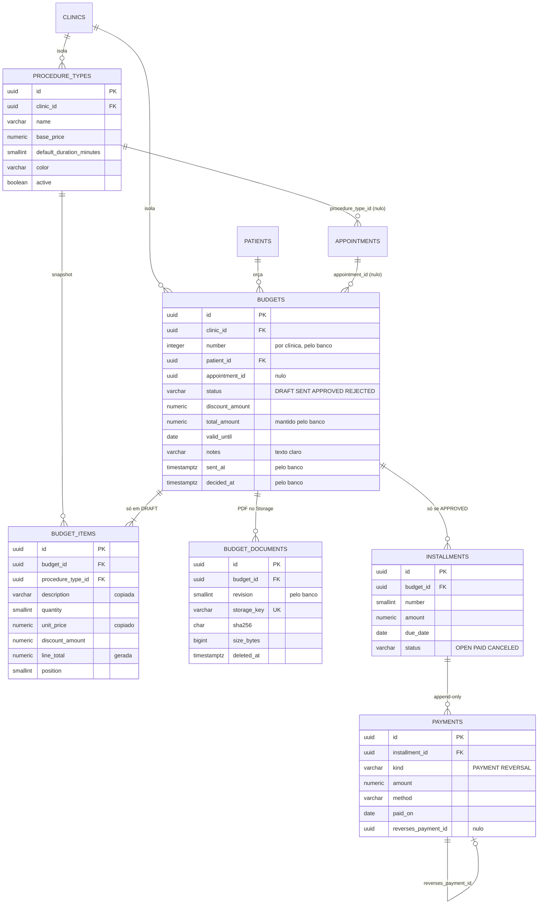

# Spec Técnica Global (Banco) — Fase 3: Comercial e Financeiro

**Base:** `docs/global/banco/Fase-3/prd.md` (decisões C1–C5, confirmadas em 2026-10-26) e as Fases 0 a 2 (`docs/global/banco/Fase-{0,1,2}/spec.md`; `database/` com V001–V021, `bootstrap/`, `rollback/`, `tests/`).
**Escopo:** tipos de procedimento, orçamento com itens e descontos, PDF do orçamento (metadados do Storage), parcelas, pagamentos com estorno, auditoria, anonimização e índices do financeiro. Schema `core`.
**Regra:** nenhum SQL é executado aqui. O DDL abaixo é **ilustrativo do contrato**; as migrations finais são do `dev-engineer-postgres`.
**Mapeamento ao modelo de spec:** as seções 1 a 6 cobrem, nesta ordem, visão técnica, modelo de dados, papéis e RLS (no lugar de "componentes": não há UI no banco), lógica central, migrations e contrato; erros, segurança/desempenho e testes vêm depois.
**Onde a spec diverge do PRD, vale a spec** (seção 11 lista cada divergência).

---

## 1. Visão técnica

- **Feature:** Banco e segurança da Fase 3 (comercial e financeiro).
- **Stack:** PostgreSQL 16 (Supabase gratuito, só como Postgres), `scripts/apply_migrations.sh` (psql), `pg_trgm` e `btree_gist` já instaladas. **Nenhuma extensão nova** (sem `pgcrypto`: nada cifrado na fase).
- **Abordagem:** 6 tabelas novas em `core` (`procedure_types`, `budgets`, `budget_items`, `budget_documents`, `installments`, `payments`) e 1 alteração aditiva (`appointments.procedure_type_id` ganha FK). A integridade do dinheiro é do **banco** (C1): triggers mantêm o total do orçamento, congelam o orçamento enviado, amarram a soma das parcelas ao total (constraint trigger adiável) e mantêm o status da parcela coerente com os pagamentos, que são append-only. O papel dentro da clínica (`app.role`) esconde parcelas e pagamentos da recepção (C2).

### 1.1 Papéis e sessão

Os quatro papéis (`crm_owner`, `crm_app`, `crm_backup`, `crm_definer`) e as três variáveis de sessão (`app.clinic_id`, `app.role`, `app.user_id`) **não mudam**. Novidades:

| Item | Mudança |
|---|---|
| `crm_app` | Grants por tabela (seção 3.1). **Sem `DELETE` em tudo, exceto `budget_items`**; sem `UPDATE` em `payments`. `EXECUTE` em duas funções auxiliares novas (`budget_items_total`, `installment_net_paid`), que rodam como o chamador e só enxergam o que a RLS deixa |
| `crm_definer` | `SELECT` e `UPDATE (notes, version)` em `budgets`; `SELECT` em `installments`; `SELECT` e `UPDATE (deleted_at)` em `budget_documents`; todos com política escopada ao tenant, para `anonymize_patient` |
| `crm_owner` | Dono das tabelas novas; sem política própria (nenhuma tabela global nova) |
| Funções `SECURITY DEFINER` | **Nenhuma nova.** Só `write_audit` e `anonymize_patient` (existentes) |

Parâmetros de sessão de `crm_app` (`statement_timeout 15s`, `search_path = core, pg_catalog`) permanecem. O backend usa `READ COMMITTED` (padrão): a numeração do orçamento depende disso (4.1).

### 1.2 Decisões desta spec (onde o PRD deixou aberto)

| # | Decisão | Justificativa |
|---|---|---|
| S1 | `UNIQUE (id, clinic_id)` em `budgets` e `installments` (além do `UNIQUE (id, patient_id, clinic_id)` de `budgets`) | Alvos das FKs compostas de `budget_items` e `payments`; uma FK só aceita como alvo um índice único **exato** nas colunas referenciadas. Na Fase 2 o índice foi evitado em `appointments` por ser tabela quente; aqui o volume é de dezenas de linhas por mês |
| S2 | Número do orçamento por **`pg_advisory_xact_lock` da clínica + `max(number) + 1`**, sem tabela de contador | Serializa a criação por clínica até o `COMMIT`, sem objeto novo. Não gera buracos (ninguém apaga orçamento); a tolerância a buracos do PRD fica como folga |
| S3 | `sent_at` e `decided_at` são **preenchidos pelo banco** (`now()`) na transição de status; valor enviado pelo cliente é ignorado | O JPA reenvia todas as colunas; relógio único; o carimbo não pode ser forjado. O backend mapeia como somente leitura e relê a linha |
| S4 | `description` e `unit_price` do item são **copiados do procedimento pelo trigger** no `INSERT` (o valor do cliente é sobrescrito) e depois imutáveis. Ajuste de preço só por `discount_amount` | Mantém o snapshot confiável e impede texto livre com nome de paciente em item (o PDF e a anonimização contam com isso) |
| S5 | `budgets.patient_id` é **sempre imutável**; `appointment_id`, `discount_amount`, `notes` e `valid_until` mudam só em `DRAFT` | Rascunho para o paciente errado se refaz; evita remarcar o dono de um orçamento com itens e (depois) parcelas |
| S6 | `DRAFT → APPROVED` e `DRAFT → REJECTED` direto são **permitidos** pelo banco | Aprovação verbal na cadeira; a ordem completa é do backend (C1). O banco só proíbe sair de estado terminal e voltar a `DRAFT` |
| S7 | O `INSERT` de orçamento não admite desconto: o total nasce `0 − desconto`, que viola `ck_budgets_total`. O desconto entra por `UPDATE` depois dos itens | Evita uma segunda constraint trigger adiável só para a ordem de gravação. O backend grava cabeçalho, itens e desconto, nessa ordem (6.3) |
| S8 | Máximo de 50 itens e de 60 parcelas por **`CHECK` de posição/número + unicidade**, sem trigger de contagem | `position BETWEEN 1 AND 50` com `UNIQUE (budget_id, position)` limita a 50 linhas; `number BETWEEN 1 AND 60` com unicidade entre as parcelas não canceladas limita a 60 ativas |
| S9 | `UNIQUE (budget_id, position)` é `DEFERRABLE INITIALLY DEFERRED` | Reordenar itens troca posições dentro de uma transação |
| S10 | Parcela `CANCELED` é permitida com **líquido pago zero** (inclusive depois de estorno), não "sem nenhum pagamento" | Permite o fluxo estorna → volta a `OPEN` → cancela (PRD, perguntas abertas) |
| S11 | O número da parcela é único **só entre as não canceladas** (índice único parcial) | Refazer o plano reaproveita 1, 2, 3… sem pular numeração |
| S12 | `budget_documents` não tem `version` nem `updated_at`; o `crm_definer` só atualiza `deleted_at` | A linha é imutável salvo `deleted_at` (só vai de nulo a instante). Corrige o `UPDATE (deleted_at, version)` do PRD |
| S13 | `revision` do PDF é atribuída pelo banco (`max + 1` sob trava do orçamento) | Sem corrida entre dois reenvios simultâneos |
| S14 | Teto de R$ 999.999,99 vale **por campo**, inclusive `line_total` e `total_amount` (por `CHECK`) | Soma de 50 linhas no teto estouraria `numeric(12,2)`; o teto também do total evita `22003` e dá erro previsível (`23514`) |
| S15 | Seis códigos novos: `CR006` a `CR011` (seção 6.1) | Cada regra monetária recebe um código estável e mapeável; `23xxx` padrão para `CHECK`, `UNIQUE` e FK |
| S16 | Triggers de guarda **devolvem `NEW` quando a linha-pai não é visível** e deixam a RLS (`42501`) ou a FK (`23503`) responder | O `WITH CHECK` do `INSERT` roda **depois** dos triggers `BEFORE`; sem isso a recepção receberia um erro de FK no lugar de `42501` |

---

## 2. Modelo de dados e schema

### 2.1 Diagrama ER



### 2.2 Convenções

As das Fases 0 a 2 (`snake_case`, plural, `uuid` com `gen_random_uuid()` de reserva, `varchar(n)` + `CHECK`, `timestamptz`, `updated_at` por trigger, `version bigint`, FKs compostas `(x_id, clinic_id)` `ON DELETE RESTRICT`, `created_by` como FK composta para `users`). Em `CHECK`, `status IN (...)` segue a convenção; em **predicados de índice e políticas**, `<>`/`OR` de igualdades (o `pg_dump` reinterpreta `varchar IN (...)`). Dinheiro: `numeric(12,2)`, `CHECK (x BETWEEN 0 AND 999999.99)`. Datas civis: `date`; instantes: `timestamptz`.

### 2.3 Dicionário de dados

#### `core.procedure_types`
| Coluna | Tipo | Nulo | Default | Regra |
|---|---|---|---|---|
| `id` | `uuid` | não | `gen_random_uuid()` | PK; imutável |
| `clinic_id` | `uuid` | não | — | FK `clinics(id)` `RESTRICT`; imutável |
| `name` | `varchar(80)` | não | — | `CHECK (char_length(btrim(name)) >= 2)` |
| `base_price` | `numeric(12,2)` | não | — | `CHECK (base_price BETWEEN 0 AND 999999.99)` |
| `default_duration_minutes` | `smallint` | não | — | `CHECK (default_duration_minutes BETWEEN 5 AND 720 AND default_duration_minutes % 5 = 0)` |
| `color` | `varchar(7)` | não | — | `CHECK (color ~ '^#[0-9A-Fa-f]{6}$')` |
| `active` | `boolean` | não | `true` | Sem `DELETE`: inativar |
| `created_by` | `uuid` | não | — | FK composta para `users`; imutável |
| `created_at` / `updated_at` / `version` | como nas fases anteriores | | | `created_at` imutável |

`UNIQUE (id, clinic_id)` (alvo das FKs compostas); índice único parcial `ux_ptype_clinic_name ON (clinic_id, lower(name)) WHERE active`.

#### `core.appointments` (alteração, V023)
`procedure_type_id` (já existe, nulo) ganha `CONSTRAINT fk_appt_procedure FOREIGN KEY (procedure_type_id, clinic_id) REFERENCES core.procedure_types (id, clinic_id) ON DELETE RESTRICT`. Com `MATCH SIMPLE`, a FK não é verificada quando `procedure_type_id` é nulo (todas as linhas atuais). Mais o índice parcial `ix_appt_procedure`.

#### `core.budgets`
| Coluna | Tipo | Nulo | Default | Regra |
|---|---|---|---|---|
| `id` | `uuid` | não | `gen_random_uuid()` | PK; imutável |
| `clinic_id` | `uuid` | não | — | FK `clinics(id)` `RESTRICT`; imutável |
| `number` | `integer` | não | pelo trigger | `CHECK (number >= 1)`; `UNIQUE (clinic_id, number)`; imutável; valor do cliente ignorado (4.1) |
| `patient_id` | `uuid` | não | — | FK composta `(patient_id, clinic_id)` → `patients`; **imutável** (S5) |
| `appointment_id` | `uuid` | sim | — | FK composta `(appointment_id, patient_id, clinic_id)` → `appointments`; muda só em `DRAFT` |
| `status` | `varchar(10)` | não | `'DRAFT'` | `CHECK (status IN ('DRAFT','SENT','APPROVED','REJECTED'))`; nasce `DRAFT` |
| `discount_amount` | `numeric(12,2)` | não | `0` | `CHECK (BETWEEN 0 AND 999999.99)`; muda só em `DRAFT` |
| `total_amount` | `numeric(12,2)` | não | pelo trigger | `ck_budgets_total`: `BETWEEN 0 AND 999999.99`; **calculado pelo banco** (4.2) |
| `valid_until` | `date` | sim | — | Informativo; `CHECK (valid_until >= DATE '2000-01-01')`; muda só em `DRAFT` |
| `notes` | `varchar(500)` | sim | — | `CHECK (notes IS NULL OR char_length(btrim(notes)) >= 1)`; **texto claro**, vai no PDF; muda só em `DRAFT` (e vira `NULL` na anonimização) |
| `sent_at` / `decided_at` | `timestamptz` | sim | — | Pelo banco (S3); `ck_budgets_stamps` |
| `created_by` | `uuid` | não | — | FK composta para `users`; imutável |
| `created_at` / `updated_at` / `version` | como nas fases anteriores | | | |

`ck_budgets_stamps`: `(status = 'DRAFT' AND sent_at IS NULL AND decided_at IS NULL) OR (status = 'SENT' AND sent_at IS NOT NULL AND decided_at IS NULL) OR ((status = 'APPROVED' OR status = 'REJECTED') AND decided_at IS NOT NULL AND (sent_at IS NULL OR sent_at <= decided_at))`.
`UNIQUE (clinic_id, number)`, `UNIQUE (id, clinic_id)` e `UNIQUE (id, patient_id, clinic_id)` (S1).

#### `core.budget_items`
| Coluna | Tipo | Nulo | Default | Regra |
|---|---|---|---|---|
| `id` | `uuid` | não | `gen_random_uuid()` | PK; imutável |
| `clinic_id` | `uuid` | não | — | FK `clinics(id)` `RESTRICT`; imutável |
| `budget_id` | `uuid` | não | — | FK composta `(budget_id, clinic_id)` → `budgets (id, clinic_id)` `RESTRICT`; imutável |
| `procedure_type_id` | `uuid` | não | — | FK composta `(procedure_type_id, clinic_id)` → `procedure_types` `RESTRICT`; imutável |
| `description` | `varchar(120)` | não | pelo trigger | Copiada de `procedure_types.name` no `INSERT` (S4); imutável |
| `quantity` | `smallint` | não | `1` | `CHECK (quantity BETWEEN 1 AND 999)` |
| `unit_price` | `numeric(12,2)` | não | pelo trigger | Copiado de `procedure_types.base_price` no `INSERT` (S4); imutável |
| `discount_amount` | `numeric(12,2)` | não | `0` | `CHECK (BETWEEN 0 AND 999999.99)` |
| `line_total` | `numeric(12,2)` | não | gerada | `GENERATED ALWAYS AS (quantity * unit_price - discount_amount) STORED`; `CHECK (line_total BETWEEN 0 AND 999999.99)` |
| `position` | `smallint` | não | — | `CHECK (position BETWEEN 1 AND 50)`; `UNIQUE (budget_id, position) DEFERRABLE INITIALLY DEFERRED` (S8, S9) |
| `created_at` / `updated_at` / `version` | como nas fases anteriores | | | |

Sem `created_by` (a autoria é do cabeçalho). Sem auditoria (PRD US-307).

#### `core.budget_documents`
| Coluna | Tipo | Nulo | Default | Regra |
|---|---|---|---|---|
| `id` | `uuid` | não | `gen_random_uuid()` | PK; imutável |
| `clinic_id` | `uuid` | não | — | FK `clinics(id)` `RESTRICT`; imutável |
| `budget_id` | `uuid` | não | — | FK composta `(budget_id, patient_id, clinic_id)` → `budgets (id, patient_id, clinic_id)` `RESTRICT`; imutável |
| `patient_id` | `uuid` | não | — | Imutável |
| `revision` | `smallint` | não | pelo trigger | `CHECK (revision >= 1)`; `UNIQUE (budget_id, revision)`; S13 |
| `storage_key` | `varchar(120)` | não | — | Único; `CHECK (storage_key ~ ('^' \|\| clinic_id::text \|\| '/' \|\| patient_id::text \|\| '/budgets/[0-9a-f-]{36}$'))`; imutável |
| `content_type` | `varchar(20)` | não | — | `CHECK (content_type = 'application/pdf')`; imutável |
| `size_bytes` | `bigint` | não | — | `CHECK (size_bytes BETWEEN 1 AND 5242880)`; imutável |
| `sha256` | `varchar(64)` | não | — | `CHECK (sha256 ~ '^[0-9a-f]{64}$')`; imutável |
| `generated_at` | `timestamptz` | não | `now()` | Imutável |
| `deleted_at` | `timestamptz` | sim | — | **Única coluna mutável**; vai de nulo a um instante, sem volta |
| `created_by` / `created_at` | | não | | Imutáveis |

#### `core.installments`
| Coluna | Tipo | Nulo | Default | Regra |
|---|---|---|---|---|
| `id` | `uuid` | não | `gen_random_uuid()` | PK; imutável |
| `clinic_id` | `uuid` | não | — | FK `clinics(id)` `RESTRICT`; imutável |
| `budget_id` / `patient_id` | `uuid` | não | — | FK composta `(budget_id, patient_id, clinic_id)` → `budgets (id, patient_id, clinic_id)` `RESTRICT`; imutáveis |
| `number` | `smallint` | não | — | `CHECK (number BETWEEN 1 AND 60)`; imutável |
| `amount` | `numeric(12,2)` | não | — | `CHECK (amount BETWEEN 0.01 AND 999999.99)`; imutável |
| `due_date` | `date` | não | — | `CHECK (due_date >= DATE '2000-01-01')`; muda só enquanto `OPEN` |
| `status` | `varchar(10)` | não | `'OPEN'` | `CHECK (status IN ('OPEN','PAID','CANCELED'))`; nasce `OPEN`; coerente com os pagamentos (4.5) |
| `created_by` / `created_at` / `updated_at` / `version` | como nas fases anteriores | | | |

`UNIQUE (id, clinic_id)` (S1); índice único parcial `ux_inst_budget_number ON (budget_id, number) WHERE status <> 'CANCELED'` (S11).

#### `core.payments` (append-only)
| Coluna | Tipo | Nulo | Default | Regra |
|---|---|---|---|---|
| `id` | `uuid` | não | `gen_random_uuid()` | PK |
| `clinic_id` | `uuid` | não | — | FK `clinics(id)` `RESTRICT` |
| `installment_id` | `uuid` | não | — | FK composta `(installment_id, clinic_id)` → `installments (id, clinic_id)` `RESTRICT` |
| `kind` | `varchar(10)` | não | — | `CHECK (kind IN ('PAYMENT','REVERSAL'))` |
| `amount` | `numeric(12,2)` | não | — | `CHECK (amount BETWEEN 0.01 AND 999999.99)` |
| `method` | `varchar(15)` | não | — | `CHECK (method IN ('CASH','PIX','DEBIT_CARD','CREDIT_CARD','BANK_TRANSFER','OTHER'))` |
| `paid_on` | `date` | não | — | `CHECK (paid_on >= DATE '2000-01-01')`; "hoje" é do backend (fuso da clínica) |
| `reverses_payment_id` | `uuid` | sim | — | `ck_pay_reversal`: `(kind = 'PAYMENT' AND reverses_payment_id IS NULL) OR (kind = 'REVERSAL' AND reverses_payment_id IS NOT NULL)`; FK composta `(reverses_payment_id, installment_id, clinic_id)` → `payments (id, installment_id, clinic_id)` `RESTRICT` (mesma parcela); `UNIQUE (reverses_payment_id)` (um estorno por pagamento) |
| `created_by` / `created_at` | | não | | FK composta para `users`; sem `updated_at` e sem `version` |

`UNIQUE (id, installment_id, clinic_id)` (alvo da FK do estorno). Sem texto livre.

#### `core.audit_log` (alteração, V028)
`ck_audit_table` passa a aceitar `'budgets'`, `'installments'`, `'payments'` e `'budget_documents'` (constraint recriada; os triggers de linha do `audit_log` não disparam em `ADD CONSTRAINT`). `varchar(30)` comporta `budget_documents` (16).

### 2.4 Índices

| Índice | Tabela | Definição | Atende |
|---|---|---|---|
| `ux_ptype_clinic_name` | `procedure_types` | `(clinic_id, lower(name)) WHERE active` único | Unicidade do nome ativo e lista da clínica |
| `ux_ptype_id_clinic` | `procedure_types` | `(id, clinic_id)` único | Alvo das FKs |
| `ix_appt_procedure` | `appointments` | `(clinic_id, procedure_type_id) WHERE procedure_type_id IS NOT NULL` | FK e "agendamentos do procedimento" |
| `ux_budgets_clinic_number` | `budgets` | `(clinic_id, number)` único | Numeração (`max`) e busca por número |
| `ux_budgets_id_clinic` / `ux_budgets_id_patient_clinic` | `budgets` | `(id, clinic_id)` / `(id, patient_id, clinic_id)` únicos | Alvos das FKs (S1) |
| `ix_budgets_patient` | `budgets` | `(clinic_id, patient_id, created_at DESC, id DESC)` | Orçamentos do paciente (keyset) e FK do paciente |
| `ix_budgets_status` | `budgets` | `(clinic_id, status, created_at DESC, id DESC)` | Lista por status |
| `ix_budgets_decided` | `budgets` | `(clinic_id, decided_at, id) WHERE status = 'APPROVED'` | Faturamento por período |
| `ix_budgets_appointment` | `budgets` | `(clinic_id, appointment_id) WHERE appointment_id IS NOT NULL` | FK do atendimento |
| `ux_items_budget_position` | `budget_items` | `(budget_id, position)` único adiável | Itens do orçamento em ordem e FK |
| `ix_items_procedure` | `budget_items` | `(clinic_id, procedure_type_id)` | FK do procedimento |
| `ux_bdoc_budget_revision` | `budget_documents` | `(budget_id, revision)` único | Revisões e FK |
| `ux_bdoc_storage_key` | `budget_documents` | `(storage_key)` único | Unicidade do objeto |
| `ix_bdoc_budget_active` | `budget_documents` | `(budget_id, revision DESC) WHERE deleted_at IS NULL` | PDF ativo (maior revisão) |
| `ix_bdoc_patient` | `budget_documents` | `(clinic_id, patient_id)` | Anonimização e FK |
| `ux_inst_id_clinic` | `installments` | `(id, clinic_id)` único | Alvo da FK de `payments` |
| `ux_inst_budget_number` | `installments` | `(budget_id, number) WHERE status <> 'CANCELED'` único | Unicidade entre as ativas (S11) |
| `ix_inst_budget` | `installments` | `(budget_id, number, id)` | Parcelas do orçamento (todas) e FK |
| `ix_inst_patient` | `installments` | `(clinic_id, patient_id, due_date, id)` | Ficha financeira do paciente e `CR006` |
| `ix_inst_open_due` | `installments` | `(clinic_id, due_date, id) WHERE status = 'OPEN'` | Contas a receber e inadimplência |
| `ux_pay_id_inst_clinic` | `payments` | `(id, installment_id, clinic_id)` único | Alvo da FK do estorno |
| `ux_pay_reverses` | `payments` | `(reverses_payment_id)` único | Um estorno por pagamento e FK |
| `ix_pay_installment` | `payments` | `(clinic_id, installment_id)` | Saldo da parcela e FK |
| `ix_pay_clinic_paid` | `payments` | `(clinic_id, paid_on, id)` | Entradas do mês e fluxo de caixa |

Exceção consciente (como nas Fases 1 e 2): `created_by` fica **sem índice** (`users` nunca é apagado); a migration registra a decisão. Volume esperado de um dentista solo: dezenas de orçamentos e algumas centenas de pagamentos por ano; a meta de teste (5 mil parcelas e 5 mil pagamentos por clínica) é um extremo. Sem particionamento.

### 2.5 DDL ilustrativo (contrato)

```sql
-- V022: tipos de procedimento
CREATE TABLE core.procedure_types (
  id uuid PRIMARY KEY DEFAULT gen_random_uuid(),
  clinic_id uuid NOT NULL REFERENCES core.clinics (id) ON DELETE RESTRICT,
  name varchar(80) NOT NULL CONSTRAINT ck_ptype_name CHECK (char_length(btrim(name)) >= 2),
  base_price numeric(12,2) NOT NULL CONSTRAINT ck_ptype_price CHECK (base_price BETWEEN 0 AND 999999.99),
  default_duration_minutes smallint NOT NULL
    CONSTRAINT ck_ptype_duration CHECK (default_duration_minutes BETWEEN 5 AND 720 AND default_duration_minutes % 5 = 0),
  color varchar(7) NOT NULL CONSTRAINT ck_ptype_color CHECK (color ~ '^#[0-9A-Fa-f]{6}$'),
  active boolean NOT NULL DEFAULT true,
  created_by uuid NOT NULL,
  -- created_at, updated_at, version ...
  CONSTRAINT fk_ptype_created_by FOREIGN KEY (created_by, clinic_id) REFERENCES core.users (id, clinic_id) ON DELETE RESTRICT,
  CONSTRAINT ux_ptype_id_clinic UNIQUE (id, clinic_id)
);
CREATE UNIQUE INDEX ux_ptype_clinic_name ON core.procedure_types (clinic_id, lower(name)) WHERE active;

-- V023: FK do procedimento no agendamento (aditiva, sem reescrever linhas)
ALTER TABLE core.appointments ADD CONSTRAINT fk_appt_procedure
  FOREIGN KEY (procedure_type_id, clinic_id) REFERENCES core.procedure_types (id, clinic_id) ON DELETE RESTRICT;
CREATE INDEX ix_appt_procedure ON core.appointments (clinic_id, procedure_type_id) WHERE procedure_type_id IS NOT NULL;

-- V024: orçamento
CREATE TABLE core.budgets (
  id uuid PRIMARY KEY DEFAULT gen_random_uuid(),
  clinic_id uuid NOT NULL REFERENCES core.clinics (id) ON DELETE RESTRICT,
  number integer NOT NULL CONSTRAINT ck_budgets_number CHECK (number >= 1),   -- preenchido por trigger
  patient_id uuid NOT NULL,
  appointment_id uuid,
  status varchar(10) NOT NULL DEFAULT 'DRAFT'
    CONSTRAINT ck_budgets_status CHECK (status IN ('DRAFT','SENT','APPROVED','REJECTED')),
  discount_amount numeric(12,2) NOT NULL DEFAULT 0 CONSTRAINT ck_budgets_discount CHECK (discount_amount BETWEEN 0 AND 999999.99),
  total_amount numeric(12,2) NOT NULL DEFAULT 0 CONSTRAINT ck_budgets_total CHECK (total_amount BETWEEN 0 AND 999999.99),
  valid_until date CONSTRAINT ck_budgets_valid CHECK (valid_until >= DATE '2000-01-01'),
  notes varchar(500) CONSTRAINT ck_budgets_notes CHECK (notes IS NULL OR char_length(btrim(notes)) >= 1),
  sent_at timestamptz, decided_at timestamptz,
  created_by uuid NOT NULL,
  -- created_at, updated_at, version ...
  CONSTRAINT ck_budgets_stamps CHECK (
       (status = 'DRAFT'    AND sent_at IS NULL     AND decided_at IS NULL)
    OR (status = 'SENT'     AND sent_at IS NOT NULL AND decided_at IS NULL)
    OR ((status = 'APPROVED' OR status = 'REJECTED') AND decided_at IS NOT NULL
        AND (sent_at IS NULL OR sent_at <= decided_at))),
  CONSTRAINT fk_budgets_patient FOREIGN KEY (patient_id, clinic_id) REFERENCES core.patients (id, clinic_id) ON DELETE RESTRICT,
  CONSTRAINT fk_budgets_appointment FOREIGN KEY (appointment_id, patient_id, clinic_id)
    REFERENCES core.appointments (id, patient_id, clinic_id) ON DELETE RESTRICT,
  CONSTRAINT fk_budgets_created_by FOREIGN KEY (created_by, clinic_id) REFERENCES core.users (id, clinic_id) ON DELETE RESTRICT,
  CONSTRAINT ux_budgets_clinic_number UNIQUE (clinic_id, number),
  CONSTRAINT ux_budgets_id_clinic UNIQUE (id, clinic_id),
  CONSTRAINT ux_budgets_id_patient_clinic UNIQUE (id, patient_id, clinic_id)
);

CREATE TABLE core.budget_items (
  id uuid PRIMARY KEY DEFAULT gen_random_uuid(),
  clinic_id uuid NOT NULL REFERENCES core.clinics (id) ON DELETE RESTRICT,
  budget_id uuid NOT NULL,
  procedure_type_id uuid NOT NULL,
  description varchar(120) NOT NULL,            -- trigger copia de procedure_types.name
  quantity smallint NOT NULL DEFAULT 1 CONSTRAINT ck_items_qty CHECK (quantity BETWEEN 1 AND 999),
  unit_price numeric(12,2) NOT NULL CONSTRAINT ck_items_price CHECK (unit_price BETWEEN 0 AND 999999.99),
  discount_amount numeric(12,2) NOT NULL DEFAULT 0 CONSTRAINT ck_items_discount CHECK (discount_amount BETWEEN 0 AND 999999.99),
  line_total numeric(12,2) GENERATED ALWAYS AS (quantity * unit_price - discount_amount) STORED
    CONSTRAINT ck_items_line CHECK (line_total BETWEEN 0 AND 999999.99),
  position smallint NOT NULL CONSTRAINT ck_items_position CHECK (position BETWEEN 1 AND 50),
  -- created_at, updated_at, version ...
  CONSTRAINT fk_items_budget FOREIGN KEY (budget_id, clinic_id) REFERENCES core.budgets (id, clinic_id) ON DELETE RESTRICT,
  CONSTRAINT fk_items_procedure FOREIGN KEY (procedure_type_id, clinic_id) REFERENCES core.procedure_types (id, clinic_id) ON DELETE RESTRICT,
  CONSTRAINT ux_items_budget_position UNIQUE (budget_id, position) DEFERRABLE INITIALLY DEFERRED
);

-- V026: parcelas
CREATE TABLE core.installments (
  id uuid PRIMARY KEY DEFAULT gen_random_uuid(),
  clinic_id uuid NOT NULL REFERENCES core.clinics (id) ON DELETE RESTRICT,
  budget_id uuid NOT NULL, patient_id uuid NOT NULL,
  number smallint NOT NULL CONSTRAINT ck_inst_number CHECK (number BETWEEN 1 AND 60),
  amount numeric(12,2) NOT NULL CONSTRAINT ck_inst_amount CHECK (amount BETWEEN 0.01 AND 999999.99),
  due_date date NOT NULL CONSTRAINT ck_inst_due CHECK (due_date >= DATE '2000-01-01'),
  status varchar(10) NOT NULL DEFAULT 'OPEN' CONSTRAINT ck_inst_status CHECK (status IN ('OPEN','PAID','CANCELED')),
  created_by uuid NOT NULL,
  -- created_at, updated_at, version ...
  CONSTRAINT fk_inst_budget FOREIGN KEY (budget_id, patient_id, clinic_id)
    REFERENCES core.budgets (id, patient_id, clinic_id) ON DELETE RESTRICT,
  CONSTRAINT ux_inst_id_clinic UNIQUE (id, clinic_id)
);
CREATE UNIQUE INDEX ux_inst_budget_number ON core.installments (budget_id, number) WHERE status <> 'CANCELED';

-- V027: pagamentos
CREATE TABLE core.payments (
  id uuid PRIMARY KEY DEFAULT gen_random_uuid(),
  clinic_id uuid NOT NULL REFERENCES core.clinics (id) ON DELETE RESTRICT,
  installment_id uuid NOT NULL,
  kind varchar(10) NOT NULL CONSTRAINT ck_pay_kind CHECK (kind IN ('PAYMENT','REVERSAL')),
  amount numeric(12,2) NOT NULL CONSTRAINT ck_pay_amount CHECK (amount BETWEEN 0.01 AND 999999.99),
  method varchar(15) NOT NULL CONSTRAINT ck_pay_method
    CHECK (method IN ('CASH','PIX','DEBIT_CARD','CREDIT_CARD','BANK_TRANSFER','OTHER')),
  paid_on date NOT NULL CONSTRAINT ck_pay_date CHECK (paid_on >= DATE '2000-01-01'),
  reverses_payment_id uuid,
  created_by uuid NOT NULL,
  created_at timestamptz NOT NULL DEFAULT now(),
  CONSTRAINT ck_pay_reversal CHECK ((kind = 'PAYMENT' AND reverses_payment_id IS NULL)
                                 OR (kind = 'REVERSAL' AND reverses_payment_id IS NOT NULL)),
  CONSTRAINT fk_pay_installment FOREIGN KEY (installment_id, clinic_id)
    REFERENCES core.installments (id, clinic_id) ON DELETE RESTRICT,
  CONSTRAINT fk_pay_reverses FOREIGN KEY (reverses_payment_id, installment_id, clinic_id)
    REFERENCES core.payments (id, installment_id, clinic_id) ON DELETE RESTRICT,
  CONSTRAINT ux_pay_id_inst_clinic UNIQUE (id, installment_id, clinic_id),
  CONSTRAINT ux_pay_reverses UNIQUE (reverses_payment_id)
);
```

### 2.6 Triggers

| Trigger | Tabela | Evento | Efeito |
|---|---|---|---|
| `trg_*_set_updated_at` | `procedure_types`, `budgets`, `budget_items`, `installments` | `BEFORE UPDATE` | `core.set_updated_at()` (V002) |
| `trg_*_forbid_immutable` | `procedure_types` (`id`, `clinic_id`, `created_by`, `created_at`); `budgets` (`id`, `clinic_id`, `number`, `patient_id`, `created_by`, `created_at`); `budget_items` (`id`, `clinic_id`, `budget_id`, `procedure_type_id`, `description`, `unit_price`, `created_at`); `budget_documents` (todas menos `deleted_at`); `installments` (`id`, `clinic_id`, `budget_id`, `patient_id`, `number`, `amount`, `created_by`, `created_at`) | `BEFORE UPDATE` | `core.forbid_immutable_columns(...)` (V002): `23514` |
| `trg_budgets_before_insert` | `budgets` | `BEFORE INSERT` | `core.budgets_before_insert()` (4.1, 4.2, 4.4) |
| `trg_budgets_guard_update` | `budgets` | `BEFORE UPDATE` | `core.guard_budget_update()` (4.2, 4.3) |
| `trg_items_guard` | `budget_items` | `BEFORE INSERT OR UPDATE OR DELETE` | `core.guard_budget_item()` (4.2) |
| `trg_items_refresh_total` | `budget_items` | `AFTER INSERT OR UPDATE OR DELETE` | `core.refresh_budget_total()` (4.2) |
| `trg_bdoc_before_insert` | `budget_documents` | `BEFORE INSERT` | `core.budget_documents_before_insert()` (4.6) |
| `trg_bdoc_guard_update` | `budget_documents` | `BEFORE UPDATE` | `core.guard_budget_document_update()` (4.6) |
| `trg_inst_guard` | `installments` | `BEFORE INSERT OR UPDATE` | `core.guard_installment()` (4.5) |
| `ctrg_inst_sum_matches_total` | `installments` | `AFTER INSERT OR UPDATE OF amount, status` — **`CONSTRAINT TRIGGER ... DEFERRABLE INITIALLY DEFERRED`**, `FOR EACH ROW` | `core.check_installments_sum()` (4.5) |
| `trg_pay_guard` | `payments` | `BEFORE INSERT` | `core.guard_payment()` (4.5) |
| `trg_pay_sync_status` | `payments` | `AFTER INSERT` | `core.sync_installment_status()` (4.5) |
| `trg_pay_append_only` | `payments` | `BEFORE UPDATE OR DELETE` e `BEFORE TRUNCATE` (comando) | `core.payments_append_only()`: `42501`, padrão do `audit_log` (V012) |
| `trg_budgets_audit`, `trg_inst_audit`, `trg_pay_audit`, `trg_bdoc_audit` | `budgets`, `installments`, `payments`, `budget_documents` | `AFTER INSERT OR UPDATE OR DELETE`, `FOR EACH ROW` | `core.write_audit()` (V012, **sem alteração**) |

Funções de trigger com `SET search_path = pg_catalog, pg_temp`, `SECURITY INVOKER`, `REVOKE EXECUTE ... FROM PUBLIC`. Triggers do mesmo evento disparam em ordem alfabética do nome; as funções acima não dependem da ordem entre si, salvo o que a seção 4 indica. `procedure_types` e `budget_items` **não** são auditadas.

---

## 3. Papéis, GRANTs e RLS

### 3.1 Matriz de privilégios

| Objeto | `crm_app` | `crm_definer` | `crm_backup` | `crm_owner` |
|---|---|---|---|---|
| `procedure_types` | `SELECT`, `INSERT`, `UPDATE` | — | `SELECT` | dono |
| `budgets` | `SELECT`, `INSERT`, `UPDATE` | `SELECT`; `UPDATE (notes, version)` | `SELECT` | dono |
| `budget_items` | `SELECT`, `INSERT`, `UPDATE`, **`DELETE`** | — | `SELECT` | dono |
| `budget_documents` | `SELECT`, `INSERT`, `UPDATE (deleted_at)` | `SELECT`; `UPDATE (deleted_at)` | `SELECT` | dono |
| `installments` | `SELECT`, `INSERT`, `UPDATE` | `SELECT` | `SELECT` | dono |
| `payments` | **`SELECT`, `INSERT`** | — | `SELECT` | dono |
| `appointments` | sem mudança | sem mudança | sem mudança | — |
| `core.budget_items_total(uuid)`, `core.installment_net_paid(uuid)` | `EXECUTE` | — | — | — |

Nenhum `GRANT ALL`; nenhum `TRUNCATE`; `DELETE` só em `budget_items` (rascunho, seção 4.2); `payments` sem `UPDATE`/`DELETE` nem para `crm_app`. `ALTER DEFAULT PRIVILEGES` da Fase 0 mantém objetos novos sem acesso. As demais funções novas não recebem `EXECUTE` (o privilégio é checado só ao criar o trigger, pelo `crm_owner`).

### 3.2 Políticas RLS

Todas as tabelas: `ENABLE` + `FORCE`. Notação das fases anteriores: `T` = `clinic_id = core.current_clinic_id()`; `D` = `(SELECT core.current_app_role()) = 'DENTIST_ADMIN'`; `R` = `... = 'RECEPTIONIST'`; `A` = `D OR R`; `U` = `created_by = core.current_user_id()`.

| Tabela | Operação | Papel | Condição |
|---|---|---|---|
| `procedure_types` | SELECT | `crm_app` | `T AND A` |
| `procedure_types` | INSERT | `crm_app` | `WITH CHECK (T AND D AND U)` |
| `procedure_types` | UPDATE | `crm_app` | `USING (T AND D)` `WITH CHECK (T AND D)` |
| `budgets` | SELECT | `crm_app` | `T AND A` |
| `budgets` | INSERT | `crm_app` | `WITH CHECK (T AND D AND U)` |
| `budgets` | UPDATE | `crm_app` | `USING (T AND D)` `WITH CHECK (T AND D)` |
| `budget_items` | SELECT | `crm_app` | `T AND A` |
| `budget_items` | INSERT / UPDATE / DELETE | `crm_app` | `T AND D` (`WITH CHECK` no `INSERT`/`UPDATE`); a exigência de **orçamento em `DRAFT`** é do trigger `trg_items_guard` (`CR007`) |
| `budget_documents` | SELECT | `crm_app` | `T AND A` |
| `budget_documents` | INSERT | `crm_app` | `WITH CHECK (T AND D AND U)` |
| `budget_documents` | UPDATE | `crm_app` | `USING (T AND D)` `WITH CHECK (T AND D)` |
| `installments` | SELECT | `crm_app` | `T AND D` |
| `installments` | INSERT | `crm_app` | `WITH CHECK (T AND D AND U)` |
| `installments` | UPDATE | `crm_app` | `USING (T AND D)` `WITH CHECK (T AND D)` |
| `payments` | SELECT | `crm_app` | `T AND D` |
| `payments` | INSERT | `crm_app` | `WITH CHECK (T AND D AND U)` |
| `budgets`, `installments`, `budget_documents` | SELECT / UPDATE | `crm_definer` | `T` (`SELECT`; `UPDATE` só nas colunas do grant) |
| as 6 tabelas | SELECT | `crm_backup` | `USING (true)` |
| `budgets`, `installments`, `budget_documents`, `payments`, `procedure_types` | DELETE | — | sem política (negado) |
| `payments` | UPDATE | — | sem política e sem grant (negado) |

**Efeitos:**
- A recepção lê procedimentos, orçamentos, itens e metadados de PDF; em `installments` e `payments` enxerga 0 linhas (não há política `R`) e não grava em nada da fase.
- Com `app.clinic_id`, `app.role` ou `app.user_id` ausente ou inválido, tudo é negado (falha fechada). Não há tabela global nova, então não há exceção de leitura sem sessão.
- `created_by = app.user_id` no `INSERT` de todas as tabelas com autoria.
- Junto da RLS, o trigger `trg_pay_append_only` nega `UPDATE`/`DELETE`/`TRUNCATE` em `payments` também ao `crm_owner` (nenhum papel altera o histórico por SQL comum).

### 3.3 Endurecimento padrão

Sem mudanças nos `REVOKE` da Fase 0. Cada migration nova: `REVOKE EXECUTE ... FROM PUBLIC` em funções, `GRANT` explícito e mínimo, `search_path` fixo, sem SQL dinâmico. As duas funções auxiliares são `SECURITY INVOKER` e `STABLE`: com `EXECUTE` concedido ao `crm_app` elas só devolvem o que a RLS do chamador permite.

---

## 4. Funções e lógica central

Regra geral dos guards (S16): quando a linha-pai que o trigger precisa ler/travar **não aparece** (outra clínica, papel sem acesso, inexistente), a função faz `RETURN NEW` e deixa a RLS (`42501`) ou a FK (`23503`) responder.

### 4.1 Número do orçamento

Dentro de `core.budgets_before_insert()` (`BEFORE INSERT`):
1. `PERFORM pg_advisory_xact_lock(hashtextextended('budgets:' || NEW.clinic_id::text, 0))` — serializa os orçamentos da clínica até o `COMMIT`.
2. `NEW.number := COALESCE((SELECT max(number) FROM core.budgets WHERE clinic_id = NEW.clinic_id), 0) + 1` — sempre sobrescreve o valor do cliente. O `SELECT` roda depois da espera pelo lock e, em `READ COMMITTED`, enxerga o orçamento confirmado pela transação anterior. O índice `ux_budgets_clinic_number` responde o `max` por varredura de índice.
3. Colisão de hash entre clínicas só causa espera desnecessária, nunca número repetido (`UNIQUE (clinic_id, number)` é a rede).

Limite: sob `REPEATABLE READ` ou `SERIALIZABLE` o `max` leria um snapshot antigo e a segunda transação falharia com `23505`. O contrato fixa `READ COMMITTED`.

### 4.2 Total, itens e congelamento do orçamento

**Função auxiliar** `core.budget_items_total(p_budget uuid) RETURNS numeric` (`STABLE`, invoker): `SELECT COALESCE(sum(line_total), 0) FROM core.budget_items WHERE budget_id = p_budget`.

**`core.guard_budget_item()`** (`BEFORE INSERT OR UPDATE OR DELETE` em `budget_items`):
1. `SELECT status FROM core.budgets WHERE id = <budget_id> AND clinic_id = <clinic_id> FOR NO KEY UPDATE`. Sem linha: `RETURN` (S16). O lock **serializa** a edição de itens com a mudança de status do orçamento (corrida item × envio, teste 99) e com outros itens do mesmo orçamento.
2. `status <> 'DRAFT'` → `CR007` ("orçamento congelado").
3. Só no `INSERT`: `SELECT name, base_price FROM core.procedure_types WHERE id = NEW.procedure_type_id AND clinic_id = NEW.clinic_id`. Sem linha: `23503` (foreign_key_violation) explícito. Com linha: `NEW.description := name; NEW.unit_price := base_price` (S4).
4. `RETURN NEW` (ou `OLD` no `DELETE`).

**`core.refresh_budget_total()`** (`AFTER INSERT OR UPDATE OR DELETE` em `budget_items`, por linha): `UPDATE core.budgets SET total_amount = core.budget_items_total(id) - discount_amount WHERE id = <budget_id> AND clinic_id = <clinic_id>`. O `UPDATE` dispara `guard_budget_update` (que recalcula o mesmo valor), `updated_at` e a auditoria do orçamento; **não** altera `version`. Se o total ficar negativo ou acima do teto, `ck_budgets_total` falha com `23514` e a operação do item reverte.

**`core.budgets_before_insert()`** (também): `status <> 'DRAFT'` → `CR008`; guarda do paciente (4.4); número (4.1); `NEW.total_amount := 0 - NEW.discount_amount` (ignora o valor do cliente; com desconto > 0 viola `ck_budgets_total`: S7); `sent_at` e `decided_at` forçados a `NULL`.

**`core.guard_budget_update()`** (`BEFORE UPDATE`) — tabela de decisão:

| Estado antigo | Regra |
|---|---|
| `DRAFT` | `NEW.total_amount := core.budget_items_total(OLD.id) - NEW.discount_amount` (sempre). Se `NEW.status` mudar para `SENT` ou `APPROVED`: exige ao menos 1 item e `total_amount > 0`, senão `CR008`. `NEW.status = 'SENT'` → `NEW.sent_at := now()`; `APPROVED`/`REJECTED` → `NEW.decided_at := now()`; permanecendo `DRAFT`, os dois carimbos ficam `NULL` (S3) |
| `SENT` | `NEW.status` só `SENT`, `APPROVED` ou `REJECTED` (senão `CR008`). Colunas de conteúdo (`discount_amount`, `total_amount`, `appointment_id`, `valid_until`, `notes`, `sent_at`) iguais às antigas, senão `CR007`. Ao decidir: `NEW.decided_at := now()` |
| `APPROVED` ou `REJECTED` | `NEW.status = OLD.status`, senão `CR008`. Conteúdo e `decided_at` iguais, senão `CR007` |

**Exceção da anonimização:** com `current_setting('core.anonymizing', true) = 'on'` (flag local da função, padrão da V013), `notes` pode passar a `NULL` em qualquer estado; nenhuma outra coluna de conteúdo muda. `updated_at`, `version` e `status`→`status` não contam como mudança de conteúdo.

### 4.3 Status do orçamento (referência; o banco impõe só a coluna "Banco")

| De | Para | Banco | Backend |
|---|---|---|---|
| `DRAFT` | `SENT` | exige itens e total > 0; carimbo `sent_at` | gera o PDF e grava `budget_documents` na mesma transação (6.3) |
| `DRAFT` | `APPROVED`, `REJECTED` | permitido (S6); `APPROVED` exige itens e total > 0 | decide se aceita a aprovação sem envio |
| `SENT` | `APPROVED`, `REJECTED` | permitido; carimbo `decided_at` | regra de negócio da decisão |
| `SENT`, `APPROVED`, `REJECTED` | `DRAFT` | **nega** (`CR008`) | — |
| `APPROVED`, `REJECTED` | qualquer outro | **nega** (`CR008`) | — |

Descartar um rascunho é `DRAFT → REJECTED` (não há `DELETE`).

### 4.4 Guarda do paciente no orçamento

Dentro de `core.budgets_before_insert()`: `SELECT p.active, p.anonymized_at FROM core.patients p WHERE p.id = NEW.patient_id AND p.clinic_id = NEW.clinic_id FOR KEY SHARE` (mesmo padrão da V013/V015: se uma anonimização está em curso, o `INSERT` espera e relê o paciente já anonimizado). Sem linha: segue (a FK responde `23503`). `anonymized_at IS NOT NULL` → `CR003`; `active = false` → `CR005`. Só no `INSERT`: orçamento já existente de quem for inativado continua editável e decidível; parcelas e pagamentos de paciente inativo seguem permitidos.

### 4.5 Parcelas e pagamentos

**Função auxiliar** `core.installment_net_paid(p_installment uuid) RETURNS numeric` (`STABLE`, invoker): `SELECT COALESCE(sum(CASE kind WHEN 'PAYMENT' THEN amount ELSE -amount END), 0) FROM core.payments WHERE installment_id = p_installment`.

**`core.guard_installment()`** (`BEFORE INSERT OR UPDATE` em `installments`):
- `INSERT`: `SELECT status FROM core.budgets WHERE id = NEW.budget_id AND clinic_id = NEW.clinic_id FOR KEY SHARE` (sem linha: `RETURN NEW`, S16). `status <> 'APPROVED'` → `CR009`. `NEW.status <> 'OPEN'` → `CR009`. Paciente anonimizado (`SELECT ... FOR KEY SHARE`, como em 4.4) → `CR003`.
- `UPDATE` com `NEW.status IS DISTINCT FROM OLD.status` (curto-circuito quando o status não muda: o JPA reenvia todas as colunas):
  - `OLD.status = 'CANCELED'` → `CR009` (terminal).
  - `NEW.status = 'CANCELED'`: exige `OLD.status = 'OPEN'` **e** `core.installment_net_paid(OLD.id) = 0` (S10), senão `CR009`.
  - `NEW.status = 'PAID'`: exige `net >= amount`; `NEW.status = 'OPEN'`: exige `net < amount`; senão `CR009`. Assim ninguém grava `PAID` sem pagamento nem deixa `OPEN` com saldo quitado, venha a escrita do trigger de pagamento ou do backend.
- `UPDATE` com `NEW.due_date IS DISTINCT FROM OLD.due_date` e `OLD.status <> 'OPEN'` → `CR009`.

**`core.check_installments_sum()`** (constraint trigger adiável, executado no `COMMIT`): para `NEW.budget_id`/`NEW.clinic_id`, calcula `count(*)` e `sum(amount)` das parcelas com `status <> 'CANCELED'` e lê `budgets.total_amount`. Se `count > 0` e `sum <> total_amount` → `CR011` ("parcelas não somam o total"). Sem parcelas ativas: passa. Cancelar uma parcela sem substituir quebra a igualdade; refazer o plano é "cancela todas as abertas + insere as novas" na **mesma transação** (o `ux_inst_budget_number` parcial permite reaproveitar os números). Roda como o chamador e com as variáveis de sessão ainda válidas (transação local).

**`core.guard_payment()`** (`BEFORE INSERT` em `payments`):
1. `SELECT i.patient_id, i.amount, i.status FROM core.installments i WHERE i.id = NEW.installment_id AND i.clinic_id = NEW.clinic_id FOR NO KEY UPDATE`. Sem linha: `RETURN NEW` (S16). O lock **serializa** os pagamentos da parcela e a leitura do saldo.
2. Paciente anonimizado (`FOR KEY SHARE`) → `CR003`. Paciente inativo: segue.
3. `i.status = 'CANCELED'` → `CR010`.
4. `v_net := core.installment_net_paid(NEW.installment_id)`.
5. `kind = 'PAYMENT'`: `v_net + NEW.amount > i.amount` → `CR010` ("pagamento excede o saldo").
6. `kind = 'REVERSAL'`: o pagamento apontado deve existir na mesma parcela, ser `PAYMENT` e ter o **mesmo valor**, senão `CR010`. Estorno repetido cai em `ux_pay_reverses` (`23505`); estorno de estorno falha em `CR010` (alvo não é `PAYMENT`); alvo de outra parcela falha na FK composta (`23503`).

**`core.sync_installment_status()`** (`AFTER INSERT` em `payments`): `UPDATE core.installments SET status = CASE WHEN core.installment_net_paid(id) >= amount THEN 'PAID' ELSE 'OPEN' END, version = version + 1 WHERE id = NEW.installment_id AND clinic_id = NEW.clinic_id AND status IS DISTINCT FROM (<mesmo CASE>)`. O `version + 1` faz uma entidade JPA velha da parcela falhar por bloqueio otimista em vez de sobrescrever o status. A atualização passa por `guard_installment` (consistente por construção) e gera sua linha de auditoria.

**`core.payments_append_only()`**: `RAISE EXCEPTION 'payments e somente de insercao' USING ERRCODE = '42501'`; ligada a `BEFORE UPDATE OR DELETE ... FOR EACH ROW` e `BEFORE TRUNCATE ... FOR EACH STATEMENT`.

**Concorrência:** dois pagamentos no último saldo da mesma parcela disputam o lock do passo 1; o segundo, depois do `COMMIT` do primeiro, relê o saldo (novo snapshot por comando em função volátil) e falha com `CR010`. Pagamentos em parcelas diferentes não se bloqueiam.

### 4.6 PDF do orçamento (`budget_documents`)

**`core.budget_documents_before_insert()`:**
1. `SELECT status FROM core.budgets WHERE id = NEW.budget_id AND clinic_id = NEW.clinic_id FOR NO KEY UPDATE`. Sem linha: `RETURN NEW` (S16). `status = 'DRAFT'` → `CR008` ("PDF só depois de enviar"). O lock serializa duas revisões simultâneas.
2. `NEW.revision := COALESCE((SELECT max(revision) FROM core.budget_documents WHERE budget_id = NEW.budget_id), 0) + 1` (S13; considera as removidas: o número não volta).
3. `RETURN NEW`.

**`core.guard_budget_document_update()`:** `forbid_immutable` cobre tudo menos `deleted_at`; a função só impede que `deleted_at` volte a `NULL` ou mude depois de preenchido (`23514`). Não há `DELETE`.

**Revisão ativa** = maior `revision` com `deleted_at IS NULL` (índice parcial). O banco **não** sabe se o objeto existe no Storage (a ordem de gravação do backend, 6.3, evita linha sem objeto).

### 4.7 `core.anonymize_patient` (alteração, V029)

A função da V021 é **substituída** por `CREATE OR REPLACE FUNCTION` pelo padrão da V021 (`GRANT CREATE ON SCHEMA core TO crm_definer`, `SET LOCAL ROLE crm_definer`, troca, `RESET ROLE`, `REVOKE CREATE`). Mudanças:
- **Novo passo, logo depois do `CR004`:** `IF EXISTS (SELECT 1 FROM core.installments i WHERE i.clinic_id = v_clinic AND i.patient_id = p_patient_id AND i.status = 'OPEN') THEN RAISE ... USING ERRCODE = 'CR006'` ("quite ou cancele as parcelas em aberto antes de anonimizar"). Usa `ix_inst_patient`. Ordem de precedência dos erros: `CR002` → `CR004` → `CR006`.
- **Depois de ligar a flag `core.anonymizing`:** `UPDATE core.budgets SET notes = NULL, version = version + 1 WHERE patient_id = p_patient_id AND notes IS NOT NULL` (passa pela exceção do `guard_budget_update`, 4.2) e `UPDATE core.budget_documents SET deleted_at = COALESCE(deleted_at, v_now) WHERE clinic_id = v_clinic AND patient_id = p_patient_id`. As `storage_key` (uuid sem dado pessoal) ficam para o backend limpar o Storage.
- Orçamentos, itens, parcelas e pagamentos **permanecem** (a retenção de 20 anos não os considera). Cada orçamento limpo gera 1 linha `UPDATE` no `audit_log`, mais o `ANONYMIZE`.
- Demais passos, códigos (`42501`, `28000`, `P0002`, `CR001` a `CR004`) e o `ANONYMIZE` ficam como na V021.
- Políticas e grants novos do `crm_definer` (3.1), escopados ao tenant; nenhum `USING (true)`.

### 4.8 Consultas críticas e índices

| Consulta | Índice | Plano esperado |
|---|---|---|
| Parcelas vencidas: `clinic_id = ? AND status = 'OPEN' AND due_date < :hoje ORDER BY due_date, id LIMIT n` | `ix_inst_open_due` | `Index Scan` ou `Bitmap Scan` parcial; top-N sort de poucas linhas aceito (a guarda é "sem `Seq Scan` e dentro do tempo") |
| Contas a receber de um intervalo (`due_date` entre datas, `OPEN`) | `ix_inst_open_due` | `Index Scan` |
| Entradas do mês / fluxo de caixa: `SUM(CASE kind WHEN 'PAYMENT' THEN amount ELSE -amount END)` com `clinic_id = ? AND paid_on >= ? AND paid_on < ?` | `ix_pay_clinic_paid` | `Index Scan` |
| Faturamento do período: `SUM(total_amount)` com `clinic_id = ? AND status = 'APPROVED' AND decided_at >= ? AND decided_at < ?` (o backend converte o período do fuso da clínica) | `ix_budgets_decided` | `Index Scan` parcial |
| Orçamentos do paciente (keyset `(created_at, id)`) | `ix_budgets_patient` | `Index Scan` |
| Orçamentos por status | `ix_budgets_status` | `Index Scan` |
| Itens do orçamento em ordem | `ux_items_budget_position` | `Index Scan` |
| Parcelas do orçamento | `ix_inst_budget` | `Index Scan` |
| Ficha financeira do paciente | `ix_inst_patient` | `Index Scan` |
| Saldo/líquido de uma parcela | `ix_pay_installment` | `Index Scan` |
| PDF ativo do orçamento | `ix_bdoc_budget_active` | `Index Scan` |
| Procedimentos ativos da clínica | `ux_ptype_clinic_name` (varredura parcial) | `Index Scan` ou `Seq Scan` irrelevante (dezenas de linhas) |

Operadores usados (`=`, `<`, `>=` em `uuid`, `date`, `timestamptz`, `varchar`) são *leakproof*, então o planejador os usa nos índices **sob RLS**; a lição da Fase 2 (`&&` de `tstzrange` fora do índice) não se repete aqui. Busca de procedimento por `lower(name)` não é crítica e pode ser sequencial.

---

> **Adendo V030 (2026-10-27, auditoria de segurança e desempenho):** (a) o `UPDATE` de `budgets` só é auditado quando status, `version`, `discount_amount`, `appointment_id`, `valid_until` ou `notes` mudam (dois triggers: `trg_budgets_audit_insdel` para `INSERT`/`DELETE` e `trg_budgets_audit_upd` com `WHEN`); o recálculo do total por item deixa de gerar linha de `audit_log` (editar 50 itens gerava ~100 linhas). (b) `core.refresh_budget_total` passa a exigir `app.user_id` (`28000`), no lugar do efeito colateral da auditoria em cascata. (c) `core.budget_documents` ganha a guarda `CR003` de paciente anonimizado no próprio banco (`trg_bdoc_no_anonymized_parent`, reaproveitando `forbid_child_of_anonymized`), que antes só o backend aplicava. Reversão: `U030`. Testes 122, 123 e 124. Vale para as seções 4.2 e 8 abaixo.

## 5. Migrations e ambientes

### 5.1 Estrutura (acréscimos)

```
database/
├─ migrations/
│  ├─ V022__core_procedure_types.sql            -- tabela, índices, triggers, RLS, grants
│  ├─ V023__core_appointments_procedure_fk.sql  -- FK composta + índice parcial em appointments
│  ├─ V024__core_budgets.sql                    -- budgets + budget_items; numeração, total, congelamento, guarda do paciente; RLS
│  ├─ V025__core_budget_documents.sql           -- metadados do PDF no Storage; revision; RLS
│  ├─ V026__core_installments.sql               -- parcelas, guard, constraint trigger da soma, installment_net_paid (PL/pgSQL); RLS
│  ├─ V027__core_payments.sql                   -- pagamentos append-only, guard, sync de status; RLS
│  ├─ V028__core_commercial_audit.sql           -- ck_audit_table ampliado + 4 triggers de auditoria
│  └─ V029__core_commercial_anonymization.sql   -- políticas do definer + anonymize_patient (CR006, notes, PDFs)
├─ rollback/U022…U029
└─ tests/ (novos e ampliados, seção 9)
```

`budgets` e `budget_items` ficam numa só migration porque o total depende das duas tabelas (uma função e dois triggers se referenciam). Cada migration é aditiva, em uma transação, com `-- Reverter:` apontando para `rollback/U0NN`. `scripts/apply_migrations.sh` e `MIGRATIONS_EXPECTED` (`run_all.sh`) passam de 21 para **29**. O rollback de tabelas (`DROP`) só é seguro **antes** de haver dados; depois, restaurar do `pg_dump`. `U029` restaura a função da V021; `U023` remove a FK e o índice.

### 5.2 Bootstrap

Sem mudança: não há extensão nova. Variáveis `CRM_STORAGE_*` e o bucket dos exames já existem; o prefixo `budgets/` não exige configuração no banco.

### 5.3 Padrões de migration

- **V028 e V029** repetem o padrão da V020/V021: a concessão temporária de `EXECUTE` em `core.write_audit()` ao `crm_owner` e a troca de `anonymize_patient` rodam `SET LOCAL ROLE crm_definer` (o `crm_owner` é membro `NOINHERIT` de `crm_definer`) e fecham a concessão ao fim, na mesma transação.
- **V023** é um `ALTER TABLE ... ADD CONSTRAINT` simples: as linhas atuais têm `procedure_type_id` nulo (o backend da Fase 2 nunca o mapeou), então não há validação cara e o bloqueio da tabela é breve. Sem `NOT VALID`.
- Constraint trigger (V026) é criado pelo `crm_owner` com `CREATE CONSTRAINT TRIGGER`; a função é `SECURITY INVOKER`.
- Nenhum dado semente na fase (sem procedimentos padrão).

### 5.4 Regras e ambientes

As regras de migration e ambientes das Fases 0 a 2 valem (migrations por `apply_migrations.sh`, sem histórico no banco; deploy manual no Supabase; CI/CD adiado). A V022–V029 não depende de ação prévia no projeto real além do que a Fase 2 já exigiu.

---

## 6. Contrato com o backend

### 6.1 Nomes definitivos e erros

| Item | Nome |
|---|---|
| Tabelas | `core.procedure_types`, `core.budgets`, `core.budget_items`, `core.budget_documents`, `core.installments`, `core.payments` |
| Coluna alterada | `core.appointments.procedure_type_id` (agora com FK) |
| Valores | `budgets.status`: `DRAFT`, `SENT`, `APPROVED`, `REJECTED`; `installments.status`: `OPEN`, `PAID`, `CANCELED`; `payments.kind`: `PAYMENT`, `REVERSAL`; `payments.method`: `CASH`, `PIX`, `DEBIT_CARD`, `CREDIT_CARD`, `BANK_TRANSFER`, `OTHER` |
| Variáveis de sessão | as mesmas da Fase 1 |
| Constraints úteis | `ux_ptype_clinic_name` (nome duplicado), `ux_budgets_clinic_number`, `ux_items_budget_position`, `ux_inst_budget_number`, `ux_pay_reverses`, `ck_budgets_total`, `ck_items_line` |

| Código | Quando |
|---|---|
| `23514` | `CHECK` (preço, duração, cor, teto, total negativo, `line_total` negativo), coluna imutável, `deleted_at` voltando |
| `23505` | Nome de procedimento duplicado, número de item/parcela duplicado, estorno repetido |
| `23503` | FK: procedimento, paciente, atendimento, orçamento, parcela ou pagamento de outra clínica/paciente |
| `42501` | Papel sem direito; autoria; `UPDATE`/`DELETE`/`TRUNCATE` em `payments` |
| `28000` | Sessão sem `app.user_id` (auditoria) |
| `CR003` / `CR005` | Paciente anonimizado / inativo (orçamento novo; parcela e pagamento só `CR003`) |
| `CR006` | Anonimização com parcela `OPEN` do paciente |
| `CR007` | Orçamento congelado: item ou campo de conteúdo alterado fora de `DRAFT` |
| `CR008` | Status do orçamento inválido: nasce fora de `DRAFT`, volta a `DRAFT`, sai de estado terminal, enviar/aprovar sem itens ou com total zero, PDF de rascunho |
| `CR009` | Regra da parcela: orçamento não `APPROVED`, status incoerente com o líquido pago, parcela terminal ou paga alterada, cancelamento com saldo pago |
| `CR010` | Regra do pagamento: excede o saldo, parcela cancelada, estorno com valor ou alvo inválido |
| `CR011` | Soma das parcelas não canceladas ≠ `total_amount` (no `COMMIT`) |

### 6.2 Mapeamento esperado das entidades

- `uuid` → `UUID`; `numeric(12,2)` → `BigDecimal` (escala 2); `date` → `LocalDate`; `timestamptz` → `Instant`; `smallint`/`integer` → `Short`/`Integer`; `bigint version` → `@Version Long`; status e `kind`/`method` → `@Enumerated(STRING)`.
- **Colunas que o banco preenche:** `budgets.number`, `total_amount`, `sent_at`, `decided_at`; `budget_items.description`, `unit_price`, `line_total`; `budget_documents.revision`. No JPA: `insertable = false, updatable = false` (ou `@Generated`) e **reler a linha** depois do `INSERT`/`UPDATE` (`refresh` ou `SELECT`); sem `RETURNING` automático, o Hibernate não as conhece. `installments.status` muda também por trigger (com `version + 1`): mapear como não atualizável e cancelar por consulta própria (`UPDATE ... SET status = 'CANCELED'`), ou recarregar a entidade antes de gravar.
- `payments` e `budget_documents` sem `@Version` (linhas imutáveis salvo `deleted_at`).
- `updatable = false` nas colunas imutáveis da seção 2.6.
- `budgets.notes` é texto claro e vai no PDF: nunca dado clínico; o backend avisa o usuário.

### 6.3 Regras para o backend

1. Definir `app.clinic_id`, `app.role` e `app.user_id` em toda transação, em `READ COMMITTED` (4.1).
2. **Criar orçamento:** `INSERT` do cabeçalho em `DRAFT` (sem desconto; **não** enviar `number` nem `total_amount`); `INSERT` dos itens (só `procedure_type_id`, `quantity`, `discount_amount` de item e `position`; `description` e `unit_price` vêm do banco); depois `UPDATE` do desconto do orçamento. Reordenar itens troca `position` na mesma transação (a unicidade é adiável).
3. **Enviar:** numa **única transação**: `UPDATE budgets SET status = 'SENT'` (congela e carimba), reler o orçamento, gerar o PDF, calcular `sha256`, gravar o objeto no Storage (`<clinic_id>/<patient_id>/budgets/<uuid>`), `INSERT` em `budget_documents`, `COMMIT`. Falha em qualquer passo: `ROLLBACK` (o orçamento volta a `DRAFT`) e apagar o objeto órfão. Reenvio: nova linha em `budget_documents` (nova `revision`), sem mexer no orçamento.
4. **Aprovar:** `UPDATE budgets SET status = 'APPROVED'`; gerar as parcelas **na mesma transação** (ou depois, em outra): divisão e arredondamento são do backend (a última parcela absorve os centavos); a soma é conferida no `COMMIT` (`CR011`).
5. **Refazer o plano:** na mesma transação, cancelar as parcelas abertas sem pagamento e inserir as novas; parcela paga não se cancela sem estornar (estorna → `OPEN` → cancela).
6. **Pagar / estornar:** `INSERT` em `payments` (`PAYMENT` ou `REVERSAL` com `reverses_payment_id`); o status da parcela é do banco. O backend calcula `paid_on` ("hoje" no fuso da clínica) e traduz `CR010` em 409. Nunca `UPDATE`/`DELETE` em `payments`.
7. **Relatórios:** consultas da seção 4.8 com `paid_on` (caixa), `decided_at` (competência) e "hoje" informados pelo backend.
8. **Procedimento inativo:** o backend impede itens novos e agendamento de procedimento `active = false` (o banco só garante a FK).
9. **Anonimização:** listar as `storage_key` dos PDFs do paciente **antes**; chamar `SELECT core.anonymize_patient(?)`; depois do sucesso, apagar os objetos; traduzir `CR006` em 409 ("quite ou cancele as parcelas em aberto"). Falha no Storage deixa linhas `deleted_at IS NOT NULL` para conciliação.
10. **Papéis:** a recepção só consulta procedimentos, orçamentos e PDFs; o backend responde 403 antes de tentar escrita (`42501` é bug do backend). Recepção não chama endpoint de parcela ou pagamento.
11. **Erros:** tratar `CR007`/`CR008`/`CR009`/`CR010`/`CR011` como 409 com mensagem própria; não registrar o `DETAIL` em log. `CR011` só aparece no `COMMIT`: o `flush` do JPA não basta para o detectar, o tratamento vai no commit.

---

## 7. Erros e casos de borda

| Cenário | Tratamento |
|---|---|
| Preço negativo, duração 7 ou 725 min, cor `red`, nome em branco | `23514` |
| Nome de procedimento ativo repetido (qualquer caixa) | `23505`; nome inativo pode ser reaproveitado |
| Agendamento com procedimento de outra clínica | `23503` |
| Orçamento com desconto no `INSERT` | `23514` (`ck_budgets_total`) |
| Orçamento criado já `SENT` | `CR008` |
| Dois orçamentos simultâneos na clínica | O segundo espera o lock; números distintos e sequenciais |
| Item de procedimento de outra clínica ou inexistente | `23503` |
| Cliente envia `unit_price` ou `description` | Ignorados (sobrescritos pelo banco) |
| Quantidade 0 ou 1000; posição 0 ou 51; desconto de item maior que a linha | `23514` |
| Total acima de R$ 999.999,99 ou desconto do orçamento maior que a soma | `23514` |
| Item inserido, alterado ou removido com orçamento `SENT`/`APPROVED`/`REJECTED` | `CR007` |
| Corrida: item inserido enquanto outra transação envia o orçamento | O segundo a obter o lock decide: item antes do envio entra no PDF; depois, `CR007` |
| Enviar ou aprovar sem itens, ou com total zero | `CR008` |
| `SENT` → `DRAFT`; `APPROVED` → `REJECTED`; qualquer saída de terminal | `CR008` |
| Alterar desconto, notas, validade ou atendimento depois de `DRAFT` | `CR007` |
| Trocar `patient_id` do orçamento | `23514` (imutável) |
| Cliente envia `sent_at`/`decided_at`/`total_amount`/`number` | Ignorados |
| Orçamento para paciente inativo / anonimizado | `CR005` / `CR003` |
| `appointment_id` de outro paciente ou outra clínica | `23503` |
| Recepção grava procedimento, orçamento, item ou PDF | `42501` (`INSERT`); `UPDATE`/`DELETE` afetam 0 linhas |
| Recepção lê parcela ou pagamento | 0 linhas |
| `app.role` ausente ou `'ADMIN'` | Tudo negado |
| `created_by` ≠ `app.user_id` | `42501` |
| Parcela de orçamento `DRAFT`, `SENT` ou `REJECTED` | `CR009` |
| Parcela com `patient_id` diferente do orçamento | `23503` |
| Parcela criada já `PAID` ou `CANCELED` | `CR009` |
| Soma das parcelas ativas ≠ total | `CR011` no `COMMIT` |
| Cancelar uma parcela sem substituí-la | `CR011` no `COMMIT` |
| Refazer o plano na mesma transação | Passa |
| Parcela 0 ou 61; número repetido entre ativas | `23514` / `23505` |
| Alterar `amount` ou `number` da parcela | `23514` (imutável) |
| Mudar `due_date` de parcela `PAID` ou `CANCELED` | `CR009` |
| Marcar `PAID` sem líquido suficiente; `OPEN` com líquido cheio | `CR009` |
| Cancelar parcela com saldo pago; sair de `CANCELED` | `CR009` |
| Pagamento maior que o saldo; em parcela cancelada | `CR010` |
| Pagamento parcial; depois o restante | Passam; a parcela vira `PAID` no último |
| Estorno com valor diferente, de pagamento de outra parcela, de estorno | `CR010`, `23503`, `CR010` |
| Dois estornos do mesmo pagamento | `23505` (`ux_pay_reverses`) |
| Estorno de pagamento quitado | Parcela volta a `OPEN` |
| `UPDATE`/`DELETE`/`TRUNCATE` em `payments` (qualquer papel) | `42501` |
| Dois pagamentos simultâneos no último saldo | Um passa, o outro `CR010` |
| Pagamento/parcela de paciente anonimizado / inativo | `CR003` / passa |
| PDF de orçamento `DRAFT` | `CR008` |
| `storage_key` fora do formato, `sha256` inválido, tipo ≠ PDF, 6 MB | `23514` |
| Alterar `sha256`/`storage_key`; `deleted_at` voltando a nulo | `23514` |
| Duas revisões simultâneas | Revisões 1 e 2, sem repetir |
| `app.user_id` ausente em `INSERT`/`UPDATE` de orçamento, parcela, pagamento ou PDF | `28000` (a operação reverte) |
| Anonimizar com parcela `OPEN` | `CR006` |
| Anonimizar com parcelas só `PAID`/`CANCELED` ou orçamento `SENT` sem parcelas | Passa; notas zeradas; PDFs `deleted_at`; financeiro intacto |
| `ddl-auto=validate` com colunas novas | Passa (nomes e tipos do dicionário) |

---

## 8. Segurança e desempenho

**Segurança**
- RLS `FORCE` em todas as tabelas novas; autoria verdadeira (`created_by = app.user_id`).
- Papel reforçado no banco: recepção sem parcela e pagamento (C2); só `DENTIST_ADMIN` grava procedimento, orçamento e PDF. Limite aceito: o banco confia no `app.role` que o backend informa (risco 1 da Fase 1).
- **Histórico de dinheiro imutável:** `payments` sem `UPDATE`/`DELETE`/`TRUNCATE` para qualquer papel (grant, RLS e trigger); estorno é linha nova; `installments`/`budgets` não têm `DELETE`; orçamento enviado congelado por trigger com lock do pai.
- **Preço não forjável:** `unit_price` e `description` do item vêm do catálogo no `INSERT`, `total_amount` e os carimbos são do banco; o cliente não escolhe.
- Sem função `SECURITY DEFINER` nova: o atalho de privilégio continua restrito a `write_audit` e `anonymize_patient`. As funções auxiliares com `EXECUTE` ao `crm_app` são invoker e leem sob RLS (nada vaza).
- `crm_definer` só vê o tenant da sessão, só altera `budgets.notes` e `budget_documents.deleted_at`, e só lê parcelas.
- Texto livre: `budgets.notes` (500 caracteres, texto claro, zerado na anonimização) e `appointments.notes`. `payments` e itens sem texto livre.
- PDF no Storage: o objeto contém o nome do paciente e **não** tem RLS; acesso só pelo backend (URL assinada curta), chave opaca (uuid), `sha256` detecta troca. O bucket é pendência de segurança já registrada (memória do Supabase real). Anonimização marca os PDFs e o backend apaga os objetos.
- `audit_log` sem valores monetários nem dado pessoal (só identificadores).
- Sem criptografia na fase (dinheiro precisa somar e indexar; o paciente é só `patient_id`).

**Desempenho**
- Metas (com **20 clínicas × 5 mil parcelas e 5 mil pagamentos = 100 mil de cada no banco**, 5 mil por clínica; sem `Seq Scan`): parcelas vencidas (página de 50) ≤ **10 ms**; soma de recebimentos do mês ≤ **10 ms**; faturamento do período ≤ **10 ms**; orçamentos do paciente ≤ **5 ms**; `INSERT` de pagamento (guard + sync + auditoria) ≤ **15 ms**; salvar um orçamento de 20 itens (20 itens + recálculos) ≤ **100 ms**.
- Custos por escrita: item = 1 `SELECT FOR NO KEY UPDATE` do pai + 1 `UPDATE` de `budgets` (e 1 linha de auditoria do orçamento); pagamento = 1 lock da parcela + 1 soma por índice + 1 `UPDATE` de parcela quando o status muda; parcela = 1 verificação de soma por linha no `COMMIT` (até 60 linhas, 1 consulta cada, por `ix_inst_budget`).
- As funções de sessão aparecem como `(SELECT ...)` nas políticas (avaliadas uma vez por consulta), como nas fases anteriores.
- Contenção: a criação de orçamentos de uma clínica é serializada até o `COMMIT` (lock consultivo); o envio mantém a trava do orçamento durante o upload do PDF (segundos). Para um dentista solo é irrelevante.
- Sem particionamento nem tabela de resumo.

---

## 9. Testes (para o `dev-engineer-postgres`)

Continuam em `database/tests/` com `psql -v ON_ERROR_STOP=1`; a numeração segue a da Fase 2 (que terminou em 85). `run_all.sh`, `catalog_rls_pattern.sql`, `schema_dictionary.sql`, `roles_and_privileges.sql`, `permissions_tables.sql`, `table_counts.sql`, `rollback_chain.sh` e os testes de backup são **ampliados** para as tabelas novas. Os testes de papel e isolamento usam duas clínicas (A e B).

**Isolamento de tenant (como `crm_app`, `DENTIST_ADMIN`)**
86. Sob A, `SELECT/UPDATE` nas 6 tabelas não alcançam linhas de B; `INSERT` com `clinic_id = B` falha; sem `app.clinic_id`, 0 linhas e `INSERT` falha.
87. FKs cruzadas: procedimento de outra clínica em `appointments` e em `budget_items` → `23503`; `appointment_id` de outro paciente em `budgets` → `23503`; parcela com `patient_id` diferente do orçamento → `23503`; `reverses_payment_id` de outra parcela → `23503`.

**Procedimentos**
88. `CHECK`s (preço negativo, duração 7 e 725, cor inválida, nome em branco); nome único ativo sem diferenciar caixa; inativo libera o nome; outra clínica passa.
89. Papéis: `RECEPTIONIST` lê e não grava (`INSERT` falha, `UPDATE` afeta 0); `DENTIST_ADMIN` grava; sem `DELETE`.
90. `appointments.procedure_type_id`: nulo passa, procedimento da clínica passa; os testes 59–85 continuam verdes.

**Orçamento e itens**
91. Numeração: 1, 2, 3 por clínica, B recomeça em 1; valor do cliente ignorado; **duas conexões** inserindo na mesma clínica recebem números distintos e sequenciais.
92. Nasce `DRAFT` (`SENT` → `CR008`); desconto no `INSERT` → `23514`; `sent_at`, `decided_at`, `total_amount` enviados são ignorados.
93. Itens: `description` e `unit_price` copiados do catálogo mesmo com valores do cliente; mudar `base_price` depois não altera o item; `line_total` gerado; total recalculado em `INSERT`, `UPDATE` e `DELETE` de item; 50º item passa, posição 51 e quantidade 1000 falham; desconto de item maior que a linha falha; total acima do teto falha; trocar posições na mesma transação passa.
94. Desconto do orçamento: maior que a soma falha (`23514`); válido recalcula o total; os dois descontos somam corretamente (propriedade: `total = Σ(q·p − d_item) − d`).
95. Congelamento: com `SENT`, `APPROVED` e `REJECTED`, `INSERT`/`UPDATE`/`DELETE` de item → `CR007`; alterar `discount_amount`, `notes`, `valid_until`, `appointment_id` → `CR007`; `patient_id` sempre `23514`; em `DRAFT` tudo isso passa (exceto `patient_id`).
96. Status: `DRAFT → SENT` sem itens ou com total zero → `CR008`; `SENT → DRAFT` e saída de terminal → `CR008`; `DRAFT → APPROVED` direto passa e carimba `decided_at` (e `sent_at` nulo); `SENT → APPROVED` carimba os dois com `sent_at ≤ decided_at`; `ck_budgets_stamps` rejeita estados incoerentes.
97. Paciente: inativo → `CR005`; anonimizado → `CR003`; orçamento existente de paciente inativado segue editável e decidível.
98. Papéis: `RECEPTIONIST` lê orçamento, itens e PDF e não grava (`INSERT` → `42501`, `UPDATE`/`DELETE` afetam 0); `app.role` ausente ou `'ADMIN'` nega tudo; `created_by ≠ app.user_id` → `42501`.
99. **Corrida item × envio (duas conexões):** A abre transação e insere item; B tenta `SENT` e espera; A confirma; B envia **com** o item. Inverso: B envia primeiro, A insere → `CR007`.

**Parcelas**
100. Só com orçamento `APPROVED` (`DRAFT`/`SENT`/`REJECTED` → `CR009`); nasce `OPEN` (`PAID`/`CANCELED` → `CR009`); paciente anonimizado → `CR003`.
101. Soma: igual ao total passa; diferente → `CR011` no `COMMIT`; cancelar uma sem substituir → `CR011`; cancelar todas as abertas e inserir novas na mesma transação passa e reaproveita os números; orçamento sem parcelas passa.
102. Imutáveis (`amount`, `number`, `budget_id`, `patient_id`) → `23514`; `due_date` muda enquanto `OPEN` e falha em `PAID`/`CANCELED` (`CR009`); número repetido entre ativas → `23505`; número 0 e 61 → `23514`.
103. Papéis: `RECEPTIONIST` enxerga 0 parcelas e 0 pagamentos e não grava; `DENTIST_ADMIN` grava; sem `DELETE`.

**Pagamentos**
104. Pagamento parcial e depois o restante → `PAID` (com `version` incrementado); estorno → `OPEN`; estorno repetido → `23505`; estorno de estorno → `CR010`; valor diferente → `CR010`.
105. Excede o saldo → `CR010`; pagamento em parcela cancelada → `CR010`; cancelar com líquido > 0 → `CR009`; estornar e cancelar passa; `UPDATE status = 'PAID'` manual sem líquido, e `'OPEN'` com líquido cheio → `CR009`.
106. Append-only: `UPDATE`/`DELETE` por `crm_app` → `42501` (grant); por `crm_owner` → `42501` (trigger); `TRUNCATE` → `42501`.
107. **Concorrência (duas conexões):** dois pagamentos no último saldo da mesma parcela: A confirma, B → `CR010`; com `ROLLBACK` de A, B passa; parcelas diferentes nunca esperam.
108. Paciente anonimizado → `CR003` em pagamento e estorno; inativo → passa.
109. **Propriedade (invariantes de dinheiro):** laço `plpgsql` com semente fixa executa ≥ 1.000 operações válidas e inválidas aleatórias (itens, descontos, envio, aprovação, parcelas, pagamentos, estornos, cancelamentos) e confere, a cada passo e ao final: (a) `total_amount = Σ line_total − desconto`; (b) Σ parcelas ativas = `total_amount` dos orçamentos com parcelas; (c) nenhuma parcela com líquido > valor ou < 0; (d) `status = 'PAID'` ⇔ líquido ≥ valor; (e) nenhum orçamento fora de `DRAFT` com item alterado depois do envio.

**PDF do orçamento**
110. `INSERT` com orçamento `DRAFT` → `CR008`; `revision` 1, 2, 3 atribuída pelo banco (duas conexões não repetem); `storage_key` de outra clínica/paciente ou sem `budgets/` → `23514`; `sha256` inválido, tipo ≠ PDF e 6 MB → `23514`; alterar qualquer coluna menos `deleted_at` → `23514`; `deleted_at` vai de nulo a instante e não volta; recepção lê e não grava.

**Auditoria**
111. Cada `INSERT/UPDATE` em `budgets`, `installments`, `payments` e `budget_documents` gera 1 linha com o `table_name` correto; sem `app.user_id`, falha com `28000` e nada é gravado; `procedure_types` e `budget_items` não geram linhas; mudança de item gera `UPDATE` em `budgets` (total recalculado) e mudança de status da parcela por pagamento gera `UPDATE` em `installments`; `audit_log` continua rejeitando nome de tabela fora da lista.

**Anonimização**
112. Paciente inativo com parcela `OPEN` → `CR006`; só com `PAID`/`CANCELED` → passa; orçamento `SENT` sem parcelas → passa; `budgets.notes` do paciente ficam `NULL`; `number`, `total_amount`, `status`, itens, parcelas e pagamentos permanecem; `budget_documents.deleted_at` preenchido; cada orçamento limpo gera 1 linha `UPDATE` no `audit_log`, mais o `ANONYMIZE`.
113. Precedência: `CR002` > `CR004` > `CR006`; anonimizar sem registro financeiro segue imediato; os testes 46–51 (Fase 1) e 77–78 (Fase 2) continuam verdes.

**Permissões e catálogo**
114. `crm_app` sem `DELETE` (exceto `budget_items`), sem `UPDATE`/`DELETE`/`TRUNCATE` em `payments`, sem `TRUNCATE`/`DROP`/`ALTER` nas 6; `UPDATE` de `budget_documents` só em `deleted_at`; `crm_definer` com os grants mínimos da seção 3.1; `EXECUTE` do `crm_app` só nas funções esperadas (inclusive as duas auxiliares).
115. Toda tabela nova com `ENABLE` + `FORCE`, política por operação e política `SELECT` para `crm_backup`; funções novas com `search_path` fixo, sem `EXECUTE` para `PUBLIC` e **nenhuma** `SECURITY DEFINER` nova.

**Desempenho**
116. Com 20 clínicas × 5 mil parcelas e 5 mil pagamentos, e orçamentos proporcionais: as consultas da seção 4.8 cumprem as metas da seção 8, sem `Seq Scan` (exceto a lista de procedimentos), **com a RLS ativa**; `EXPLAIN` registrado.

**Migrations, backup e backend**
117. V022–V029 aplicam do zero sobre V001–V021; a cadeia `U029 → U022` reverte e reaplica; `MIGRATIONS_EXPECTED = 29`.
118. `anonymize_patient` restaurada pela `U029` volta ao comportamento da V021 (sem `CR006`, sem notas de orçamento).
119. `pg_dump` como `crm_backup` traz as 6 tabelas; restaura em PostgreSQL limpo (superusuário, `--disable-triggers`, como nos testes anteriores) com as mesmas contagens; o guarda de catálogo da restauração aceita a constraint trigger adiável, a coluna gerada, o índice parcial e as políticas.
120. `ddl-auto=validate` do backend contra o schema (o teste 84 da Fase 2, hoje possível, e o da Fase 3, quando o backend existir).
121. `schema_dictionary.sql` e `table_counts.sql` conhecem as 6 tabelas novas.

---

## 10. Pontos a validar no projeto Supabase real

1. `pg_advisory_xact_lock` e constraint triggers adiáveis atrás do pooler em modo transação (a transação inteira usa a mesma conexão; esperado: ok).
2. `crm_owner` consegue `CREATE TRIGGER ... EXECUTE FUNCTION core.write_audit()` na V028 pelo padrão `SET LOCAL ROLE crm_definer` (igual à V020).
3. `CREATE OR REPLACE FUNCTION core.anonymize_patient` na V029 pelo padrão da V021 (`GRANT CREATE ON SCHEMA` temporário ao `crm_definer`).
4. `GENERATED ALWAYS AS (...) STORED` em `budget_items` e o `pg_dump`/restauração da coluna gerada.
5. Trigger `BEFORE TRUNCATE` em `payments` não atrapalha a restauração (a carga usa `COPY`, que não dispara `UPDATE`/`DELETE`); o `restore_check` só trunca tabelas com seed (`holidays`).
6. Desempenho das consultas da seção 4.8 com 100 mil parcelas e 100 mil pagamentos no plano gratuito.
7. Prefixo `budgets/` no bucket dos exames: política do bucket (privado, só o backend) e URL assinada de curta duração.

---

## 11. Divergências e decisões em relação ao PRD (a conciliar)

| Item | PRD | Esta spec |
|---|---|---|
| Número do orçamento | Contador por clínica, "buracos permitidos" | **Lock consultivo + `max + 1`** (S2), sem tabela de contador; não gera buracos |
| `sent_at`/`decided_at` | Preenchidos "a partir de" `SENT` e da decisão | **Pelo banco**, ignorando o cliente (S3) |
| `description` e `unit_price` do item | "Copiados do procedimento" | **Copiados pelo trigger**, valor do cliente sobrescrito, imutáveis; ajuste só por desconto (S4) |
| Congelamento do orçamento | `discount_amount`, `patient_id`, `appointment_id` e `number` congelam ao sair de `DRAFT` | `patient_id` e `number` **sempre** imutáveis; `appointment_id`, desconto, notas e validade congelam ao sair de `DRAFT` (S5) |
| Desconto no `INSERT` | Não especificado | Desconto só por `UPDATE` depois dos itens (S7) |
| `DELETE` de `budget_items` | "Política exige o `DRAFT` do pai" | Política só `T AND D`; **o trigger** exige `DRAFT` (`CR007`) |
| Parcela `CANCELED` | "só de `OPEN` **sem pagamento**" | **Líquido zero** (S10): estorna → `OPEN` → cancela |
| Número da parcela | `UNIQUE (budget_id, number)` | Único **só entre as não canceladas** (S11) |
| Limites de 50 itens e 60 parcelas | "trigger" (itens) / não especificado | `CHECK` + unicidade, sem trigger de contagem (S8) |
| `budget_documents` e o `crm_definer` | `UPDATE (deleted_at, version)` | **`UPDATE (deleted_at)`**; a tabela não tem `version` (S12) |
| `UNIQUE (id, clinic_id)` | Não citado | Em `budgets` e `installments` (S1), exceção ao S1 da Fase 2 |
| Códigos de erro | `CR006` e "erros mapeáveis" | `CR006` a `CR011` definidos (S15) |
| `DRAFT → APPROVED` direto | "O banco só impõe terminalidade" | Permitido explicitamente (S6) |
| Fase 2, seção 12 ("a reavaliar `core`") | — | Fechada: a Fase 3 **fica em `core`** (PRD) |
| Spec 4.6 da Fase 2 (pré-checagem de conflito) | Pendência herdada | Não é desta fase; segue como pendência do arquiteto/QA |

### 11.1 Divergências encontradas na implementação (2026-10-26)

Descobertas ao implementar e testar V022–V029; a **migration e os testes valem**, e a documentação já foi corrigida.

| Item | Spec | Implementação |
|---|---|---|
| `budget_documents.sha256` | `char(64)` | **`varchar(64)`**: a Fase 0 já decidiu que `char(n)` (`bpchar`) quebra o `ddl-auto=validate` do Hibernate, e `schema_dictionary.sql` proíbe `char`/`text`. O `CHECK ~ '^[0-9a-f]{64}$'` continua impondo os 64 hexadecimais |
| Guards com a linha-pai invisível (S16) | "devolvem `NEW` e deixam a RLS/FK responderem" | Também **preenchem as colunas `NOT NULL` que o trigger define** (snapshot `description`/`unit_price` do item, `revision` do PDF) antes de devolver `NEW`; senão o `NOT NULL` (`23502`) respondia antes da FK (`23503`) |
| `DRAFT → REJECTED` | "enviar ou aprovar exige itens e total > 0" | Confirmado e testado: **só `SENT` e `APPROVED`** exigem itens (descartar um rascunho vazio é válido); a V024 chegou a exigir também para `REJECTED` e foi corrigida antes de qualquer aplicação |
| Total do orçamento no guard | `core.budget_items_total` | O `guard_budget_update` calcula a soma **inline** (o `crm_definer` não precisa de `EXECUTE` nem de `SELECT` em `budget_items`); a função auxiliar só é usada pelo recálculo disparado pelos itens |
| `payments` e o dono | "o trigger nega `UPDATE`/`DELETE` também ao dono" | Com `FORCE RLS` e **sem política para `crm_owner`**, `UPDATE`/`DELETE` do dono afetam **0 linhas** (a RLS nega antes); o trigger de linha nega ao superusuário/`BYPASSRLS`, e o de comando nega `TRUNCATE` (inclusive `TRUNCATE ... CASCADE`) ao dono |
| `U028` com auditoria gravada | "falha se já houver linhas" | Confirmado e testado: falha **de forma atômica** (os 4 triggers permanecem); reverter exige restaurar do `pg_dump` |
| Exceção da anonimização no congelamento (4.2) | "flag `core.anonymizing = 'on'`" | **QA 2026-10-26:** a flag é um GUC que qualquer sessão forja (reproduzido: o dentista limpava `notes` de orçamento `APPROVED`). A exceção agora exige **também `current_user = 'crm_definer'`** (valor dentro da `SECURITY DEFINER`); testado com a flag forjada por `crm_app` (`CR007`/`CR008`) |
| `UPDATE` de `sha256`/`storage_key` por `crm_app` (F03) | `23514` (trigger de imutáveis) | **`42501`** (grant por coluna: só `deleted_at` é atualizável); `23514` fica para o dono e o superusuário |
| Lock consultivo da numeração | — | `crm_app` consegue tomar o lock de qualquer clínica (`pg_advisory_xact_lock` é público): negação de serviço só por SQL arbitrário; **risco aceito** |
| Plano das páginas de parcelas | "`Index Scan` parcial, sem sort" | `Index Scan` ou `Bitmap Scan` parcial; o top-N sort de poucas linhas é aceito. A guarda do teste 116 é "sem `Seq Scan` e dentro do tempo" |
| Teste 116 | "orçamentos e parcelas sintéticos" | 1.500 orçamentos por clínica (1.250 `APPROVED` com 4 parcelas cada, 150 `SENT`, 100 `DRAFT`), para que as listas por status sejam seletivas; períodos de caixa e faturamento dentro dos dados |
| Arquivos de teste | um arquivo por teste de concorrência | `commercial_concurrency.sh` reúne 91, 99, 107 e 110; 118 está em `migrations_phase3.sh` (ver F08/spec.md) |
| Medições (teste 116, Docker local) | metas ≤ 10 / 10 / 10 / 5 / 15 / 100 ms | vencidas ≈ 1,3 ms · recebimentos do mês ≈ 0,14 ms · faturamento ≈ 0,11 ms · orçamentos do paciente ≈ 0,08 ms · `INSERT` de pagamento ≈ 1,4 ms · orçamento de 20 itens ≈ 28 ms |

## 12. Fases seguintes (visão)

| Fase | Schema | Destaques |
|---|---|---|
| 4 | `core` ou `documents` | Documentos gerados (atestado, receita, encaminhamento); views de relatório com `security_invoker = true`; dashboard (usa `appointments`, `payments`, `budgets`; eventual `started_at`/`finished_at` se o S8 da Fase 2 for revisto) |
| Depois | — | Estorno parcial, crédito do paciente, contas a pagar e fluxo de caixa com saídas, trigger de transição de status da agenda, múltiplos profissionais (muda o `EXCLUDE`), lembretes, auditoria de leitura |
