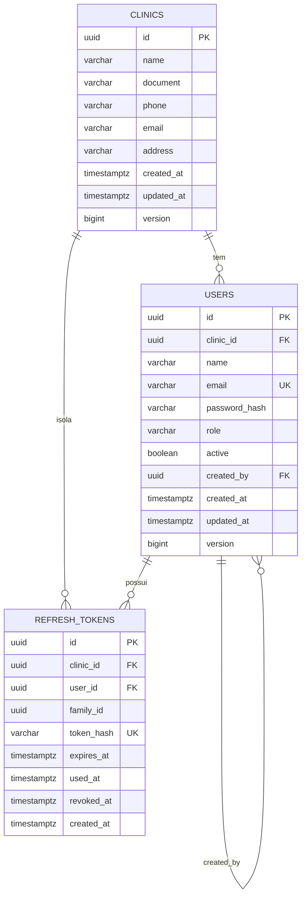

# Spec Técnica Global (Banco) — CRM Clínica Dental

**Base:** `docs/global/banco/prd.md` (aprovado em 2026-10-19) e o contrato do backend (`docs/global/backend/spec.md`, seção 2; `docs/features/backend/F01..F05`).
**Escopo:** Fase 0 (schema `core`). Fases 1–4 apenas como visão (seção 9).
**Regra:** nenhum SQL é executado aqui. O DDL abaixo é **ilustrativo do contrato**; as migrations finais são do `dev-engineer-postgres`.

---

## 1. Visão técnica

- **Feature:** Banco de dados e segurança da Fase 0.
- **Stack:** PostgreSQL 15+ no **Supabase (plano gratuito, usado só como Postgres)**, Supavisor (pooler), Flyway CLI em contêiner, GitHub Actions, `psql`/`pg_dump`, `age` (criptografia de backup).
- **Abordagem:** um banco, um schema por módulo (`core` agora), dois papéis de login (`crm_owner` para migrations, `crm_app` para a API), um papel interno sem login (`crm_definer`) para funções de bootstrap, RLS `ENABLE` + `FORCE` que nega por padrão.

### 1.1 Papéis

| Papel | Login | Função | Atributos |
|---|---|---|---|
| `postgres` (Supabase) | sim | Só no *bootstrap* único; nunca usado pela API nem pelo backup | Administrador do projeto |
| `crm_owner` | sim | Dono do schema `core` e das tabelas; usado **só** pelo Flyway | `NOSUPERUSER NOCREATEDB NOCREATEROLE NOBYPASSRLS` |
| `crm_app` | sim | Usado pela API em runtime | `NOSUPERUSER NOBYPASSRLS`, **não dono**, sem DDL |
| `crm_backup` | sim | Usado só pelo `pg_dump` diário; lê todas as linhas por política RLS nomeada, **sem** `BYPASSRLS`; sem escrita | `NOSUPERUSER NOBYPASSRLS`, só `SELECT` |
| `crm_definer` | **não** | Dono das funções `SECURITY DEFINER`; lê dados de login sem tenant por políticas RLS explícitas | `NOLOGIN NOBYPASSRLS`, não dono de tabelas |
| `anon`, `authenticated`, `service_role` (internos do Supabase) | — | **Sem nenhum acesso** ao schema `core` | Revogados |

**Por que `crm_definer` existe.** Com `FORCE ROW LEVEL SECURITY`, até o dono da tabela é filtrado pela RLS. Uma função `SECURITY DEFINER` pertencente a `crm_owner` enxergaria 0 linhas (sem tenant definido). Conceder `BYPASSRLS` exigiria um privilégio que não vamos assumir ter no Supabase. A solução é um papel dedicado, não dono das tabelas, com **políticas de leitura nomeadas apenas para ele**, restritas às colunas e às funções do login. Assim `FORCE` continua valendo para todos. **A spec inteira não depende de nenhum papel ter `BYPASSRLS`**: nem o backup (`crm_backup`, mesmo padrão) nem as funções (`crm_definer`).

### 1.2 Conexões

| Uso | Destino | Usuário | Observações |
|---|---|---|---|
| API (Render) | Supavisor, modo *transaction*, porta 6543 | `crm_app.<project-ref>` | `sslmode=require` (ou `verify-full`), driver com `prepareThreshold=0`, Hikari máx. 10 |
| Migrations (GitHub Actions) | Supavisor, modo *session*, porta 5432 | `crm_owner.<project-ref>` | A conexão direta do Supabase é IPv6 e os runners são IPv4; o modo *session* aceita DDL |
| Bootstrap (uma vez) | Supavisor, modo *session* | `postgres.<project-ref>` | Secret restrito ao ambiente protegido |
| Backup | Supavisor, modo *session* | `crm_backup.<project-ref>` | Só leitura |
| Manutenção (*keep-alive*) | Supavisor, modo *transaction* | `crm_app.<project-ref>` | Consulta leve + função de limpeza |

> O formato `usuário.<project-ref>` é o do Supavisor e deve ser confirmado no projeto real.

---

## 2. Modelo de dados e schema

### 2.1 Diagrama ER



### 2.2 Convenções

- Schema `core`; tabelas no plural, `snake_case`, FKs `<entidade>_id`, chaves `id uuid`.
- UUID gerado pela **aplicação** (o registro precisa do `clinic_id` antes de inserir). `DEFAULT gen_random_uuid()` fica como reserva para scripts e testes.
- Textos como `varchar(n)` (e **não** `char(n)` nem `text`), para que o `ddl-auto=validate` do Hibernate encontre os tipos que espera. Papéis e status = `varchar(20)` + `CHECK`.
- Instantes em `timestamptz`; todas as comparações de tempo usam `now()` do servidor.
- Todas as tabelas de negócio: `clinic_id uuid NOT NULL`, FK, índice e RLS.

### 2.3 Dicionário de dados

#### `core.clinics`
| Coluna | Tipo | Nulo | Default | Regra |
|---|---|---|---|---|
| `id` | `uuid` | não | `gen_random_uuid()` | PK |
| `name` | `varchar(150)` | não | — | `CHECK (char_length(name) >= 2)` |
| `document` | `varchar(20)` | sim | — | CNPJ/CPF opcional |
| `phone` | `varchar(20)` | sim | — | |
| `email` | `varchar(254)` | sim | — | |
| `address` | `varchar(255)` | sim | — | |
| `created_at` | `timestamptz` | não | `now()` | Imutável |
| `updated_at` | `timestamptz` | não | `now()` | Trigger |
| `version` | `bigint` | não | `0` | `@Version` do JPA |

#### `core.users`
| Coluna | Tipo | Nulo | Default | Regra |
|---|---|---|---|---|
| `id` | `uuid` | não | `gen_random_uuid()` | PK |
| `clinic_id` | `uuid` | não | — | FK `clinics(id)` `ON DELETE RESTRICT`; imutável |
| `name` | `varchar(120)` | não | — | `CHECK (char_length(name) >= 2)` |
| `email` | `varchar(254)` | não | — | `CHECK (email = lower(email))`; **único global** |
| `password_hash` | `varchar(100)` | não | — | Hash BCrypt feito pela aplicação |
| `role` | `varchar(20)` | não | — | `CHECK (role IN ('DENTIST_ADMIN','RECEPTIONIST'))`; imutável |
| `active` | `boolean` | não | `true` | `CHECK (role <> 'DENTIST_ADMIN' OR active)` |
| `created_by` | `uuid` | sim | — | FK `users(id)` `ON DELETE SET NULL`; nulo no dentista fundador |
| `created_at` | `timestamptz` | não | `now()` | Imutável |
| `updated_at` | `timestamptz` | não | `now()` | Trigger |
| `version` | `bigint` | não | `0` | |

Constraints adicionais: `UNIQUE (id, clinic_id)` (permite FK composta), índice único parcial de um dentista por clínica.

#### `core.refresh_tokens`
| Coluna | Tipo | Nulo | Default | Regra |
|---|---|---|---|---|
| `id` | `uuid` | não | `gen_random_uuid()` | PK |
| `clinic_id` | `uuid` | não | — | FK `clinics(id)` `ON DELETE CASCADE`; imutável |
| `user_id` | `uuid` | não | — | FK composta `(user_id, clinic_id)` → `users(id, clinic_id)` `ON DELETE CASCADE` |
| `family_id` | `uuid` | não | — | Cadeia de rotação |
| `token_hash` | `varchar(64)` | não | — | `CHECK (token_hash ~ '^[0-9a-f]{64}$')`; **único** |
| `expires_at` | `timestamptz` | não | — | |
| `used_at` | `timestamptz` | sim | — | Preenchido na rotação |
| `revoked_at` | `timestamptz` | sim | — | |
| `created_at` | `timestamptz` | não | `now()` | Imutável |

A FK composta garante que um token **nunca** pertença a um usuário de outra clínica, mesmo por erro de código.

### 2.4 Índices

| Índice | Tabela | Colunas | Atende |
|---|---|---|---|
| `pk_*` | todas | `id` | Chave primária |
| `ux_users_email` | `users` | `(email)` único | Login e unicidade global |
| `ux_users_one_dentist` | `users` | `(clinic_id)` `WHERE role = 'DENTIST_ADMIN'` único | Um dentista por clínica |
| `ux_users_id_clinic` | `users` | `(id, clinic_id)` único | FK composta |
| `ix_users_clinic_name` | `users` | `(clinic_id, name)` | Listagem paginada por nome (F05) |
| `ux_refresh_hash` | `refresh_tokens` | `(token_hash)` único | Refresh e logout |
| `ix_refresh_user` | `refresh_tokens` | `(user_id)` | Revogar sessões do usuário |
| `ix_refresh_family` | `refresh_tokens` | `(family_id)` | Revogar a cadeia em caso de reuso |
| `ix_refresh_expires` | `refresh_tokens` | `(expires_at)` | Limpeza de vencidos |
| `ix_refresh_clinic` | `refresh_tokens` | `(clinic_id)` | Suporte à RLS |

Volume esperado: dezenas de linhas por clínica; nenhum particionamento.

### 2.5 DDL ilustrativo (contrato)

```sql
-- função de tenant (V002)
CREATE FUNCTION core.current_clinic_id() RETURNS uuid
  LANGUAGE sql STABLE PARALLEL SAFE
  SET search_path = pg_catalog
AS $$ SELECT NULLIF(current_setting('app.clinic_id', true), '')::uuid $$;

-- users (V004, trecho)
CREATE TABLE core.users (
  id uuid PRIMARY KEY DEFAULT gen_random_uuid(),
  clinic_id uuid NOT NULL REFERENCES core.clinics(id) ON DELETE RESTRICT,
  name varchar(120) NOT NULL CHECK (char_length(name) >= 2),
  email varchar(254) NOT NULL CHECK (email = lower(email)),
  password_hash varchar(100) NOT NULL,
  role varchar(20) NOT NULL CHECK (role IN ('DENTIST_ADMIN','RECEPTIONIST')),
  active boolean NOT NULL DEFAULT true,
  created_by uuid REFERENCES core.users(id) ON DELETE SET NULL,
  created_at timestamptz NOT NULL DEFAULT now(),
  updated_at timestamptz NOT NULL DEFAULT now(),
  version bigint NOT NULL DEFAULT 0,
  CONSTRAINT ck_users_dentist_active CHECK (role <> 'DENTIST_ADMIN' OR active)
);
CREATE UNIQUE INDEX ux_users_email ON core.users (email);
CREATE UNIQUE INDEX ux_users_one_dentist ON core.users (clinic_id) WHERE role = 'DENTIST_ADMIN';
CREATE UNIQUE INDEX ux_users_id_clinic ON core.users (id, clinic_id);
CREATE INDEX ix_users_clinic_name ON core.users (clinic_id, name);
```

### 2.6 Triggers

| Trigger | Tabelas | Evento | Efeito |
|---|---|---|---|
| `trg_set_updated_at` | `clinics`, `users` | `BEFORE UPDATE` | `NEW.updated_at := now()` |
| `trg_forbid_immutable` | `clinics` (`id`, `created_at`), `users` (`id`, `clinic_id`, `role`, `created_at`), `refresh_tokens` (`id`, `clinic_id`, `user_id`, `family_id`, `token_hash`, `created_at`) | `BEFORE UPDATE` | Erro se uma coluna imutável mudar |

Funções de trigger em `core`, com `SET search_path = pg_catalog, core`. `version` é incrementado pelo JPA, não por trigger.

### 2.7 Estado e configuração de sessão

- `app.clinic_id` (obrigatória nas rotas autenticadas): `set_config('app.clinic_id', '<uuid>', true)`, **sempre dentro de transação**.
- `app.role` e `app.user_id`: o contrato é reservado, mas **não** é lido por nenhuma política na Fase 0.
- Por papel (`ALTER ROLE crm_app SET ...`): `statement_timeout = '15s'`, `idle_in_transaction_session_timeout = '30s'`, `search_path = core, pg_catalog`.

---

## 3. Papéis, GRANTs e RLS

### 3.1 Matriz de privilégios (`crm_app`)

| Objeto | SELECT | INSERT | UPDATE | DELETE | EXECUTE |
|---|---|---|---|---|---|
| `core.clinics` | ✔ | ✔ | ✔ | — | — |
| `core.users` | ✔ | ✔ | ✔ | — (desativa-se, não se apaga) | — |
| `core.refresh_tokens` | ✔ | ✔ | ✔ | — (limpeza só pela função) | — |
| `core.current_clinic_id()` | — | — | — | — | ✔ |
| `core.find_user_for_login(text)` | — | — | — | — | ✔ |
| `core.find_refresh_token(text)` | — | — | — | — | ✔ |
| `core.purge_expired_refresh_tokens()` | — | — | — | — | ✔ |
| Schema `core` | `USAGE` | — | — | — | — |
| Tudo o mais (`public`, `flyway_schema_history`, outros schemas) | — | — | — | — | — |

`crm_backup`: `USAGE` em `core` e `SELECT` em todas as tabelas de `core` (exceto `flyway_schema_history`); nada mais.

`crm_definer`: `USAGE` em `core`; `SELECT` nas colunas `id, clinic_id, password_hash, role, active, email` de `users` e nas colunas de `refresh_tokens`; `DELETE` em `refresh_tokens`. Nada mais.

### 3.2 Endurecimento padrão

- `REVOKE ALL ON SCHEMA public FROM PUBLIC` e `REVOKE CREATE ON SCHEMA public FROM PUBLIC`.
- `REVOKE ALL ON SCHEMA core FROM PUBLIC, anon, authenticated, service_role`; o mesmo para tabelas, sequências e funções de `core`.
- `ALTER DEFAULT PRIVILEGES FOR ROLE crm_owner IN SCHEMA core`: sem `GRANT` automático a ninguém (cada migration concede explicitamente).
- Funções: `REVOKE EXECUTE ... FROM PUBLIC` e `GRANT EXECUTE ... TO crm_app` apenas onde a matriz permite.
- Nenhum `GRANT ALL`.

### 3.3 Políticas RLS

Todas as tabelas: `ENABLE` e `FORCE ROW LEVEL SECURITY`. Uma política por operação. Onde não há política para uma operação, ela é **negada**.

| Tabela | Operação | Papel | Condição |
|---|---|---|---|
| `clinics` | SELECT | `crm_app` | `id = core.current_clinic_id()` |
| `clinics` | INSERT | `crm_app` | `WITH CHECK (id = core.current_clinic_id())` |
| `clinics` | UPDATE | `crm_app` | `USING` e `WITH CHECK (id = core.current_clinic_id())` |
| `clinics` | DELETE | — | sem política (negado) |
| `users` | SELECT / INSERT / UPDATE | `crm_app` | `clinic_id = core.current_clinic_id()` (`USING` e/ou `WITH CHECK`) |
| `users` | DELETE | — | sem política (negado) |
| `users` | SELECT | `crm_definer` | `USING (true)` (restrito pelas colunas concedidas e pela função) |
| `refresh_tokens` | SELECT / INSERT / UPDATE | `crm_app` | `clinic_id = core.current_clinic_id()` |
| `refresh_tokens` | SELECT | `crm_definer` | `USING (true)` |
| `refresh_tokens` | DELETE | `crm_definer` | `USING (expires_at < now() - interval '30 days')` |
| `clinics`, `users`, `refresh_tokens` | SELECT | `crm_backup` | `USING (true)` (somente leitura, para o backup) |

**Regra para as fases seguintes:** toda tabela nova de negócio recebe também a política `SELECT ... TO crm_backup USING (true)`; sem ela o backup dessa tabela falha (o teste 26 detecta).

Sem `app.clinic_id`, `core.current_clinic_id()` é `NULL`; `uuid = NULL` nunca é verdadeiro: **0 linhas visíveis e nenhuma gravação**.

Ilustrativo:
```sql
ALTER TABLE core.users ENABLE ROW LEVEL SECURITY;
ALTER TABLE core.users FORCE  ROW LEVEL SECURITY;
CREATE POLICY users_sel ON core.users FOR SELECT TO crm_app
  USING (clinic_id = core.current_clinic_id());
CREATE POLICY users_ins ON core.users FOR INSERT TO crm_app
  WITH CHECK (clinic_id = core.current_clinic_id());
CREATE POLICY users_upd ON core.users FOR UPDATE TO crm_app
  USING (clinic_id = core.current_clinic_id())
  WITH CHECK (clinic_id = core.current_clinic_id());
CREATE POLICY users_definer_sel ON core.users FOR SELECT TO crm_definer USING (true);
```

### 3.4 Papéis dentro do tenant (Dentista × Recepcionista)

Na Fase 0 as regras de papel ficam **no backend** (usuários e clínica são área do dentista). O banco já garante o que é invariante: um dentista por clínica, dentista sempre ativo, papel imutável. A partir da Fase 1 (prontuário e financeiro) as políticas passam a ler `app.role`; o contrato de sessão já está reservado (item 2.7).

---

## 4. Funções (bootstrap e manutenção)

Todas em `core`, `LANGUAGE sql` ou `plpgsql`, **`SECURITY DEFINER`**, `SET search_path = pg_catalog, core`, **sem SQL dinâmico**, dono `crm_definer`, `REVOKE ... FROM PUBLIC`, `GRANT EXECUTE ... TO crm_app`. Dono alterado com `ALTER FUNCTION ... OWNER TO crm_definer` (o `crm_owner` é membro de `crm_definer` para isso).

| Função | Retorno | Regra |
|---|---|---|
| `core.find_user_for_login(p_email varchar)` | `id, clinic_id, password_hash, role, active` (0 ou 1 linha) | Busca por `lower(p_email)`; não retorna nome nem dados da clínica |
| `core.find_refresh_token(p_hash varchar)` | `id, clinic_id, user_id, family_id, expires_at, used_at, revoked_at` (0 ou 1 linha) | Busca pelo índice único do hash |
| `core.purge_expired_refresh_tokens()` | `integer` (linhas apagadas) | Apaga `expires_at < now() - interval '30 days'`; coberto pela política de `DELETE` do `crm_definer` |

`core.current_clinic_id()` **não** é `SECURITY DEFINER` (só lê a variável de sessão).

### 4.1 Registro de clínica (fluxo suportado)

1. A aplicação gera `clinicId` e abre transação.
2. `set_config('app.clinic_id', clinicId, true)`.
3. `INSERT core.clinics (id = clinicId, ...)` → política `clinics_ins` valida `id`.
4. `INSERT core.users (clinic_id = clinicId, role = 'DENTIST_ADMIN', ...)` → política `users_ins` valida `clinic_id`.
5. `INSERT core.refresh_tokens (...)`; `COMMIT`.
A FK composta e as FKs simples são verificadas pelo próprio PostgreSQL, sem passar pela RLS.

---

## 5. Migrations e ambientes

### 5.1 Estrutura no repositório

```
database/
├─ bootstrap/00_roles_and_schema.sql      -- executado 1 vez, como postgres (idempotente)
├─ migrations/
│  ├─ V001__core_privileges.sql           -- revokes, defaults, grants de schema
│  ├─ V002__core_tenant_function.sql
│  ├─ V003__core_clinics.sql              -- tabela, trigger, RLS
│  ├─ V004__core_users.sql
│  ├─ V005__core_refresh_tokens.sql
│  └─ V006__core_bootstrap_functions.sql  -- funções, dono, políticas do crm_definer, grants
├─ rollback/U006…U001 (notas/SQL manual de reversão, nunca automático)
├─ tests/*.sql                            -- testes de isolamento e permissões
└─ flyway.conf
```

### 5.2 `bootstrap/00_roles_and_schema.sql` (como `postgres`, via workflow manual)

Cria, de forma idempotente: `crm_definer` (NOLOGIN), `crm_owner`, `crm_app` e `crm_backup` (LOGIN, `NOSUPERUSER NOCREATEDB NOCREATEROLE NOBYPASSRLS`), senhas vindas de variáveis do `psql`; `GRANT crm_definer TO crm_owner`; `CREATE SCHEMA core AUTHORIZATION crm_owner`; os `ALTER ROLE crm_app SET ...`; e as verificações abaixo (aborta se falharem):
- `rolbypassrls = false` e `rolsuper = false` para os quatro papéis;
- nenhum dos quatro é membro de `anon`, `authenticated`, `service_role`, `supabase_admin` ou de qualquer papel com `BYPASSRLS`.

### 5.3 Regras de migrations

- Nome `V<NNN>__descricao.sql`, uma migration por mudança coesa, aplicada em transação.
- **Imutáveis depois de aplicadas**; correção = nova versão. `flyway validate` falha se o checksum mudar.
- Mudanças destrutivas em passos (adicionar → migrar dados → trocar → remover). Sem homologação, preferir migrations **aditivas e pequenas**.
- `CREATE INDEX CONCURRENTLY` fora da transação, quando houver dados.
- Configuração Flyway: `defaultSchema=core`, `schemas=core`, tabela de histórico `core.flyway_schema_history` (dono `crm_owner`, sem `GRANT` ao `crm_app`), `cleanDisabled=true`, `outOfOrder=false`, `validateMigrationNaming=true`.
- Seeds: nenhum na Fase 0. Dados iniciais futuros (feriados nacionais) entram em migrations de seed idempotentes e separadas.

### 5.4 Ambientes

Apenas **produção** (Supabase) e **bancos descartáveis** em contêiner (PR e desenvolvimento local). `docker-compose` de dev do backend sobe PostgreSQL e aplica `bootstrap` + `migrations` (ver contrato com o backend, seção 8).

---

## 6. CI/CD (GitHub Actions)

Permissões mínimas por workflow (`permissions: contents: read`); segredos só em *environments*.

| Workflow | Gatilho | O que faz | Ambiente / segredos |
|---|---|---|---|
| `db-pr.yml` | `pull_request` em `database/**` | Sobe `postgres:16`; cria papéis de stub do Supabase (`anon`, `authenticated`, `service_role`) para exercitar os `REVOKE`; roda `bootstrap`; `flyway migrate`; executa `database/tests/*.sql` como `crm_app`; falha se qualquer teste falhar | nenhum segredo |
| `db-deploy.yml` | `push` na `main` em `database/migrations/**` | `flyway validate` + `flyway migrate` no Supabase via pooler *session* como `crm_owner`; `concurrency` serializa execuções | Ambiente `production` com **aprovação manual**: `SUPABASE_OWNER_URL`, `SUPABASE_OWNER_PASSWORD` |
| `db-bootstrap.yml` | `workflow_dispatch` | Executa `bootstrap/00_roles_and_schema.sql` como `postgres` (uma vez) | `production`: `SUPABASE_ADMIN_URL`, senhas dos papéis |
| `db-backup.yml` | `schedule` diário + manual | `pg_dump -Fc --schema=core --exclude-table=core.flyway_schema_history --enable-row-security --no-owner --no-acl` como `crm_backup` (a política `USING (true)` dele deixa ler todas as linhas), criptografa com `age` (chave pública), publica como *artifact* privado com `retention-days: 30` | `backup` (sem revisor): `SUPABASE_BACKUP_URL`, `SUPABASE_BACKUP_PASSWORD`, `BACKUP_AGE_PUBLIC_KEY` |
| `db-restore-check.yml` | `schedule` mensal | Baixa o último dump, descriptografa, restaura num `postgres:16` descartável e confere contagens e as constraints | `restore-test`: `BACKUP_AGE_PRIVATE_KEY` |
| `db-maintenance.yml` | `schedule` a cada 3 dias | Como `crm_app`: `SELECT 1` (*keep-alive* contra a pausa do plano gratuito) e `SELECT core.purge_expired_refresh_tokens()` | `maintenance` (sem revisor, para o job agendado não esperar aprovação): `SUPABASE_APP_URL`, `SUPABASE_APP_PASSWORD` |

Observações:
- `pg_dump` como `crm_owner` **não serve**: com `FORCE RLS` o dono vê 0 linhas. Por isso o backup usa `crm_backup`, com `--enable-row-security` (sem essa opção o `pg_dump` desliga a RLS e falha). Nenhum papel precisa de `BYPASSRLS`. O dump contém as políticas, mas não papéis nem donos (`--no-owner --no-acl`); a recuperação roda o `bootstrap`, depois o `flyway migrate` e então `pg_restore --data-only` (ver `database/README.md`).
- Para um portfólio, a chave privada do `age` no ambiente `restore-test` é aceitável; num caso real, ela ficaria offline.
- GitHub desativa workflows agendados após 60 dias sem atividade no repositório; reativar manualmente.
- Segredos nunca em log: `::add-mask::`, sem `set -x`, sem `echo` de variáveis.

---

## 7. Segurança específica do Supabase

1. **Data API desligada** (projeto: *Settings → Data API*); `core` **fora** da lista de schemas expostos. Mesmo que alguém a religasse, `anon` e `authenticated` não têm `USAGE` em `core`.
2. Não usar Supabase Auth, Storage nem Realtime; a autenticação é do backend.
3. As chaves `anon` e `service_role` do projeto nunca entram em frontend, backend ou repositório. A `service_role` tem `BYPASSRLS`: tratar como segredo equivalente ao `postgres`.
4. TLS obrigatório (`sslmode=require`; `verify-full` com o certificado do projeto, se o driver permitir).
5. Restringir por IP é recurso de plano pago: no gratuito, depender de senhas fortes e dos papéis limitados.
6. Rotacionar as senhas de `crm_app` e `crm_owner` ao menos por troca de segredo; o `ALTER ROLE ... PASSWORD` é feito pelo `db-bootstrap.yml`.
7. Sem `pgcrypto` nem criptografia no banco: a cifra AES-256-GCM é da aplicação (F03 do backend). O banco nunca vê o texto claro.

---

## 8. Contrato com o backend (para conciliar os docs)

### 8.1 Nomes definitivos

| Item | Nome |
|---|---|
| Schema | `core` (JPA: `hibernate.default_schema=core`) |
| Variável de sessão | `app.clinic_id` |
| Função de tenant | `core.current_clinic_id()` (os docs do backend diziam `app_clinic_id()`, indicativo) |
| Funções de login | `core.find_user_for_login(varchar)`, `core.find_refresh_token(varchar)` |
| Limpeza | `core.purge_expired_refresh_tokens()` |
| Papel da API | `crm_app` |

### 8.2 Divergências a corrigir nos docs do backend

1. `refresh_tokens.token_hash` é **`varchar(64)`**, não `char(64)` (evita erro de `ddl-auto=validate` com `bpchar`).
2. Os nomes de função/schema acima substituem os "indicativos".
3. O backend não precisa de `DB_OWNER_*`; as migrations rodam no GitHub Actions.
4. O `docker-compose` do backend deve aplicar `database/bootstrap` + `database/migrations` no Postgres local.
5. O backend não agenda a limpeza de tokens: ela roda no `db-maintenance.yml`.

### 8.3 Mapeamento esperado das entidades

`uuid` → `UUID`; `timestamptz` → `Instant`/`OffsetDateTime`; `varchar` → `String`; `bigint version` → `@Version Long`; `role` → enum com `@Enumerated(STRING)`. `clinic_id`, `id`, `role`, `created_at` são `updatable = false`.

---

## 9. Fases seguintes (visão)

| Fase | Schema | Destaques |
|---|---|---|
| 1 | `core` (+ pacientes, prontuário) | Tabelas de pacientes e prontuário (campos clínicos já cifrados pela aplicação), metadados de exames, `audit_log` por trigger sem dados clínicos, políticas por `app.role`, `pg_trgm` se a busca exigir |
| 2 | `scheduling` | `EXCLUDE USING gist` com `btree_gist` para conflito de agenda por clínica, feriados globais e por clínica, tabela de transições de status |
| 3 | `billing`, `finance` | Procedimentos, orçamentos e parcelas em `numeric(12,2)`, transições de status |
| 4 | `documents`, `dashboard` | Documentos gerados, views de KPIs (com `security_invoker = true` para respeitar a RLS) |

---

## 10. Erros e casos de borda

| Cenário | Tratamento |
|---|---|
| Transação sem `app.clinic_id` | 0 linhas lidas; `INSERT`/`UPDATE` falham por `WITH CHECK` (falha fechada) |
| `app.clinic_id` com valor que não é UUID | Erro de conversão em `core.current_clinic_id()`; transação aborta. A aplicação só passa UUID validado |
| `set_config` fora de transação | Valor descartado ao fim do comando; teste de pool de 1 conexão detecta |
| E-mail duplicado (mesmo de outra clínica) | `ux_users_email` falha com `23505`; o backend traduz para 409 sem revelar a clínica |
| Dois registros simultâneos com o mesmo e-mail | Um vence pelo índice único |
| Tentativa de segundo dentista na clínica | `ux_users_one_dentist` falha |
| Desativar o dentista | `ck_users_dentist_active` falha (defesa em profundidade; o backend responde 422 antes) |
| Alterar `clinic_id`, `role` ou `token_hash` | `trg_forbid_immutable` bloqueia |
| Refresh token de usuário de outra clínica | FK composta impede a gravação |
| Migration aplicada e depois editada | `flyway validate` falha; o deploy não prossegue |
| Migration falha no deploy | Transação desfaz a migration; o workflow falha; a API continua na versão anterior do schema (por isso migrations aditivas) |
| Projeto pausado por inatividade (plano gratuito) | *keep-alive* a cada 3 dias; se pausar, restaurar pelo painel antes do próximo deploy |
| Runner sem rota IPv6 para a conexão direta | Usa o pooler em modo *session* (decisão desta spec) |
| Backup falha em dia específico | Workflow falha e notifica; o último artefato de 30 dias permanece |

---

## 11. Segurança e desempenho

**Segurança**
- Menor privilégio: nenhum `GRANT ALL`; sem `DELETE` em `clinics`/`users`; `crm_app` sem DDL.
- RLS `FORCE` em todas as tabelas de negócio; funções `SECURITY DEFINER` com `search_path` fixo, sem SQL dinâmico e retorno mínimo.
- Senhas dos papéis só como segredos do GitHub; `password_hash` guarda apenas o hash recebido da aplicação.
- Logs do PostgreSQL sem parâmetros sensíveis (não habilitar `log_statement = 'all'` com bind values).

**Desempenho**
- `find_user_for_login` e `find_refresh_token`: `Index Scan` em índice único, ≤ 5 ms com 100 mil usuários (verificar com `EXPLAIN`).
- Listagem de usuários: `ix_users_clinic_name`, sem *sort* adicional.
- `core.current_clinic_id()` é `STABLE`: avaliada uma vez por consulta, usada pelo planejador como constante.
- Limites do plano gratuito: ≈ 500 MB de dados e conexões restritas; a API usa no máximo 10 conexões.

---

## 12. Testes (para o `dev-engineer-postgres`)

Arquivos SQL em `database/tests/`, executados com `psql -v ON_ERROR_STOP=1` e asserções em blocos `DO`. Rodam no `db-pr.yml`.

**Isolamento de tenant (como `crm_app`, clínicas A e B)**
1. Sob `app.clinic_id = A`, `SELECT` em `users`, `clinics` e `refresh_tokens` não retorna nenhuma linha de B.
2. Sob A, `UPDATE`/`DELETE` em linha de B afeta 0 linhas.
3. Sob A, `INSERT` com `clinic_id = B` falha por `WITH CHECK`.
4. Sem `app.clinic_id`: 0 linhas visíveis; `INSERT` falha.
5. `set_config` com `is_local = true`: após `COMMIT`, a variável volta vazia, na mesma conexão.
6. Registro: `INSERT` em `clinics` com `id` diferente do tenant falha.

**Constraints**
7. E-mail duplicado (clínicas diferentes) falha; e-mail com maiúsculas falha no `CHECK`.
8. Segundo `DENTIST_ADMIN` na clínica falha; desativar o dentista falha.
9. `role` inválido falha; alterar `role`/`clinic_id`/`token_hash` falha.
10. `token_hash` fora do formato hexadecimal de 64 caracteres falha; `token_hash` duplicado falha.
11. Token com `user_id` de outra clínica falha pela FK composta.
12. `updated_at` muda a cada `UPDATE`.

**Funções**
13. `find_user_for_login` retorna 1 linha com o e-mail em qualquer caixa e 0 para inexistente; sem tenant definido.
14. `find_refresh_token` retorna a linha pelo hash sem tenant definido.
15. `purge_expired_refresh_tokens` apaga só tokens vencidos há mais de 30 dias e retorna a contagem.
16. As funções têm `search_path` fixo e `EXECUTE` só para `crm_app` (não `PUBLIC`).

**Permissões**
17. `crm_app`, `crm_owner`, `crm_backup`: `rolsuper`, `rolbypassrls`, `rolcreaterole`, `rolcreatedb` são falsos; não é dono de nenhuma tabela; não é membro de papéis privilegiados.
18. `crm_app` não consegue `DROP TABLE`, `TRUNCATE`, `ALTER TABLE`, `CREATE TABLE`, nem `DELETE` em `users`/`clinics`.
19. `crm_app` não lê `core.flyway_schema_history` nem tabelas de outros schemas.
20. `crm_app` não consegue `SET ROLE crm_definer` nem `crm_owner`.
21. `anon`, `authenticated`, `service_role` não têm `USAGE` em `core`.
22. `crm_owner`, mesmo sendo dono, enxerga 0 linhas (prova do `FORCE`).

**Migrations**
23. Todas as migrations aplicam do zero em PostgreSQL limpo.
24. `flyway validate` passa; alterar uma migration aplicada o faz falhar (teste negativo).
25. O `ddl-auto=validate` do backend passa contra o schema (executado na CI do backend usando os mesmos scripts).

**Backup**
26. Como `crm_backup`, `pg_dump --enable-row-security` de `core` traz as linhas das clínicas A e B; qualquer tabela de negócio sem política de leitura para `crm_backup` faz o teste falhar.
27. `crm_backup` não consegue `INSERT`, `UPDATE`, `DELETE` nem DDL.
28. O dump restaura em um PostgreSQL limpo (após o `bootstrap`) com as mesmas contagens de linhas.

---

## 13. Pontos a validar no projeto Supabase real

1. `CREATE ROLE` e `ALTER ROLE ... NOBYPASSRLS` são permitidos ao usuário `postgres`.
2. O formato de usuário do Supavisor (`usuário.<project-ref>`) e as portas 5432 (*session*) e 6543 (*transaction*).
3. Permissões de `ALTER FUNCTION ... OWNER TO crm_definer` por `crm_owner`.
4. Que a Data API está desligada e `core` não está exposto.
5. Que `pg_dump --enable-row-security` conectado pelo pooler em modo *session* funciona com `crm_backup`.
